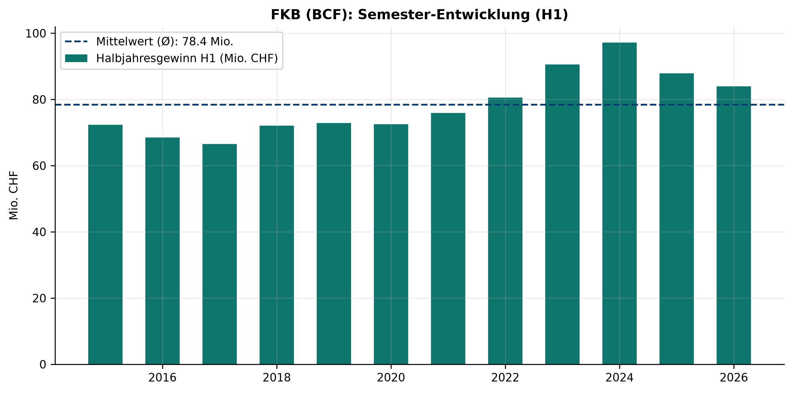

# 06 · Unterjährige Dynamik (Semesterberichte): Freiburger Kantonalbank

## 1. Management Summary
- Vorliegen von **12 Halbjahresabschlüssen**; jüngster Stichtag ist **H1-2026** mit einem Geschäftsertrag von **– Mio. CHF** und einem Halbjahresgewinn von **83,9 Mio. CHF**.

## 2. Quantitative Entwicklung
| Periode | Bilanzsumme | Zinserfolg H1 | Geschäftsertrag H1 | Geschäftserfolg H1 | Reingewinn H1 |
| --- | --- | --- | --- | --- | --- |
| H1-2015 | – | 112,5 | 134,8 | 84,8 | 72,3 |
| H1-2016 | – | 110,5 | 130,0 | 82,9 | 68,5 |
| H1-2017 | – | 114,2 | 132,0 | 81,0 | 66,5 |
| H1-2018 | – | 116,7 | 144,5 | 87,2 | 72,1 |
| H1-2019 | – | 124,0 | 139,6 | 88,1 | 72,9 |
| H1-2020 | – | 124,0 | 137,3 | 81,4 | 72,5 |
| H1-2021 | – | 122,6 | 139,0 | 84,8 | 75,9 |
| H1-2022 | – | 123,2 | 149,1 | 89,4 | 80,6 |
| H1-2023 | 27'589,0 | 168,1 | – | 105,4 | 90,6 |
| H1-2024 | 28'655,5 | 179,1 | – | 122,7 | 97,1 |
| H1-2025 | 29'247,0 | 157,1 | – | 112,8 | 87,9 |
| H1-2026 | 29'720,4 | 150,4 | – | 99,2 | 83,9 |

## 3. Treiberanalyse & Wendepunkte
- Der Vergleich von H1-Werten gegen die jeweiligen Gesamtjahresergebnisse (FY) zeigt die saisonale Ertragsverteilung und Reservebildung im zweiten Halbjahr.

## 4. Fazit & Ausblick
- Die Halbjahresberichte ermöglichen ein zeitnahes Monitoring der Zinsmargen- und Kreditvolumen-Dynamik bis H1-2026.
