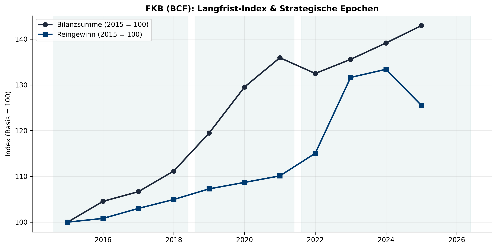
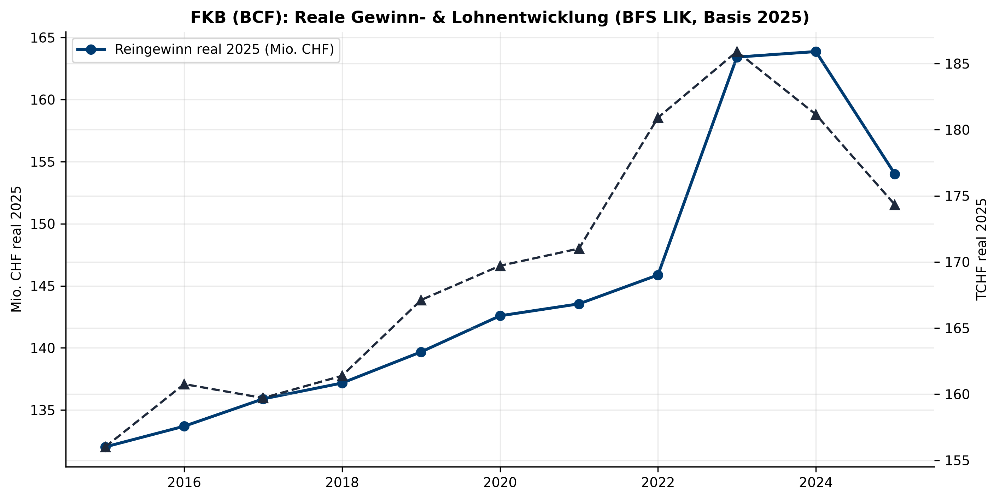

# 07 · Strategische Epochen, Governance, reale Vergütung & Vorsorge (2015–2025): Freiburger Kantonalbank

> **Preisbasis:** Sämtliche Realgrössen sind mit dem offiziellen **BFS Landesindex der Konsumentenpreise (LIK, Dez. 1982 = 100)** deterministisch auf **reale CHF 2025** deflationiert.

## 1. Management Summary & Strategische Epochen
- **Epoche 1 (2015–2018):** Negativzins-Phase & digitales Wachstum
- **Epoche 2 (2019–2021):** Pandemie-Wachstum & Kapitalaufbau
- **Epoche 3 (2022–2026):** Zinswende, Rekordgewinne & Basel III final

## 2. Reale Gewinn-, Lohn- & Vergütungsentwicklung (real 2025 CHF)
| Jahr | Gewinn nom. | Gewinn real 2025 | Lohn/FTE real (TCHF) | VR real (TCHF) | CEO real (TCHF) | GL real (TCHF) |
| --- | --- | --- | --- | --- | --- | --- |
| 2015 | 122,7 | 132,0 | 156,0 | 833,8 | – | 1'641,6 |
| 2016 | 123,7 | 133,7 | 160,8 | 941,3 | – | 1'722,3 |
| 2017 | 126,4 | 135,9 | 159,7 | 979,2 | – | 1'955,7 |
| 2018 | 128,8 | 137,2 | 161,4 | 971,0 | – | 2'134,6 |
| 2019 | 131,6 | 139,7 | 167,1 | 1'167,4 | – | 2'208,9 |
| 2020 | 133,3 | 142,6 | 169,7 | 1'377,3 | – | 2'345,0 |
| 2021 | 135,1 | 143,5 | 171,0 | 1'500,4 | – | 3'288,8 |
| 2022 | 141,1 | 145,9 | 180,9 | 1'466,5 | – | 2'682,7 |
| 2023 | 161,5 | 163,4 | 185,9 | 1'099,0 | – | 3'471,9 |
| 2024 | 163,7 | 163,9 | 181,2 | 1'040,2 | – | 3'097,7 |
| 2025 | 154,0 | 154,0 | 174,3 | 1'060,6 | – | 3'414,5 |

## 3. Arbeitgeber-Attraktivität & Vorsorgeeinrichtung (Pensionskasse)
- **Vorsorgeeinrichtung:** Pensionskasse für das Personal der Freiburger Kantonalbank (*Beitragsprimat*, Basis: `Swiss GAAP FER 26 / ARB`)
- **Versichertenstruktur:** Aktive **572**, Rentner **218** (Verhältnis Aktive/Rentner: **2,62**)
- **Deckungsgrad (BVG) / Reserven:** Deckungsgrad **119,7 %**, Arbeitgeberbeitragsreserve **0,0 Mio. CHF**, Sondereinlagen **0,0 Mio. CHF**
- **CEO-zu-Mitarbeitenden-Pay-Ratio (2025):** **–×** (CEO real 2025: – TCHF vs. Ø Personalaufwand/FTE: 174,3 TCHF)
- **Quelle:** `fkb/.md/fkb-geschaeftsbericht-2025.md (Anhang Vorsorgeverpflichtungen, S. 57 & 75); bcf.ch (Arbeitgeberin)` — Autonome öffentlich-rechtliche Vorsorgeeinrichtung; Stand 31.12.2025/01.01.2026: 572 Aktive / 218 Rentner (Verhältnis 2,62), Deckungsgrad 119,67 %, Arbeitgeberbeiträge durchschnittlich 2,5x Arbeitnehmerbeiträge (~71,4 %); bezahlte Beiträge 2025: CHF 10,321 Mio.

## 4. Treiberanalyse, Strukturbrüche & Ausblick
- **2015:** Umstellung auf FINMA-RVB
- **2025:** Inkrafttreten Basel III final per 01.01.2025
- Die gemeinsame Inflationsbereinigung auf `real 2025 CHF` ermöglicht den unverzerrten Vergleich von Produktivität, Reallöhnen, Pay Ratio und Pensionskassen-Resilienz im Branchenvergleich (`comparison/reports/07_mitarbeiter_und_vorsorge_branchenvergleich.md`).
