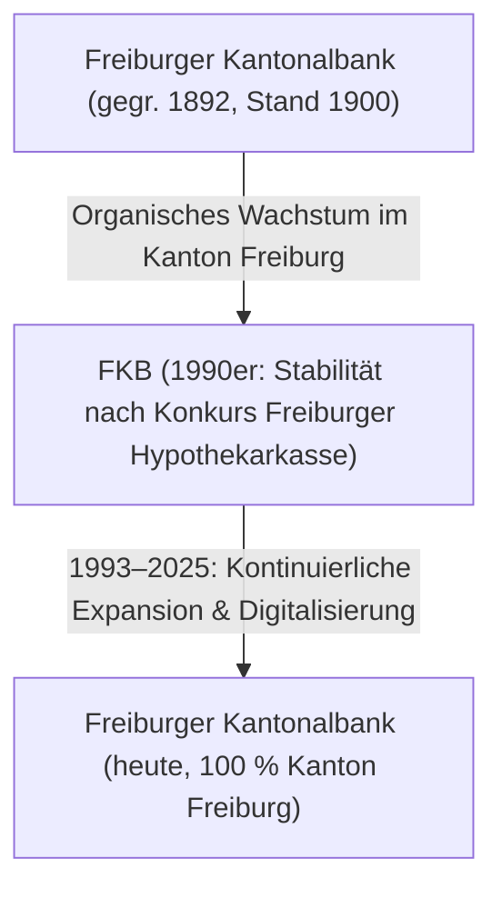

# 10 · Fusionsbaum & Institutsgeschichte seit 1900: Freiburger Kantonalbank

> **Gründung / Ursprung:** 1892 (Freiburger Kantonalbank / Banque Cantonale de Fribourg, Gesetz vom 29. Dezember 1892) | **Aktuelle Rechtsform:** `cantonal_institution` | **FINMA-Kategorie:** 3

## 1. Überblick der Institutslinie (1900–2026)
Die Freiburger Kantonalbank (FKB) wurde durch Gesetz vom 29. Dezember 1892 als öffentlich-rechtliche Anstalt des Kantons Freiburg gegründet und nahm 1893 ihre Geschäftstätigkeit auf. Seit 1900 wuchs sie kontinuierlich organisch ohne Grossfusionen zur klaren Marktführerin im zweisprachigen Kanton Freiburg (heute 25–26 Niederlassungen) und übernahm während der Immobilienkrise der 1990er-Jahre eine stabilisierende Rolle im Kanton.

## 2. Fusionsbaum (Mermaid-Diagramm seit 1900)

## 3. Chronologische Meilensteine (Fusionen, Übernahmen & Rechtsformwechsel)
| Jahr / Zeitraum | Institut / Ereignis | Typ | Bedeutung & Auswirkung |
| --- | --- | --- | --- |
| 1892 / 1900 | Freiburger Kantonalbank (FKB / BCF) | Gründung & Ausgangslage | Gesetz vom 29. Dezember 1892; öffentlich-rechtliche Staatsbank mit Sitz in Freiburg |
| 1992 | 100-Jahr-Jubiläum & Stiftung der FKB | Meilenstein | Gründung der 100-Jahre-Stiftung zugunsten von Kultur, Sozialem und Wirtschaft im Kanton Freiburg |
| 1993–2011 | Ära Albert Michel (CEO) | Wachstum & Marktführerschaft | Stabilisierung des Freiburger Bankenplatzes in den 1990er-Jahren und Ausbau des Filialnetzes |
| 2015–2025 | FINMA-RVB, Zinswende & Digitalisierung | Modernisierung | Bilanzwachstum von CHF 20,6 Mrd. (2015) auf CHF 29,5 Mrd. (2025) bei branchenführender CIR (~32–38 %) |

- **Quellenbasis:** `FKB Geschäftsberichte (2015–2025); Gesetz über die Freiburger Kantonalbank`
