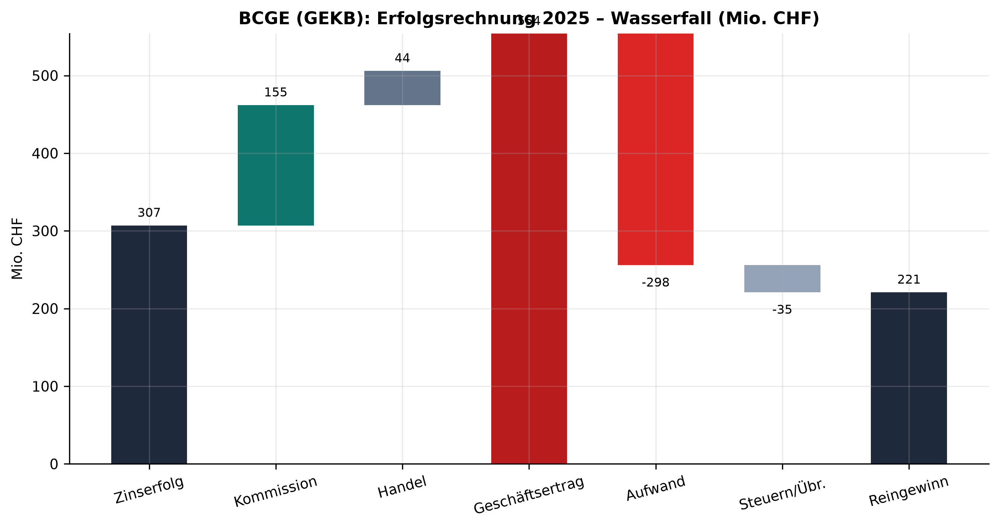
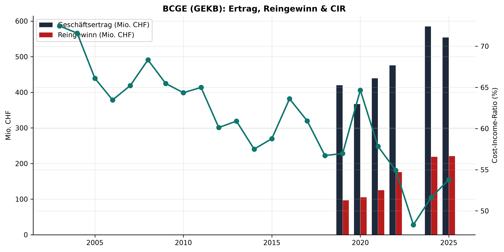

# 01 · Zinszyklen & Ertragsarchitektur (2003–2025): Banque Cantonale de Genève

> **Scope:** `consolidated` | **Standard:** `ARB_RVB` | **Währung:** Mio. CHF (harmonisierte Zeitreihe)

## 1. Management Summary
- Im Zeitraum **2003–2025** entwickelte sich der Geschäftsertrag von **0,3 Mio. CHF** auf **554,0 Mio. CHF** (CAGR **41,29 % p. a.**).
- Der Reingewinn erreichte im jüngsten Geschäftsjahr 2025 **221,0 Mio. CHF** (nach 0,0 Mio. CHF im Jahr 2003).
- Der Netto-Zinserfolg trägt aktuell **55,4 %** zum Gesamtertrag bei, das Kommissionsgeschäft **28,0 %** und das Handelsgeschäft **7,9 %**.

## 2. Quantitative Entwicklung
| Jahr | Zinserfolg (Mio.) | Kommission (Mio.) | Handel (Mio.) | Geschäftsertrag | Geschäftserfolg | Reingewinn | Zinsanteil |
| --- | --- | --- | --- | --- | --- | --- | --- |
| 2003 | – | – | – | 0,3 | 0,1 | 0,0 | – % |
| 2004 | 0,2 | – | – | 0,3 | 0,1 | 0,0 | 64,4 % |
| 2005 | 0,2 | – | – | 0,3 | 0,1 | 0,0 | 62,0 % |
| 2006 | 0,2 | – | – | 0,3 | 0,1 | 0,1 | 59,4 % |
| 2007 | 0,2 | – | – | 0,3 | 111,9 | 0,1 | 62,4 % |
| 2008 | 0,2 | – | – | 0,3 | 101,1 | 0,1 | 66,8 % |
| 2009 | 0,2 | – | – | 0,3 | 115,2 | 0,1 | 56,5 % |
| 2010 | 0,2 | – | – | 0,3 | 0,1 | 0,1 | 59,5 % |
| 2011 | 0,2 | – | – | 0,3 | 0,1 | 0,1 | 58,5 % |
| 2012 | 0,2 | – | – | 0,3 | 137,4 | 0,1 | 59,2 % |
| 2013 | 0,2 | – | – | 0,3 | 131,1 | 0,1 | 60,0 % |
| 2014 | 0,2 | – | – | 0,4 | 153,3 | 0,1 | 57,2 % |
| 2015 | 0,2 | – | 0,0 | 0,4 | 130,0 | 0,1 | 58,5 % |
| 2016 | 0,2 | – | 0,0 | 0,3 | 110,7 | 0,1 | 59,0 % |
| 2017 | 0,2 | – | 0,0 | 0,4 | 128,3 | 0,1 | 57,4 % |
| 2018 | 0,2 | 117,0 | 0,0 | 0,4 | 161,3 | 0,1 | 60,4 % |
| 2019 | 231,0 | 120,0 | 31,0 | 420,0 | 165'378,0 | 96,8 | 55,0 % |
| 2020 | 216,0 | 116,0 | 30,0 | 367,0 | 112'995,0 | 105,0 | 58,9 % |
| 2021 | 250,8 | 136,0 | – | 439,2 | 174,3 | 125,2 | 57,1 % |
| 2022 | 291,4 | 132,7 | – | 475,7 | 195,0 | 175,9 | 61,2 % |
| 2023 | 0,4 | 0,1 | 0,0 | 0,6 | 281,7 | 0,2 | 66,1 % |
| 2024 | 377,0 | 148,0 | 41,0 | 585,0 | 258,0 | 219,0 | 64,4 % |
| 2025 | 307,0 | 155,0 | 44,0 | 554,0 | 233,0 | 221,0 | 55,4 % |

## 3. Treiberanalyse & Wendepunkte
- **2008:** Abwicklung Fondation de valorisation
- **2015:** Umstellung auf FINMA-RVB
- **2025:** Inkrafttreten Basel III final per 01.01.2025

## 4. Fazit & Ausblick
- Die Ertragsarchitektur von BCGE (GEKB) spiegelt die Zinszyklen (Negativzinsphase 2015–2022, Zinswende 2022–2024, Zinssenkungen ab 2025) unmittelbar wider.
