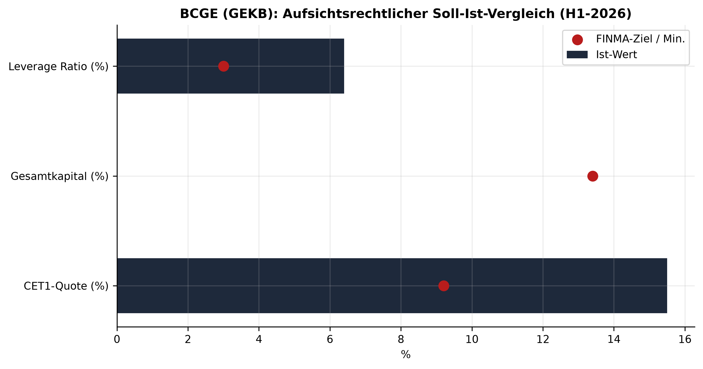
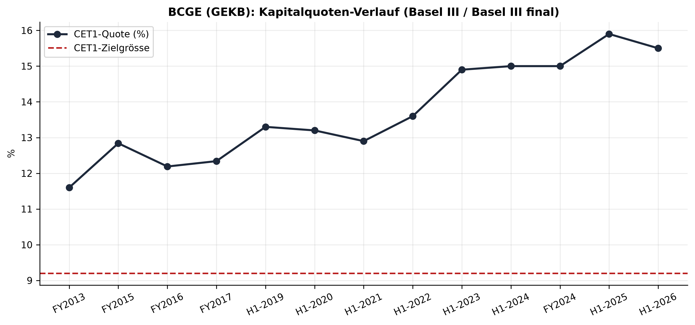

# 03 · Aufsichtsrechtliche Resilienz & Basel III: Banque Cantonale de Genève

> **FINMA-Kategorie:** Kategorie 3 | **CET1-Zielgrösse:** 9,20 % | **Gesamtkapital-Ziel:** 13,40 %

## 1. Management Summary
- Am jüngsten Offenlegungsstichtag (**H1-2026**, Regime: *Basel III final*) beträgt die **CET1-Quote 15,50 %** (Puffer über Ziel: **6,30 Prozentpunkte**).
- Die Gesamtkapitalquote liegt bei **– %**, die Leverage Ratio bei **6,40 %**.
- Liquiditätsquoten: LCR **166,0 %**, NSFR **138,0 %** (Mindestanforderung je 100 %).

## 2. Quantitative Entwicklung (24 Stichtage)
| Periode | Regime | RWA (Mio.) | CET1 (Mio.) | CET1 % | Gesamtkap. % | Leverage % | LCR % | NSFR % |
| --- | --- | --- | --- | --- | --- | --- | --- | --- |
| FY2010 | Basel III | – | – | – % | – % | – % | – % | – % |
| FY2011 | Basel III | – | – | – % | – % | – % | – % | – % |
| FY2012 | Basel III | – | – | – % | – % | – % | – % | – % |
| FY2013 | Basel III | – | 1'159,5 | 11,60 % | – % | – % | – % | – % |
| FY2014 | Basel III | – | 1'227,9 | – % | – % | – % | – % | – % |
| FY2015 | Basel III | – | 1'307,5 | 12,84 % | – % | 6,76 % | – % | – % |
| FY2016 | Basel III | – | 1'362,3 | 12,19 % | – % | 6,60 % | – % | – % |
| FY2017 | Basel III | – | 1'457,5 | 12,34 % | – % | 6,91 % | – % | – % |
| FY2018 | Basel III | – | – | – % | – % | – % | – % | – % |
| H1-2019 | Basel III | 12'079,6 | – | 13,30 % | – % | 7,40 % | – % | – % |
| FY2019 | Basel III | – | – | – % | – % | – % | – % | – % |
| H1-2020 | Basel III | 12'558,4 | 1'658,4 | 13,20 % | – % | 8,20 % | – % | – % |
| FY2020 | Basel III | – | – | – % | – % | – % | – % | – % |
| H1-2021 | Basel III | – | – | 12,90 % | – % | 6,70 % | – % | – % |
| FY2021 | Basel III | – | – | – % | – % | – % | – % | – % |
| H1-2022 | Basel III | 13'568,4 | 1'848,7 | 13,60 % | – % | 6,80 % | – % | – % |
| FY2022 | Basel III | – | – | – % | – % | – % | – % | – % |
| H1-2023 | Basel III | 13'652,7 | 2'034,2 | 14,90 % | – % | 6,70 % | – % | – % |
| FY2023 | Basel III | – | – | – % | – % | – % | – % | – % |
| H1-2024 | Basel III | 14'814,6 | 2'220,5 | 15,00 % | – % | 7,10 % | – % | – % |
| FY2024 | Basel III | – | – | 15,00 % | – % | – % | – % | – % |
| H1-2025 | Basel III final | – | 2'335,7 | 15,90 % | – % | 6,50 % | – % | – % |
| FY2025 | Basel III final | – | – | – % | – % | – % | – % | – % |
| H1-2026 | Basel III final | – | 2'402,8 | 15,50 % | – % | 6,40 % | 166,0 % | 138,0 % |

## 3. Treiberanalyse & Wendepunkte
- Mit Inkrafttreten von **Basel III final** ab 01.01.2025 verändern sich risikogewichtete Aktiven (RWA) und RWA-Dichte durch angepasste Standard- bzw. Output-Floor-Vorgaben.

## 4. Fazit & Ausblick
- Die Eigenmittel- und Liquiditätspuffer übertreffen die regulatorischen Mindestanforderungen für FINMA-Kategorie 3 deutlich.
