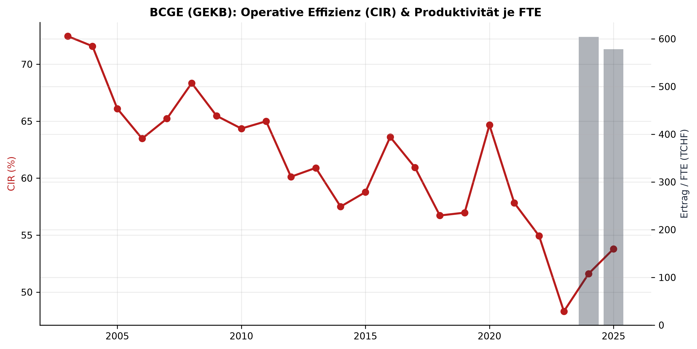

# 04 · Operative Effizienz & Transformation (2003–2025): Banque Cantonale de Genève

## 1. Management Summary
- Die Cost-Income-Ratio (CIR) liegt im Jahr 2025 bei **53,79 %** (vs. 72,46 % im Jahr 2003), die Eigenkapitalrendite (ROE) bei **8,84 %**.
- Der Personalbestand umfasst 2025 **958,4 FTE** bei einem Ertrag pro Vollzeitstelle von **578,0 TCHF** und einem **Lohnkosten-/Produktivitätsverhältnis von 33,0 %** (bzw. **3,03×** Ertrag je CHF Personalaufwand).

## 2. Quantitative Entwicklung
| Jahr | CIR % | ROE % | FTE | Ertrag/FTE (TCHF) | Lohn/FTE (TCHF) | Lohn/Ertrag % | Ertrag/Lohn | Bilanz/FTE (Mio.) |
| --- | --- | --- | --- | --- | --- | --- | --- | --- |
| 2003 | 72,46 % | 0,00 % | – | – | – | – % | –× | – |
| 2004 | 71,58 % | 0,00 % | – | – | – | – % | –× | – |
| 2005 | 66,10 % | 0,00 % | – | – | – | – % | –× | – |
| 2006 | 63,47 % | 0,01 % | – | – | – | – % | –× | – |
| 2007 | 65,22 % | 0,01 % | – | – | – | – % | –× | – |
| 2008 | 68,34 % | 0,01 % | – | – | – | – % | –× | – |
| 2009 | 65,47 % | 0,01 % | – | – | – | – % | –× | – |
| 2010 | 64,35 % | 0,01 % | – | – | – | – % | –× | – |
| 2011 | 64,99 % | 0,01 % | – | – | – | – % | –× | – |
| 2012 | 60,12 % | 0,01 % | – | – | – | – % | –× | – |
| 2013 | 60,90 % | 0,01 % | – | – | – | – % | –× | – |
| 2014 | 57,50 % | 0,01 % | – | – | – | – % | –× | – |
| 2015 | 58,77 % | 0,01 % | – | – | – | – % | –× | – |
| 2016 | 63,61 % | 0,01 % | – | – | – | – % | –× | – |
| 2017 | 60,93 % | 0,01 % | – | – | – | – % | –× | – |
| 2018 | 56,72 % | 0,01 % | – | – | – | – % | –× | – |
| 2019 | 56,97 % | 0,01 % | – | – | – | – % | –× | – |
| 2020 | 64,66 % | 0,01 % | – | – | – | – % | –× | – |
| 2021 | 57,83 % | 6,85 % | – | – | – | – % | –× | – |
| 2022 | 54,93 % | 8,87 % | – | – | – | – % | –× | – |
| 2023 | 48,31 % | 0,01 % | – | – | – | – % | –× | – |
| 2024 | 51,62 % | 9,34 % | 968,2 | 604,2 | – | – % | –× | 33,50 |
| 2025 | 53,79 % | 8,84 % | 958,4 | 578,0 | 190,7 | 33,0 % | 3,03× | 36,42 |

## 3. Treiberanalyse & Wendepunkte
- **2008:** Abwicklung Fondation de valorisation
- **2015:** Umstellung auf FINMA-RVB
- **2025:** Inkrafttreten Basel III final per 01.01.2025

## 4. Fazit & Ausblick
- Digitalisierung und Skalierung steigern Bilanzsumme und Geschäftsvolumen pro Vollzeitstelle langfristig.
