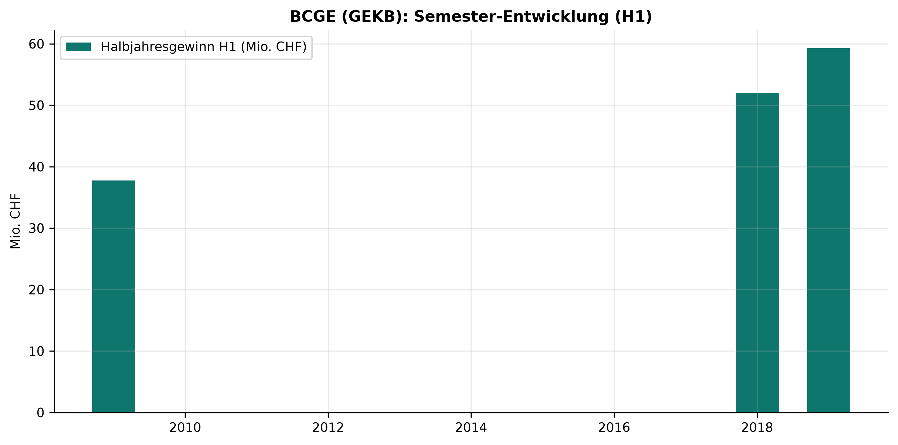

# 06 · Unterjährige Dynamik (Semesterberichte): Banque Cantonale de Genève

## 1. Management Summary
- Vorliegen von **18 Halbjahresabschlüssen**; jüngster Stichtag ist **H1-2026** mit einem Geschäftsertrag von **310,5 Mio. CHF** und einem Halbjahresgewinn von **– Mio. CHF**.

## 2. Quantitative Entwicklung
| Periode | Bilanzsumme | Zinserfolg H1 | Geschäftsertrag H1 | Geschäftserfolg H1 | Reingewinn H1 |
| --- | --- | --- | --- | --- | --- |
| H1-2008 | 13'055,9 | – | 159,8 | 53,6 | – |
| H1-2009 | 14'051,5 | – | 163,6 | 57,1 | 37,8 |
| H1-2010 | – | 97,7 | 164,3 | – | – |
| H1-2011 | – | 97,4 | 163,8 | 54,0 | – |
| H1-2012 | – | 105,7 | 178,3 | 70,2 | – |
| H1-2013 | – | 102,6 | 167,1 | 65,4 | – |
| H1-2014 | – | – | – | – | – |
| H1-2015 | 20'270,3 | 103,6 | – | 60,8 | – |
| H1-2017 | 21'401,4 | 104,5 | 183,1 | 65,6 | – |
| H1-2018 | 22'306,1 | 121,5 | 208,0 | 84,5 | 52,0 |
| H1-2019 | 23'627,9 | 121,0 | 220,1 | 94,6 | 59,3 |
| H1-2020 | 26'867,3 | 122,2 | 183,1 | 50,6 | – |
| H1-2021 | 27'914,3 | 126,4 | 205,3 | 77,3 | – |
| H1-2022 | 29'133,2 | 129,9 | 231,2 | 93,7 | – |
| H1-2023 | 30'407,0 | 192,9 | 290,6 | 137,0 | – |
| H1-2024 | 31'251,1 | 201,2 | 299,6 | 136,6 | – |
| H1-2025 | 33'903,9 | 175,3 | 276,5 | 110,9 | – |
| H1-2026 | 35'563,2 | 183,3 | 310,5 | 138,3 | – |

## 3. Treiberanalyse & Wendepunkte
- Der Vergleich von H1-Werten gegen die jeweiligen Gesamtjahresergebnisse (FY) zeigt die saisonale Ertragsverteilung und Reservebildung im zweiten Halbjahr.

## 4. Fazit & Ausblick
- Die Halbjahresberichte ermöglichen ein zeitnahes Monitoring der Zinsmargen- und Kreditvolumen-Dynamik bis H1-2026.
