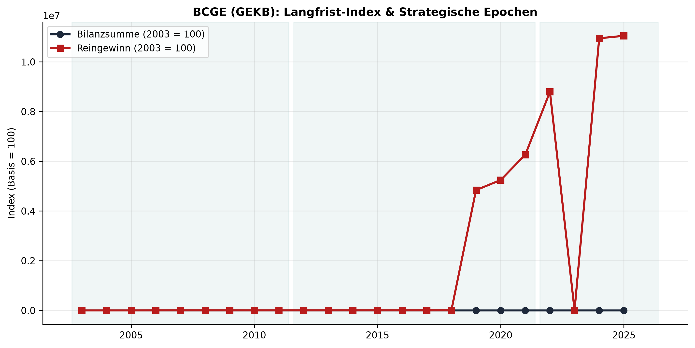
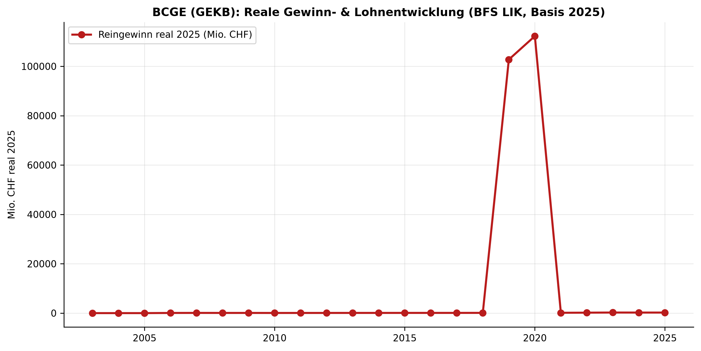

# 07 · Strategische Epochen, Governance, reale Vergütung & Vorsorge (2003–2025): Banque Cantonale de Genève

> **Preisbasis:** Sämtliche Realgrössen sind mit dem offiziellen **BFS Landesindex der Konsumentenpreise (LIK, Dez. 1982 = 100)** deterministisch auf **reale CHF 2025** deflationiert.

## 1. Management Summary & Strategische Epochen
- **Epoche 1 (2003–2011):** Nachgang Sanierung & Fondation de valorisation
- **Epoche 2 (2012–2021):** Internationalisierung & Eigenkapitalaufbau
- **Epoche 3 (2022–2026):** Zinswende, Commodity Finance & Basel III final

## 2. Reale Gewinn-, Lohn- & Vergütungsentwicklung (real 2025 CHF)
| Jahr | Gewinn nom. | Gewinn real 2025 | Lohn/FTE real (TCHF) | Fluktuation % | VR real (TCHF) | CEO real (TCHF) | GL real (TCHF) |
| --- | --- | --- | --- | --- | --- | --- | --- |
| 2003 | 0,0 | 0,0 | – | – | – | – | – |
| 2004 | 0,0 | 0,0 | – | – | – | – | – |
| 2005 | 0,0 | 0,0 | – | – | – | – | – |
| 2006 | 0,1 | 0,1 | – | – | – | – | – |
| 2007 | 0,1 | 0,1 | – | – | – | – | – |
| 2008 | 0,1 | 0,1 | – | – | – | – | – |
| 2009 | 0,1 | 0,1 | – | – | – | – | – |
| 2010 | 0,1 | 0,1 | – | – | – | – | – |
| 2011 | 0,1 | 0,1 | – | – | – | – | – |
| 2012 | 0,1 | 0,1 | – | – | – | – | – |
| 2013 | 0,1 | 0,1 | – | – | – | – | – |
| 2014 | 0,1 | 0,1 | – | – | – | – | – |
| 2015 | 0,1 | 0,1 | – | – | – | – | – |
| 2016 | 0,1 | 0,1 | – | – | – | – | – |
| 2017 | 0,1 | 0,1 | – | – | – | – | – |
| 2018 | 0,1 | 0,1 | – | – | – | – | – |
| 2019 | 96,8 | 102,7 | – | – | – | – | – |
| 2020 | 105,0 | 112,2 | – | – | – | – | – |
| 2021 | 125,2 | 133,1 | – | – | – | – | – |
| 2022 | 175,9 | 181,8 | – | 9,3 % | – | – | – |
| 2023 | 0,2 | 0,2 | – | 10,1 % | – | – | – |
| 2024 | 219,0 | 219,3 | – | 8,3 % | – | – | – |
| 2025 | 221,0 | 221,0 | 190,7 | 9,7 % | 1'280,0 | 1'450,0 | 5'477,1 |

## 3. Arbeitgeber-Attraktivität, Personalfluktuation & Vorsorgeeinrichtung (Pensionskasse)
- **Vorsorgeeinrichtung:** Fondation de prévoyance professionnelle de la BCGE (*Beitragsprimat (umhüllend)*, Basis: `Swiss GAAP FER 16 / ARB`)
- **Versichertenstruktur:** Aktive **–**, Rentner **–** (Verhältnis Aktive/Rentner: **–**)
- **Deckungsgrad (BVG) / Reserven:** Deckungsgrad **– %**, Arbeitgeberbeitragsreserve **0,0 Mio. CHF**, Sondereinlagen **0,0 Mio. CHF**
- **CEO-zu-Mitarbeitenden-Pay-Ratio (2025):** **7,6×** (CEO real 2025: 1'450,0 TCHF vs. Ø Personalaufwand/FTE: 190,7 TCHF)
- **Quelle Vorsorge:** `gekb/.md/gekb-geschaeftsbericht-2025.md (Annexe 4.13 b, S. 92)` — Haupt-Vorsorgeeinrichtung der BCGE-Gruppe; bezahlte Arbeitgeberbeiträge 2025: 19,128 Mio. CHF (Vorsorgeaufwand im Personalaufwand 19,241 Mio. CHF; 2024: 18,260 Mio. CHF).
- **Personalfluktuation (4 Berichtsjahre, 2022–2025):** **2022:** 9,3 %, **2023:** 10,1 %, **2024:** 8,3 %, **2025:** 9,7 %
- **Methodik & Quelle Fluktuation:** Taux de rotation du personnel BCGE Maison-mère (GRI 401-1: nombre de départs / effectif moyen) (`gekb/.md/gekb-geschaeftsbericht-2023.md & BCGE Rapports RSE 2024 (p. 52/61) & 2025 (p. 67/72) – GRI 401-1`)

## 4. Treiberanalyse, Strukturbrüche & Ausblick
- **2008:** Abwicklung Fondation de valorisation
- **2015:** Umstellung auf FINMA-RVB
- **2025:** Inkrafttreten Basel III final per 01.01.2025
- Die gemeinsame Inflationsbereinigung auf `real 2025 CHF` ermöglicht den unverzerrten Vergleich von Produktivität, Reallöhnen, Personalfluktuation, Pay Ratio und Pensionskassen-Resilienz im Branchenvergleich (`comparison/reports/07_mitarbeiter_und_vorsorge_branchenvergleich.md`).
