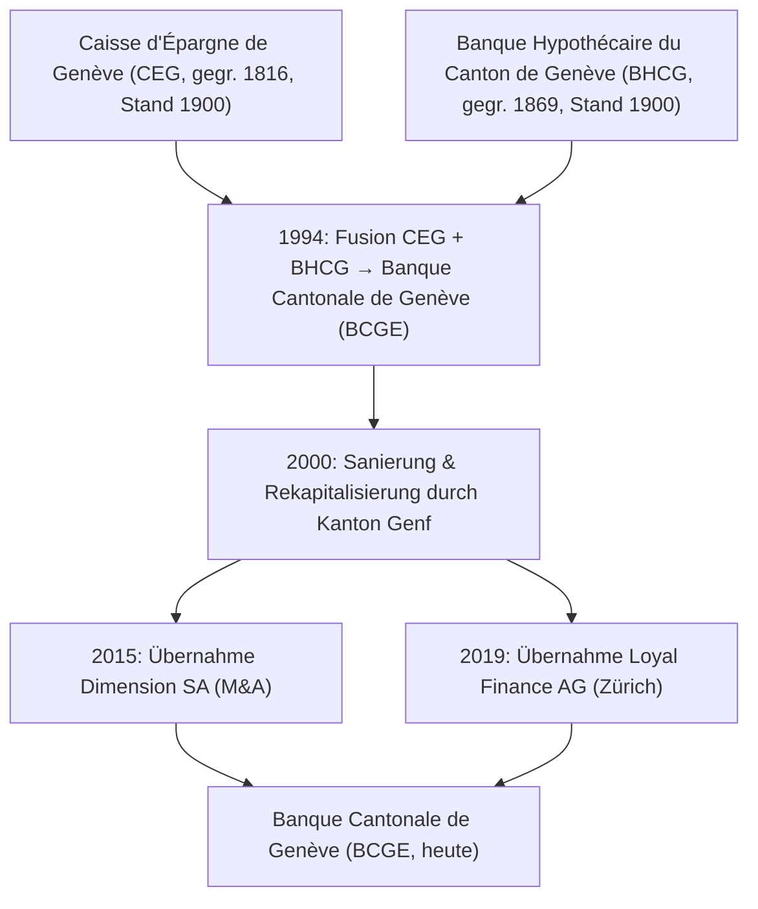

# 10 · Fusionsbaum & Institutsgeschichte seit 1900: Banque Cantonale de Genève

> **Gründung / Ursprung:** 1816 (Caisse d'Épargne) / 1869 (BHCG) → 1994 Fusion zur BCGE | **Aktuelle Rechtsform:** `listed_ag` | **FINMA-Kategorie:** 3

## 1. Überblick der Institutslinie (1900–2026)
Die Banque Cantonale de Genève (BCGE) entstand am 1. Januar 1994 aus der Fusion zweier historischer Genfer Institute: der 1816 gegründeten Caisse d'Épargne de la République et Canton de Genève (CEG) und der 1869 gegründeten Banque Hypothécaire du Canton de Genève (BHCG). Später folgten gezielte Boutique-Akquisitionen wie Dimension SA (2015) und Loyal Finance AG (2019).

## 2. Fusionsbaum (Mermaid-Diagramm seit 1900)

## 3. Chronologische Meilensteine (Fusionen, Übernahmen & Rechtsformwechsel)
| Jahr / Zeitraum | Institut / Ereignis | Typ | Bedeutung & Auswirkung |
| --- | --- | --- | --- |
| 1816 / 1900 | Caisse d'Épargne (CEG) & Banque Hypothécaire (BHCG) | Ausgangslage 1900 | Zwei eigenständige Genfer Kantonal-/Sparkasseninstitute seit dem 19. Jh. |
| 1994 | Fusion CEG + BHCG → Banque Cantonale de Genève (BCGE) | Fusion | Gründung der BCGE als öffentlich-rechtliche Aktiengesellschaft |
| 2000 | Kantonale Rekapitalisierung & Neuausrichtung | Restrukturierung | Bereinigung von Altlasten; Beginn der Ära Blaise Goetschin (2000–2024) |
| 2015 / 2019 | Übernahmen Dimension SA (Lausanne) & Loyal Finance AG (Zürich) | Akquisitionen | Ausbau von M&A-Beratung und institutionellem Obligationen-Asset-Management |

- **Quellenbasis:** `BCGE Geschäftsberichte; Historisches Lexikon der Schweiz`
