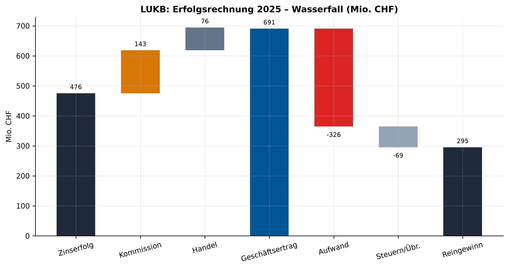
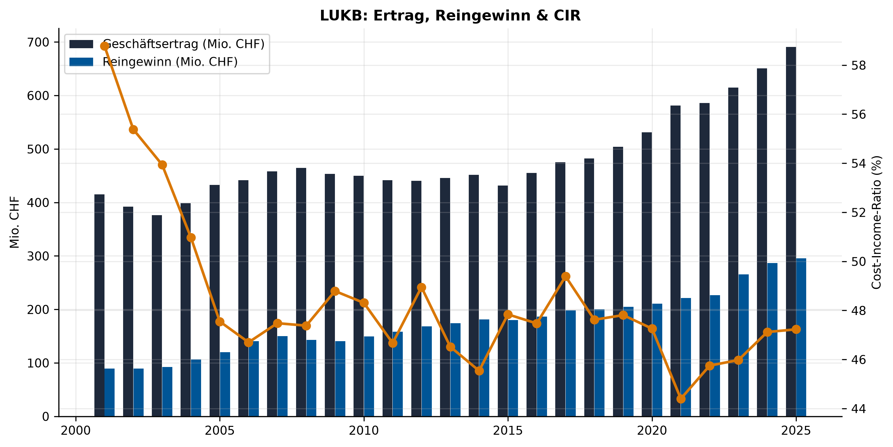

# 01 · Zinszyklen & Ertragsarchitektur (2001–2025): Luzerner Kantonalbank AG

> **Scope:** `consolidated` | **Standard:** `ARB_RVB` | **Währung:** Mio. CHF (harmonisierte Zeitreihe)

## 1. Management Summary
- Im Zeitraum **2001–2025** entwickelte sich der Geschäftsertrag von **415,2 Mio. CHF** auf **691,0 Mio. CHF** (CAGR **2,15 % p. a.**).
- Der Reingewinn erreichte im jüngsten Geschäftsjahr 2025 **295,5 Mio. CHF** (nach 89,2 Mio. CHF im Jahr 2001).
- Der Netto-Zinserfolg trägt aktuell **68,8 %** zum Gesamtertrag bei, das Kommissionsgeschäft **20,7 %** und das Handelsgeschäft **11,0 %**.

## 2. Quantitative Entwicklung
| Jahr | Zinserfolg (Mio.) | Kommission (Mio.) | Handel (Mio.) | Geschäftsertrag | Geschäftserfolg | Reingewinn | Zinsanteil |
| --- | --- | --- | --- | --- | --- | --- | --- |
| 2001 | 283,6 | 102,9 | – | 415,2 | 187,5 | 89,2 | 68,3 % |
| 2002 | 276,7 | 91,8 | 14,9 | 392,4 | 175,1 | 89,6 | 70,5 % |
| 2003 | 255,7 | 91,9 | 19,5 | 376,2 | 173,3 | 92,1 | 68,0 % |
| 2004 | 264,0 | 102,9 | 21,9 | 398,5 | 195,4 | 106,3 | 66,2 % |
| 2005 | 278,5 | 113,6 | 30,7 | 432,8 | 227,0 | 120,0 | 64,4 % |
| 2006 | 277,1 | 121,8 | 28,2 | 441,4 | 235,3 | 140,6 | 62,8 % |
| 2007 | 280,6 | 128,7 | 36,0 | 458,4 | 240,7 | 149,9 | 61,2 % |
| 2008 | – | – | – | 464,3 | – | 143,3 | – % |
| 2009 | – | – | – | 453,7 | – | 140,7 | – % |
| 2010 | – | – | – | 449,8 | – | 149,4 | – % |
| 2011 | 325,8 | 81,7 | – | 441,9 | 235,6 | 158,6 | 73,7 % |
| 2012 | 331,0 | 76,4 | 26,1 | 440,6 | 224,9 | 168,3 | 75,1 % |
| 2013 | 323,4 | 80,9 | 27,5 | 445,9 | 238,5 | 174,3 | 72,5 % |
| 2014 | 332,9 | 84,1 | 20,9 | 451,6 | 246,0 | 181,5 | 73,7 % |
| 2015 | 306,4 | 82,7 | 22,5 | 431,9 | – | 180,1 | 71,0 % |
| 2016 | 327,1 | 82,4 | 29,6 | 455,0 | 210,0 | 186,6 | 71,9 % |
| 2017 | 345,6 | 89,4 | 30,5 | 475,1 | 214,7 | 198,4 | 72,7 % |
| 2018 | 340,9 | 93,3 | 31,5 | 482,3 | 225,4 | 200,4 | 70,7 % |
| 2019 | 357,5 | 99,3 | 35,7 | 504,3 | 238,9 | 204,9 | 70,9 % |
| 2020 | 383,5 | 103,3 | 50,3 | 531,1 | 250,3 | 210,9 | 72,2 % |
| 2021 | 393,1 | 120,4 | 51,6 | 581,3 | 282,7 | 221,4 | 67,6 % |
| 2022 | 404,5 | 119,1 | 61,5 | 585,7 | 284,6 | 226,6 | 69,0 % |
| 2023 | 427,4 | 118,1 | 59,6 | 614,9 | 303,5 | 265,4 | 69,5 % |
| 2024 | 459,1 | 130,1 | 56,5 | 650,5 | 317,8 | 286,6 | 70,6 % |
| 2025 | 475,6 | 143,2 | 76,0 | 691,0 | 333,8 | 295,5 | 68,8 % |

## 3. Treiberanalyse & Wendepunkte
- **2015:** Einführung SNB-Negativzins & Rechnungslegungswechsel (ARB)
- **2023:** Aktiensplit 1:5 & Zinswende-Höchststand
- **2025:** Inkrafttreten Basel III final per 01.01.2025

## 4. Fazit & Ausblick
- Die Ertragsarchitektur von LUKB spiegelt die Zinszyklen (Negativzinsphase 2015–2022, Zinswende 2022–2024, Zinssenkungen ab 2025) unmittelbar wider.
