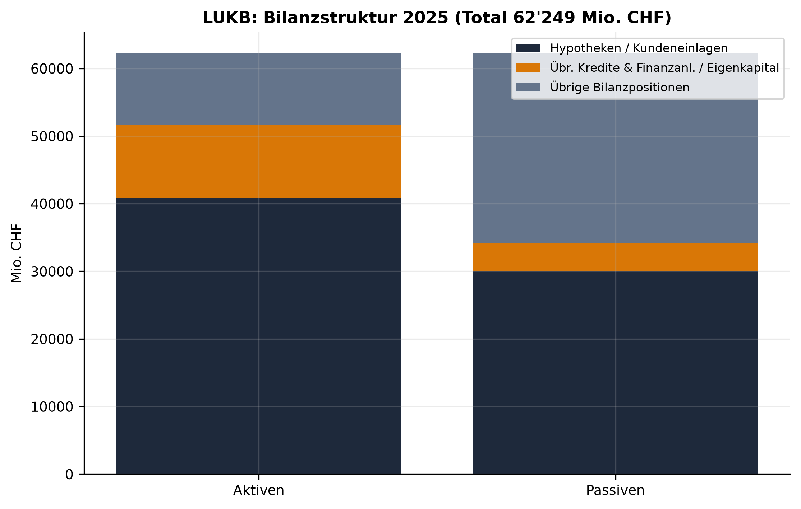
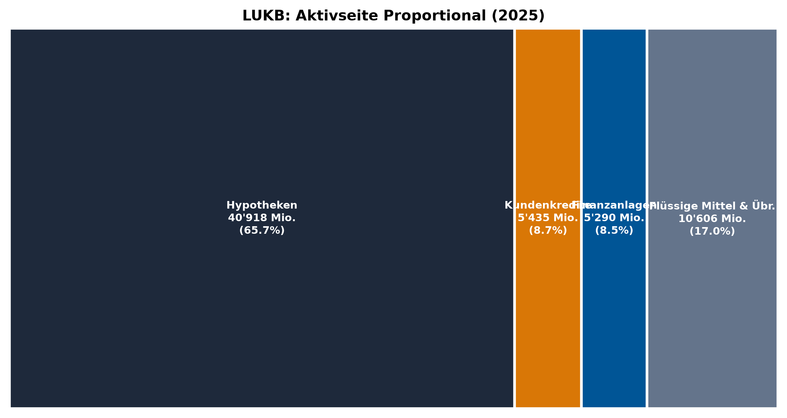
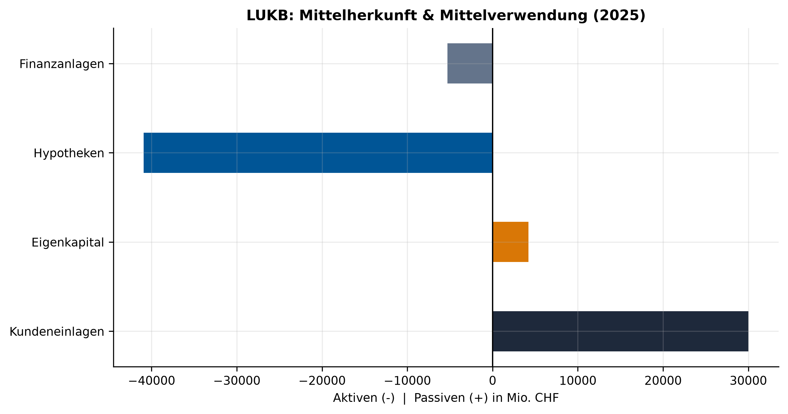
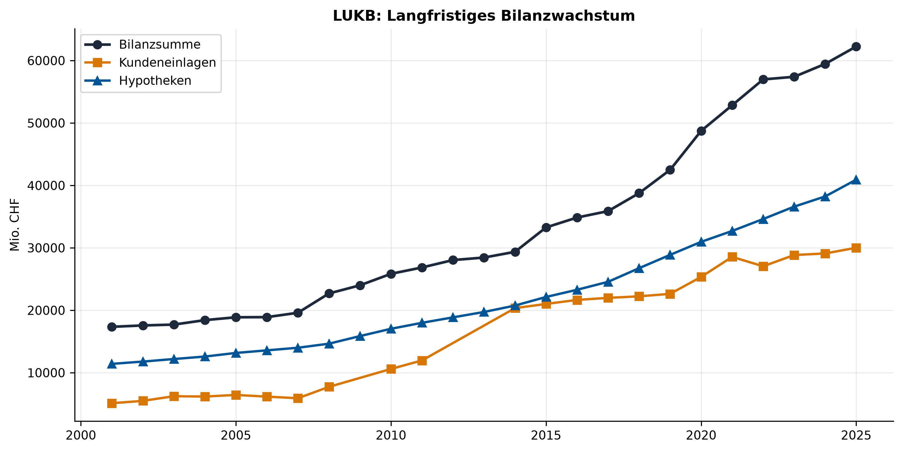

# 02 · Bilanzwachstum, Hypotheken & Refinanzierung (2001–2025): Luzerner Kantonalbank AG

## 1. Management Summary
- Die Bilanzsumme wuchs von **17'350,1 Mio. CHF** (2001) auf **62'249,1 Mio. CHF** (2025, CAGR **5,47 %**).
- Die Hypothekarforderungen machen im Jahr 2025 **65,7 %** der Bilanzsumme aus.
- Die Kundeneinlagen belaufen sich 2025 auf **30'009,6 Mio. CHF**, das Eigenkapital auf **4'224,6 Mio. CHF** (Eigenkapitalquote **6,79 %**).

## 2. Quantitative Entwicklung
| Jahr | Bilanzsumme | Hypotheken | Finanzanlagen | Kundeneinlagen | Eigenkapital | Deckungsgrad |
| --- | --- | --- | --- | --- | --- | --- |
| 2001 | 17'350,1 | 11'416,3 | 638,6 | 5'113,2 | – | 44,8 % |
| 2002 | 17'570,1 | 11'781,4 | 650,1 | 5'489,8 | – | 37,5 % |
| 2003 | 17'706,9 | 12'192,4 | 590,9 | 6'234,6 | – | 41,6 % |
| 2004 | 18'421,4 | 12'587,4 | 642,4 | 6'179,4 | – | 40,3 % |
| 2005 | 18'879,6 | 13'165,2 | 652,5 | 6'439,5 | – | 40,1 % |
| 2006 | 18'901,6 | 13'579,8 | 685,1 | 6'166,4 | – | 37,2 % |
| 2007 | 19'602,8 | 13'998,9 | 707,2 | 5'910,9 | – | 34,6 % |
| 2008 | 22'694,8 | 14'647,2 | 1'119,6 | 7'733,1 | – | 42,9 % |
| 2009 | 23'998,0 | 15'865,5 | 1'730,5 | – | – | – % |
| 2010 | 25'841,9 | 17'036,3 | 1'748,8 | 10'600,9 | – | 62,2 % |
| 2011 | 26'856,2 | 17'990,7 | 1'465,7 | 11'963,3 | – | 54,7 % |
| 2012 | 28'043,8 | 18'865,5 | 1'455,1 | – | – | – % |
| 2013 | 28'443,7 | 19'728,3 | 1'702,7 | – | – | – % |
| 2014 | 29'363,8 | 20'755,2 | 2'342,0 | 20'344,1 | – | 98,0 % |
| 2015 | 33'271,5 | 22'130,6 | 2'389,0 | 21'014,0 | – | 95,0 % |
| 2016 | 34'854,9 | 23'284,2 | 2'533,3 | 21'656,7 | 2'488,2 | 93,0 % |
| 2017 | 35'881,6 | 24'557,1 | 2'609,9 | 21'987,0 | 2'579,3 | 89,5 % |
| 2018 | 38'761,0 | 26'742,2 | 2'779,8 | 22'233,1 | 2'670,3 | 83,1 % |
| 2019 | 42'493,1 | 28'874,0 | 3'048,3 | 22'628,5 | 2'769,9 | 78,4 % |
| 2020 | 48'738,9 | 30'959,0 | 4'355,7 | 25'341,0 | 2'865,5 | 81,8 % |
| 2021 | 52'837,4 | 32'704,0 | 4'267,6 | 28'551,0 | 3'081,9 | 87,3 % |
| 2022 | 56'980,0 | 34'615,3 | 5'035,2 | 27'045,4 | 3'228,8 | 78,1 % |
| 2023 | 57'397,1 | 36'601,5 | 5'051,5 | 28'848,1 | 3'856,1 | 78,8 % |
| 2024 | 59'462,5 | 38'235,4 | 5'153,7 | 29'101,7 | 4'045,3 | 67,0 % |
| 2025 | 62'249,1 | 40'917,7 | 5'290,1 | 30'009,6 | 4'224,6 | 64,7 % |

## 3. Treiberanalyse & Wendepunkte
- **2015:** Einführung SNB-Negativzins & Rechnungslegungswechsel (ARB)
- **2023:** Aktiensplit 1:5 & Zinswende-Höchststand
- **2025:** Inkrafttreten Basel III final per 01.01.2025

## 4. Fazit & Ausblick
- Refinanzierungsbasis und Bilanzstruktur bleiben eng an Kundeneinlagen und die jeweilige Geschäftsmodell-Spezialisierung gekoppelt.
