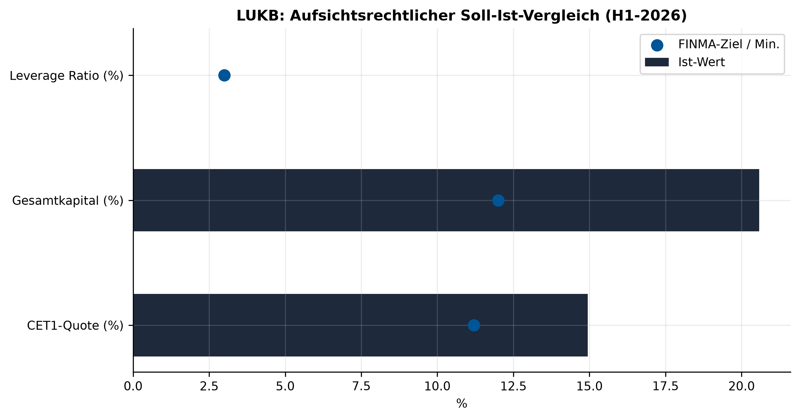
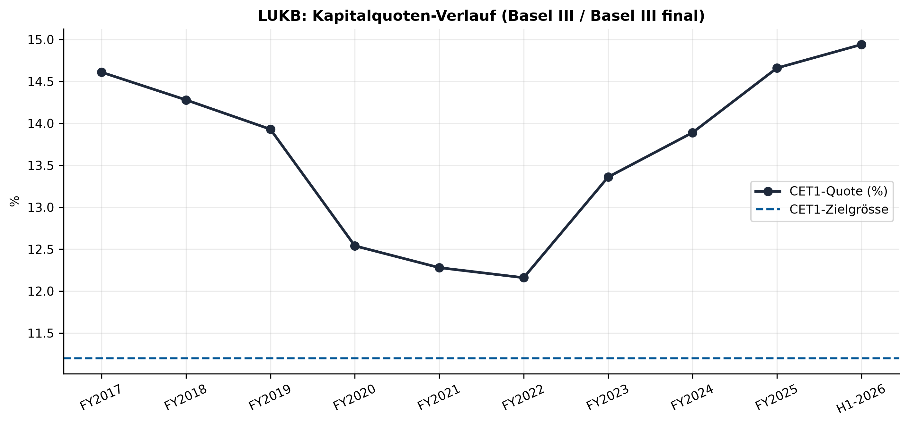

# 03 · Aufsichtsrechtliche Resilienz & Basel III: Luzerner Kantonalbank AG

> **FINMA-Kategorie:** Kategorie 3 | **CET1-Zielgrösse:** 11,20 % | **Gesamtkapital-Ziel:** 12,00 %

## 1. Management Summary
- Am jüngsten Offenlegungsstichtag (**H1-2026**, Regime: *Basel III final*) beträgt die **CET1-Quote 14,94 %** (Puffer über Ziel: **3,74 Prozentpunkte**).
- Die Gesamtkapitalquote liegt bei **20,58 %**, die Leverage Ratio bei **– %**.
- Liquiditätsquoten: LCR **135,6 %**, NSFR **– %** (Mindestanforderung je 100 %).

## 2. Quantitative Entwicklung (10 Stichtage)
| Periode | Regime | RWA (Mio.) | CET1 (Mio.) | CET1 % | Gesamtkap. % | Leverage % | LCR % | NSFR % |
| --- | --- | --- | --- | --- | --- | --- | --- | --- |
| FY2017 | Basel III | – | – | 14,61 % | 16,59 % | – % | – % | – % |
| FY2018 | Basel III | – | 2'662,1 | 14,28 % | 16,05 % | – % | – % | – % |
| FY2019 | Basel III | 19,8 | 2,8 | 13,93 % | 16,69 % | – % | – % | – % |
| FY2020 | Basel III | 22,6 | 2,8 | 12,54 % | 15,81 % | – % | – % | – % |
| FY2021 | Basel III | 23'947,0 | 2'941,1 | 12,28 % | 17,59 % | – % | – % | 132,9 % |
| FY2022 | Basel III | 25'553,4 | 3'107,7 | 12,16 % | 17,17 % | – % | – % | 130,3 % |
| FY2023 | Basel III | 27'833,6 | 3'717,2 | 13,36 % | 17,99 % | – % | – % | 131,8 % |
| FY2024 | Basel III | 28'208,5 | 3'917,0 | 13,89 % | 18,47 % | – % | – % | 126,5 % |
| FY2025 | Basel III final | 27'904,3 | 4'090,9 | 14,66 % | 20,57 % | – % | – % | – % |
| H1-2026 | Basel III final | 27'836,2 | 4'159,3 | 14,94 % | 20,58 % | – % | 135,6 % | – % |

## 3. Treiberanalyse & Wendepunkte
- Mit Inkrafttreten von **Basel III final** ab 01.01.2025 verändern sich risikogewichtete Aktiven (RWA) und RWA-Dichte durch angepasste Standard- bzw. Output-Floor-Vorgaben.

## 4. Fazit & Ausblick
- Die Eigenmittel- und Liquiditätspuffer übertreffen die regulatorischen Mindestanforderungen für FINMA-Kategorie 3 deutlich.
