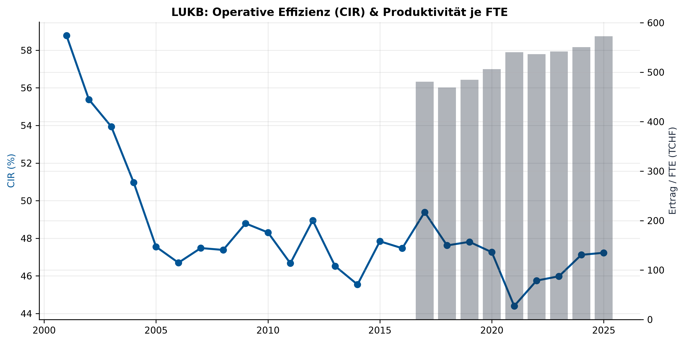

# 04 · Operative Effizienz & Transformation (2001–2025): Luzerner Kantonalbank AG

## 1. Management Summary
- Die Cost-Income-Ratio (CIR) liegt im Jahr 2025 bei **47,23 %** (vs. 58,78 % im Jahr 2001), die Eigenkapitalrendite (ROE) bei **6,99 %**.
- Der Personalbestand umfasst 2025 **1'206,2 FTE** bei einem Ertrag pro Vollzeitstelle von **572,9 TCHF** und einem **Lohnkosten-/Produktivitätsverhältnis von 31,6 %** (bzw. **3,16×** Ertrag je CHF Personalaufwand).
- **Personalfluktuation:** Jüngster offengelegter Wert liegt im Jahr **2025** bei **4,3 %** (*Netto-Fluktuationsrate Konzern (freiwillige Fluktuation exkl. Pensionierungen, befristete Verträge, Lernende & familiäre Gründe, GRI 401-1)*).

## 2. Quantitative Entwicklung
| Jahr | CIR % | ROE % | FTE | Fluktuation % | Ertrag/FTE (TCHF) | Lohn/FTE (TCHF) | Lohn/Ertrag % | Ertrag/Lohn | Bilanz/FTE (Mio.) |
| --- | --- | --- | --- | --- | --- | --- | --- | --- | --- |
| 2001 | 58,78 % | – % | – | – | – | – | – % | –× | – |
| 2002 | 55,38 % | – % | – | – | – | – | – % | –× | – |
| 2003 | 53,94 % | – % | – | – | – | – | – % | –× | – |
| 2004 | 50,97 % | – % | – | – | – | – | – % | –× | – |
| 2005 | 47,55 % | – % | – | – | – | – | – % | –× | – |
| 2006 | 46,70 % | – % | – | – | – | – | – % | –× | – |
| 2007 | 47,48 % | – % | – | – | – | – | – % | –× | – |
| 2008 | 47,38 % | – % | – | – | – | – | – % | –× | – |
| 2009 | 48,79 % | – % | – | – | – | – | – % | –× | – |
| 2010 | 48,31 % | – % | – | – | – | – | – % | –× | – |
| 2011 | 46,67 % | – % | – | – | – | – | – % | –× | – |
| 2012 | 48,95 % | – % | – | – | – | – | – % | –× | – |
| 2013 | 46,52 % | – % | – | – | – | – | – % | –× | – |
| 2014 | 45,54 % | – % | – | – | – | – | – % | –× | – |
| 2015 | 47,84 % | – % | – | – | – | – | – % | –× | – |
| 2016 | 47,47 % | 7,50 % | – | 3,6 % | – | – | – % | –× | – |
| 2017 | 49,39 % | 7,69 % | 988,4 | 3,3 % | 480,6 | 166,5 | 34,6 % | 2,89× | 36,30 |
| 2018 | 47,62 % | 7,51 % | 1'027,8 | 4,1 % | 469,2 | 153,3 | 32,7 % | 3,06× | 37,71 |
| 2019 | 47,81 % | 7,40 % | 1'040,1 | 4,8 % | 484,9 | 156,3 | 32,2 % | 3,10× | 40,85 |
| 2020 | 47,26 % | 7,36 % | 1'049,2 | 4,1 % | 506,2 | 163,7 | 32,3 % | 3,09× | 46,45 |
| 2021 | 44,40 % | 7,18 % | 1'075,7 | 3,7 % | 540,4 | 165,4 | 30,6 % | 3,27× | 49,12 |
| 2022 | 45,75 % | 7,02 % | 1'091,9 | 5,5 % | 536,4 | 167,6 | 31,2 % | 3,20× | 52,18 |
| 2023 | 45,98 % | 6,88 % | 1'134,9 | 4,5 % | 541,8 | 169,5 | 31,3 % | 3,20× | 50,57 |
| 2024 | 47,12 % | 7,09 % | 1'181,0 | 3,2 % | 550,8 | 177,0 | 32,1 % | 3,11× | 50,35 |
| 2025 | 47,23 % | 6,99 % | 1'206,2 | 4,3 % | 572,9 | 181,1 | 31,6 % | 3,16× | 51,61 |

## 3. Treiberanalyse & Wendepunkte
- **2015:** Einführung SNB-Negativzins & Rechnungslegungswechsel (ARB)
- **2023:** Aktiensplit 1:5 & Zinswende-Höchststand
- **2025:** Inkrafttreten Basel III final per 01.01.2025

## 4. Fazit & Ausblick
- Digitalisierung und Skalierung steigern Bilanzsumme und Geschäftsvolumen pro Vollzeitstelle langfristig.
