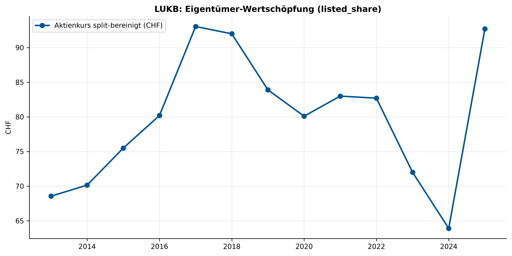

# 05 · Aktie, Dividenden & Investoren-Wertschöpfung (2001–2025): Luzerner Kantonalbank AG

> **Eigentümer-Modus:** `listed_share` | **Staatsgarantie:** Ja | **Ticker:** `LUKN`

## 1. Management Summary
- Im Geschäftsjahr 2025 erwirtschaftete LUKB einen Gewinn von **295,5 Mio. CHF** bei einem Eigenkapital von **4'224,6 Mio. CHF**.
- **Aktuelle Ausschüttung (2025):** Kurs **92.70 CHF**, Dividende **2.70 CHF** (Rendite **2,91 %**).

## 2. Quantitative Entwicklung
| Jahr | Reingewinn (Mio.) | Eigenkapital (Mio.) | Aktienkurs (split-ber.) | Dividende/Aktie | Div.-Rendite | Öff. Ablieferung (Mio.) |
| --- | --- | --- | --- | --- | --- | --- |
| 2001 | 89,2 | – | – | – | – % | – |
| 2002 | 89,6 | – | – | – | – % | – |
| 2003 | 92,1 | – | – | – | – % | – |
| 2004 | 106,3 | – | – | – | – % | – |
| 2005 | 120,0 | – | – | – | – % | – |
| 2006 | 140,6 | – | – | – | – % | – |
| 2007 | 149,9 | – | – | – | – % | – |
| 2008 | 143,3 | – | – | – | – % | – |
| 2009 | 140,7 | – | – | – | – % | – |
| 2010 | 149,4 | – | – | – | – % | – |
| 2011 | 158,6 | – | – | – | – % | – |
| 2012 | 168,3 | – | – | – | – % | – |
| 2013 | 174,3 | – | 68.55 | 2.20 | 3,21 % | – |
| 2014 | 181,5 | – | 70.15 | 2.20 | 3,14 % | – |
| 2015 | 180,1 | – | 75.50 | 2.20 | 2,91 % | – |
| 2016 | 186,6 | 2'488,2 | 80.20 | 2.30 | 2,87 % | – |
| 2017 | 198,4 | 2'579,3 | 93.05 | 2.40 | 2,58 % | – |
| 2018 | 200,4 | 2'670,3 | 92.00 | 2.50 | 2,72 % | – |
| 2019 | 204,9 | 2'769,9 | 83.90 | 2.50 | 2,98 % | – |
| 2020 | 210,9 | 2'865,5 | 80.10 | 2.50 | 3,12 % | – |
| 2021 | 221,4 | 3'081,9 | 83.00 | 2.50 | 3,01 % | – |
| 2022 | 226,6 | 3'228,8 | 82.70 | 2.50 | 3,02 % | – |
| 2023 | 265,4 | 3'856,1 | 72.00 | 2.50 | 3,47 % | – |
| 2024 | 286,6 | 4'045,3 | 63.90 | 2.60 | 4,07 % | – |
| 2025 | 295,5 | 4'224,6 | 92.70 | 2.70 | 2,91 % | – |

## 3. Treiberanalyse & Wendepunkte (Investoren-Perspektive)
- Bei kotierten Instituten mit Aktiensplits (z. B. BCV 1:10 im Jahr 2020) sind sämtliche historischen Kurs- und Dividendenreihen deterministisch split-bereinigt.
- Im Branchenvergleich (siehe `comparison/reports/06_investoren_branchenvergleich.md`) werden P/B, P/E, Dividendenrendite und Eigentümer-Ablieferungen über alle 19 Institute eingeordnet.

## 4. Fazit, Führungsleistung & Ausblick
- Stabile Ertragskraft sichert langfristig Dividendenkontinuität bzw. verlässliche Ablieferungen an Kanton, Post oder Genossenschafter.
- Die detaillierte Leistungsbilanz von CEO und Verwaltungsratspräsidium aus Investoren- und Eigentümersicht findet sich im [CEO & Chairman of the Board Achievement Report](./08_ceo_und_vrp_leistungsbericht.md).
