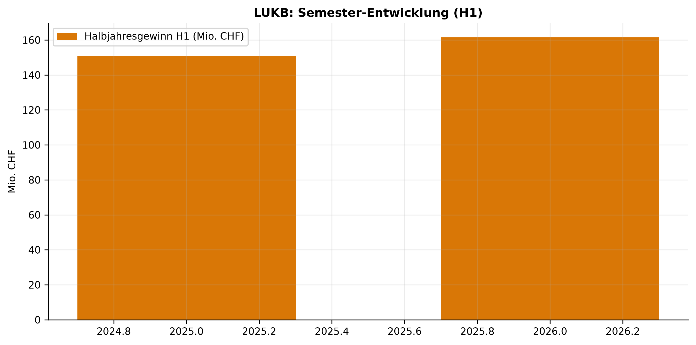

# 06 · Unterjährige Dynamik (Semesterberichte): Luzerner Kantonalbank AG

## 1. Management Summary
- Vorliegen von **2 Halbjahresabschlüssen**; jüngster Stichtag ist **H1-2026** mit einem Geschäftsertrag von **369'235,0 Mio. CHF** und einem Halbjahresgewinn von **161,4 Mio. CHF**.

## 2. Quantitative Entwicklung
| Periode | Bilanzsumme | Zinserfolg H1 | Geschäftsertrag H1 | Geschäftserfolg H1 | Reingewinn H1 |
| --- | --- | --- | --- | --- | --- |
| H1-2025 | 59'720,0 | 236,2 | 347,4 | 170,9 | 150,7 |
| H1-2026 | 63'217,7 | 244'879,0 | 369'235,0 | 181'741,0 | 161,4 |

## 3. Treiberanalyse & Wendepunkte
- Der Vergleich von H1-Werten gegen die jeweiligen Gesamtjahresergebnisse (FY) zeigt die saisonale Ertragsverteilung und Reservebildung im zweiten Halbjahr.

## 4. Fazit & Ausblick
- Die Halbjahresberichte ermöglichen ein zeitnahes Monitoring der Zinsmargen- und Kreditvolumen-Dynamik bis H1-2026.
