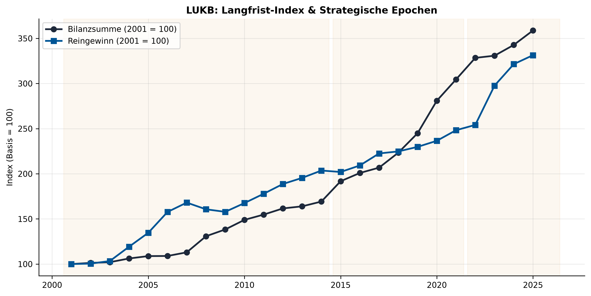
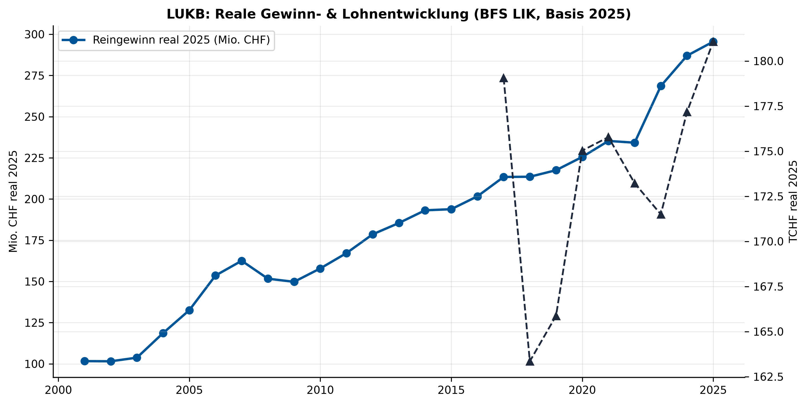

# 07 · Strategische Epochen, Governance, reale Vergütung & Vorsorge (2001–2025): Luzerner Kantonalbank AG

> **Preisbasis:** Sämtliche Realgrössen sind mit dem offiziellen **BFS Landesindex der Konsumentenpreise (LIK, Dez. 1982 = 100)** deterministisch auf **reale CHF 2025** deflationiert.

## 1. Management Summary & Strategische Epochen
- **Epoche 1 (2001–2014):** Agiles Wachstum nach AG-Umwandlung (2001) & Finanzkrise
- **Epoche 2 (2015–2021):** SNB-Negativzinsen & Zentralschweizer Expansion
- **Epoche 3 (2022–2026):** Zinswende, Strategie LUKB25/30 & Basel III final

## 2. Reale Gewinn-, Lohn- & Vergütungsentwicklung (real 2025 CHF)
| Jahr | Gewinn nom. | Gewinn real 2025 | Lohn/FTE real (TCHF) | VR real (TCHF) | CEO real (TCHF) | GL real (TCHF) |
| --- | --- | --- | --- | --- | --- | --- |
| 2001 | 89,2 | 101,6 | – | – | – | – |
| 2002 | 89,6 | 101,5 | – | – | – | – |
| 2003 | 92,1 | 103,7 | – | – | – | – |
| 2004 | 106,3 | 118,7 | – | – | – | – |
| 2005 | 120,0 | 132,5 | – | – | – | – |
| 2006 | 140,6 | 153,6 | – | – | – | – |
| 2007 | 149,9 | 162,5 | – | – | – | – |
| 2008 | 143,3 | 151,7 | – | – | – | – |
| 2009 | 140,7 | 149,7 | – | – | – | – |
| 2010 | 149,4 | 157,9 | – | – | – | – |
| 2011 | 158,6 | 167,2 | – | – | – | – |
| 2012 | 168,3 | 178,6 | – | – | – | – |
| 2013 | 174,3 | 185,4 | – | – | – | – |
| 2014 | 181,5 | 193,2 | – | – | – | – |
| 2015 | 180,1 | 193,8 | – | – | – | – |
| 2016 | 186,6 | 201,7 | – | – | – | – |
| 2017 | 198,4 | 213,4 | 179,1 | – | – | – |
| 2018 | 200,4 | 213,5 | 163,3 | – | – | – |
| 2019 | 204,9 | 217,5 | 165,9 | – | – | – |
| 2020 | 210,9 | 225,5 | 175,0 | – | – | – |
| 2021 | 221,4 | 235,2 | 175,8 | – | – | – |
| 2022 | 226,6 | 234,2 | 173,2 | – | – | – |
| 2023 | 265,4 | 268,6 | 171,5 | – | – | – |
| 2024 | 286,6 | 287,0 | 177,2 | – | – | – |
| 2025 | 295,5 | 295,5 | 181,1 | – | – | – |

## 3. Arbeitgeber-Attraktivität & Vorsorgeeinrichtung (Pensionskasse)
- **Vorsorgeeinrichtung:** Pensionskasse der Luzerner Kantonalbank (*Beitragsprimat*, Basis: `Swiss GAAP FER 26 / ARB`)
- **Versichertenstruktur:** Aktive **–**, Rentner **–** (Verhältnis Aktive/Rentner: **–**)
- **Deckungsgrad (BVG) / Reserven:** Deckungsgrad **128,1 %**, Arbeitgeberbeitragsreserve **0,0 Mio. CHF**, Sondereinlagen **0,0 Mio. CHF**
- **CEO-zu-Mitarbeitenden-Pay-Ratio (2025):** **–×** (CEO real 2025: – TCHF vs. Ø Personalaufwand/FTE: 181,1 TCHF)
- **Quelle:** `lukb/.md/lukb-geschaeftsbericht-2025.md (Anhang 6.9 / 8.11 Wirtschaftliche Lage der eigenen Vorsorgeeinrichtungen)` — Rechtlich selbstständige Pensionskasse (Swiss GAAP FER 26); Deckungsgrad per 31.12.2025 128,1 % (Vorjahr 127,4 %); Zielwert Wertschwankungsreserve (25,6 %) erreicht; bezahlte Beiträge 2025: CHF 20,616 Mio. (2024: CHF 19,883 Mio.).

## 4. Treiberanalyse, Strukturbrüche & Ausblick
- **2015:** Einführung SNB-Negativzins & Rechnungslegungswechsel (ARB)
- **2023:** Aktiensplit 1:5 & Zinswende-Höchststand
- **2025:** Inkrafttreten Basel III final per 01.01.2025
- Die gemeinsame Inflationsbereinigung auf `real 2025 CHF` ermöglicht den unverzerrten Vergleich von Produktivität, Reallöhnen, Pay Ratio und Pensionskassen-Resilienz im Branchenvergleich (`comparison/reports/07_mitarbeiter_und_vorsorge_branchenvergleich.md`).
