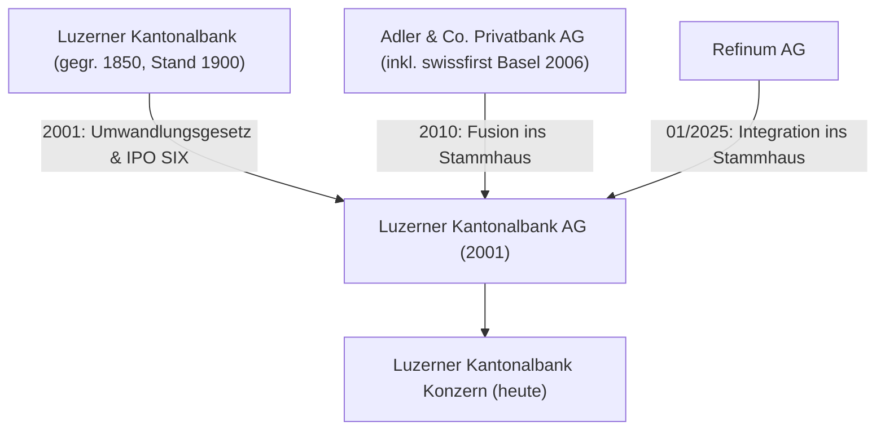

# 10 · Fusionsbaum & Institutsgeschichte seit 1900: Luzerner Kantonalbank AG

> **Gründung / Ursprung:** 1850 (Luzerner Kantonalbank) → 2001 (Umwandlung in privatrechtliche AG & Börsengang SIX) | **Aktuelle Rechtsform:** `listed_ag` | **FINMA-Kategorie:** 3

## 1. Überblick der Institutslinie (1900–2026)
Die 1850 gegründete Luzerner Kantonalbank wurde 2001 auf Basis des kantonalen Umwandlungsgesetzes in eine privatrechtliche Aktiengesellschaft umgewandelt und an der SIX Swiss Exchange kotiert (Kanton Luzern hält 61,5 %). 2006 übernahm die Tochter Adler & Co. Privatbank den Basler Standort der swissfirst Bank AG und fusionierte 2010 mit dem Stammhaus LUKB; 2025 wurde zudem die Tochter Refinum AG ins Stammhaus integriert.

## 2. Fusionsbaum (Mermaid-Diagramm seit 1900)

## 3. Chronologische Meilensteine (Fusionen, Übernahmen & Rechtsformwechsel)
| Jahr / Zeitraum | Institut / Ereignis | Typ | Bedeutung & Auswirkung |
| --- | --- | --- | --- |
| 1850 / 1900 | Luzerner Kantonalbank | Gründung & Ausgangslage | Kantonalbank des Kantons Luzern seit 1850 |
| 2001 | Umwandlung in AG & Börsengang (SIX: LUKN) | Rechtsformwechsel | Privatrechtliche AG mit Staatsgarantie und 61,5 % Kantonsbeteiligung |
| 2006–2010 | Adler & Co. Privatbank AG | Akquisition & Fusion | Übernahme Standort Basel (2006) und vollständige Fusion mit LUKB (2010) |
| 2025 | 175-Jahr-Jubiläum & Integration Refinum AG | Jubiläum & Konsolidierung | Integration der Tochter Refinum AG per 31. Januar 2025 ins Stammhaus |

- **Quellenbasis:** `LUKB Geschäftsberichte (2001–2025); LUKB Chronik`
