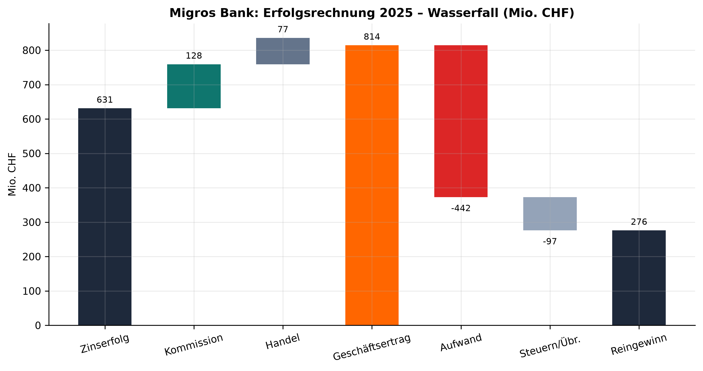
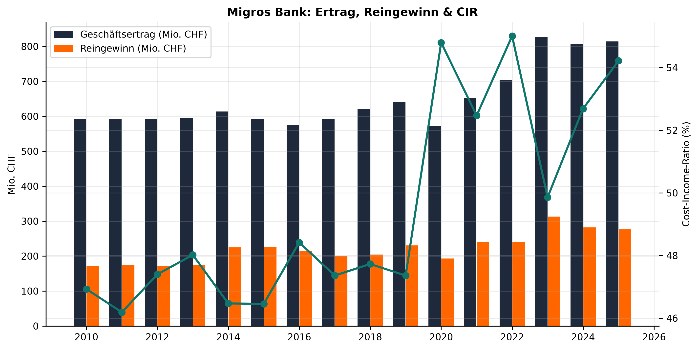

# 01 · Zinszyklen & Ertragsarchitektur (2010–2025): Migros Bank AG

> **Scope:** `standalone` | **Standard:** `ARB_RVB` | **Währung:** Mio. CHF (harmonisierte Zeitreihe)

## 1. Management Summary
- Im Zeitraum **2010–2025** entwickelte sich der Geschäftsertrag von **593,3 Mio. CHF** auf **814,4 Mio. CHF** (CAGR **2,13 % p. a.**).
- Der Reingewinn erreichte im jüngsten Geschäftsjahr 2025 **276,2 Mio. CHF** (nach 172,6 Mio. CHF im Jahr 2010).
- Der Netto-Zinserfolg trägt aktuell **77,5 %** zum Gesamtertrag bei, das Kommissionsgeschäft **15,7 %** und das Handelsgeschäft **9,4 %**.

## 2. Quantitative Entwicklung
| Jahr | Zinserfolg (Mio.) | Kommission (Mio.) | Handel (Mio.) | Geschäftsertrag | Geschäftserfolg | Reingewinn | Zinsanteil |
| --- | --- | --- | --- | --- | --- | --- | --- |
| 2010 | 473,7 | – | 39,8 | 593,3 | 314,9 | 172,6 | 79,8 % |
| 2011 | 465,5 | – | 37,8 | 591,1 | 318,1 | 174,6 | 78,8 % |
| 2012 | 477,7 | – | 34,2 | 593,4 | 312,1 | 171,7 | 80,5 % |
| 2013 | 475,1 | – | 32,3 | 596,1 | 309,9 | 174,0 | 79,7 % |
| 2014 | 488,0 | – | 35,7 | 613,9 | 328,6 | 225,2 | 79,5 % |
| 2015 | 455,1 | – | 38,9 | 593,5 | 287,7 | 226,3 | 76,7 % |
| 2016 | 460,6 | – | 33,7 | 575,3 | 266,2 | 214,6 | 80,1 % |
| 2017 | 462,6 | – | 33,5 | 591,8 | 281,4 | 200,6 | 78,2 % |
| 2018 | 473,5 | – | 33,6 | 619,8 | 287,7 | 204,2 | 76,4 % |
| 2019 | 495,7 | – | 39,7 | 639,6 | 306,1 | 230,6 | 77,5 % |
| 2020 | 492,9 | – | 36,8 | 572,3 | 236,5 | 192,9 | 86,1 % |
| 2021 | 494,5 | 115,5 | 46,1 | 652,2 | 234,3 | 240,1 | 75,8 % |
| 2022 | 531,2 | 125,7 | 49,1 | 703,0 | 291,7 | 240,5 | 75,6 % |
| 2023 | 687,0 | 108,7 | 62,5 | 827,8 | 383,0 | 313,4 | 83,0 % |
| 2024 | 631,2 | 125,1 | 73,9 | 806,6 | 341,1 | 282,1 | 78,2 % |
| 2025 | 631,1 | 128,1 | 76,5 | 814,4 | 335,2 | 276,2 | 77,5 % |

## 3. Treiberanalyse & Wendepunkte
- **2025:** Inkrafttreten Basel III final per 01.01.2025

## 4. Fazit & Ausblick
- Die Ertragsarchitektur von Migros Bank spiegelt die Zinszyklen (Negativzinsphase 2015–2022, Zinswende 2022–2024, Zinssenkungen ab 2025) unmittelbar wider.
