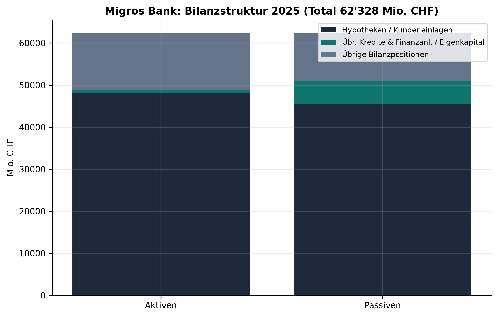
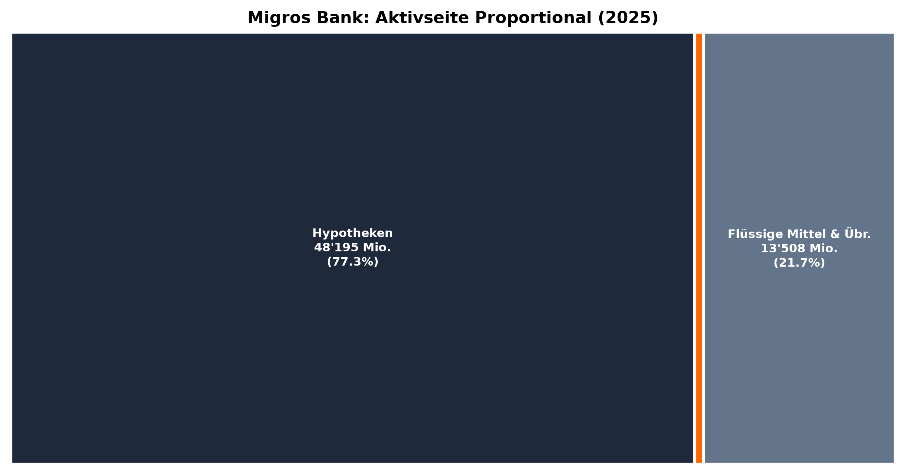
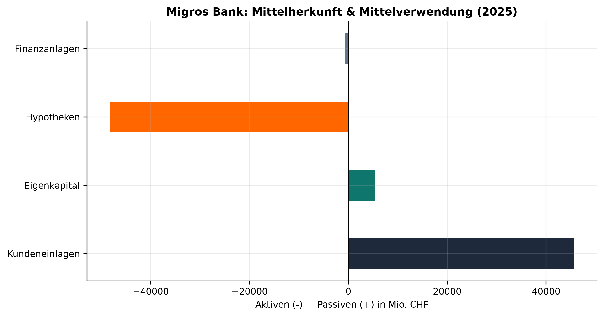
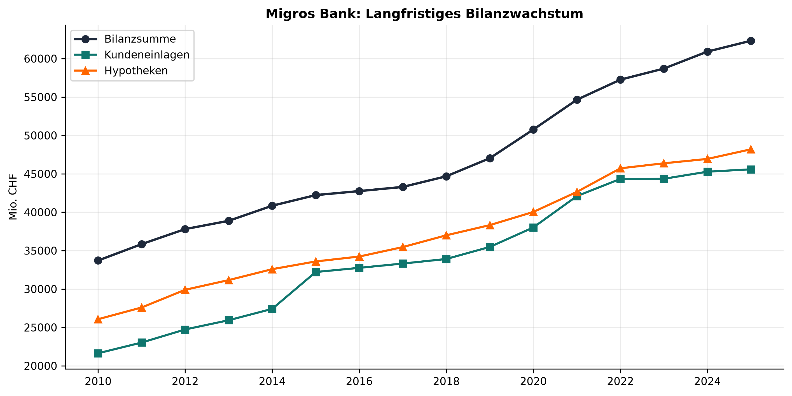

# 02 · Bilanzwachstum, Hypotheken & Refinanzierung (2010–2025): Migros Bank AG

## 1. Management Summary
- Die Bilanzsumme wuchs von **33'714,0 Mio. CHF** (2010) auf **62'327,6 Mio. CHF** (2025, CAGR **4,18 %**).
- Die Hypothekarforderungen machen im Jahr 2025 **77,3 %** der Bilanzsumme aus.
- Die Kundeneinlagen belaufen sich 2025 auf **45'583,3 Mio. CHF**, das Eigenkapital auf **5'448,3 Mio. CHF** (Eigenkapitalquote **8,74 %**).

## 2. Quantitative Entwicklung
| Jahr | Bilanzsumme | Hypotheken | Finanzanlagen | Kundeneinlagen | Eigenkapital | Deckungsgrad |
| --- | --- | --- | --- | --- | --- | --- |
| 2010 | 33'714,0 | 26'071,8 | 1'822,9 | 21'638,2 | – | 74,7 % |
| 2011 | 35'846,6 | 27'598,0 | 1'058,0 | 23'031,4 | – | 74,4 % |
| 2012 | 37'804,4 | 29'902,4 | 793,6 | 24'735,5 | – | 75,6 % |
| 2013 | 38'882,2 | 31'163,3 | 548,1 | 25'938,3 | – | 76,3 % |
| 2014 | 40'846,4 | 32'585,9 | 655,7 | 27'416,8 | – | 77,7 % |
| 2015 | 42'231,5 | 33'592,1 | 709,0 | 32'215,2 | – | 95,9 % |
| 2016 | 42'752,2 | 34'230,9 | 657,0 | 32'758,8 | – | 95,7 % |
| 2017 | 43'294,2 | 35'462,2 | 616,5 | 33'317,1 | – | 94,0 % |
| 2018 | 44'679,4 | 36'997,5 | 531,1 | 33'912,8 | – | 91,7 % |
| 2019 | 47'033,3 | 38'322,2 | 516,8 | 35'481,9 | 4'068,0 | 92,6 % |
| 2020 | 50'769,1 | 40'036,1 | 453,2 | 38'019,6 | 4'211,0 | 95,0 % |
| 2021 | 54'646,7 | 42'645,8 | 395,5 | 42'094,8 | 4'329,0 | 98,7 % |
| 2022 | 57'261,3 | 45'718,4 | 583,9 | 44'341,1 | 4'572,0 | 97,0 % |
| 2023 | 58'706,2 | 46'373,2 | 515,0 | 44'355,0 | 4'887,0 | 95,7 % |
| 2024 | 60'916,0 | 46'939,8 | 604,2 | 45'280,3 | 5'171,0 | 96,5 % |
| 2025 | 62'327,6 | 48'195,3 | 623,9 | 45'583,3 | 5'448,3 | 94,6 % |

## 3. Treiberanalyse & Wendepunkte
- **2025:** Inkrafttreten Basel III final per 01.01.2025

## 4. Fazit & Ausblick
- Refinanzierungsbasis und Bilanzstruktur bleiben eng an Kundeneinlagen und die jeweilige Geschäftsmodell-Spezialisierung gekoppelt.
