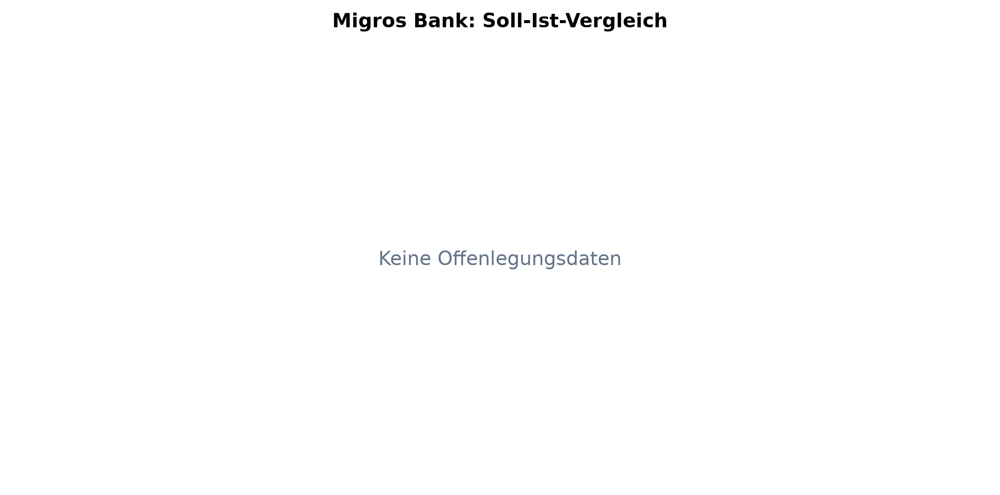
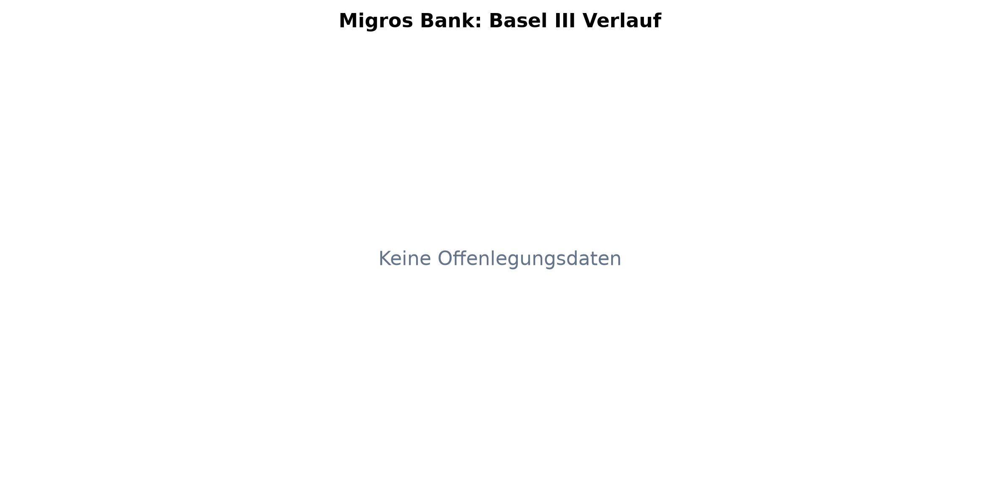

# 03 · Aufsichtsrechtliche Resilienz & Basel III: Migros Bank AG

> **FINMA-Kategorie:** Kategorie 3 | **CET1-Zielgrösse:** 10,50 % | **Gesamtkapital-Ziel:** 12,00 %

## 1. Management Summary
- Am jüngsten Offenlegungsstichtag (**–**, Regime: *Basel III*) beträgt die **CET1-Quote – %** (Puffer über Ziel: **– Prozentpunkte**).
- Die Gesamtkapitalquote liegt bei **– %**, die Leverage Ratio bei **– %**.
- Liquiditätsquoten: LCR **– %**, NSFR **– %** (Mindestanforderung je 100 %).

## 2. Quantitative Entwicklung (0 Stichtage)
| Periode | Regime | RWA (Mio.) | CET1 (Mio.) | CET1 % | Gesamtkap. % | Leverage % | LCR % | NSFR % |
| --- | --- | --- | --- | --- | --- | --- | --- | --- |

## 3. Treiberanalyse & Wendepunkte
- Mit Inkrafttreten von **Basel III final** ab 01.01.2025 verändern sich risikogewichtete Aktiven (RWA) und RWA-Dichte durch angepasste Standard- bzw. Output-Floor-Vorgaben.

## 4. Fazit & Ausblick
- Die Eigenmittel- und Liquiditätspuffer übertreffen die regulatorischen Mindestanforderungen für FINMA-Kategorie 3 deutlich.
