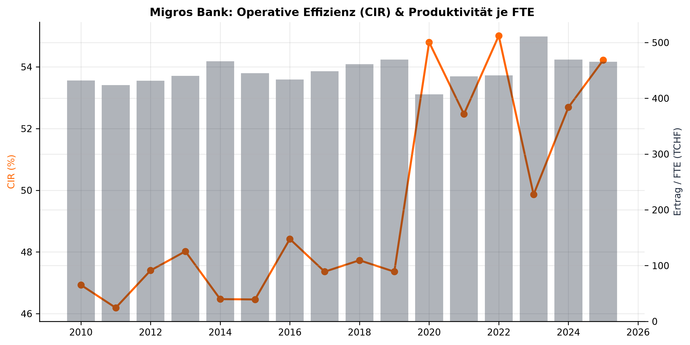

# 04 · Operative Effizienz & Transformation (2010–2025): Migros Bank AG

## 1. Management Summary
- Die Cost-Income-Ratio (CIR) liegt im Jahr 2025 bei **54,22 %** (vs. 46,93 % im Jahr 2010), die Eigenkapitalrendite (ROE) bei **5,07 %**.
- Der Personalbestand umfasst 2025 **1'749,0 FTE** bei einem Ertrag pro Vollzeitstelle von **465,7 TCHF** und einem **Lohnkosten-/Produktivitätsverhältnis von 32,6 %** (bzw. **3,07×** Ertrag je CHF Personalaufwand).
- **Personalfluktuation:** Jüngster offengelegter Wert liegt im Jahr **2025** bei **11,1 %** (*Bruttofluktuationsrate in % (natürliche Austritte ohne ordentliche Pensionierungen, befristete Verträge, Tod & interne Wechsel / Ø Monatslohn-Bestand Schweiz)*).

## 2. Quantitative Entwicklung
| Jahr | CIR % | ROE % | FTE | Fluktuation % | Ertrag/FTE (TCHF) | Lohn/FTE (TCHF) | Lohn/Ertrag % | Ertrag/Lohn | Bilanz/FTE (Mio.) |
| --- | --- | --- | --- | --- | --- | --- | --- | --- | --- |
| 2010 | 46,93 % | – % | 1'373,0 | – | 432,1 | 124,2 | 28,7 % | 3,48× | 24,56 |
| 2011 | 46,19 % | – % | 1'395,0 | – | 423,8 | 123,7 | 29,2 % | 3,42× | 25,70 |
| 2012 | 47,40 % | – % | 1'375,0 | – | 431,5 | 127,2 | 29,5 % | 3,39× | 27,49 |
| 2013 | 48,02 % | – % | 1'354,0 | – | 440,2 | 129,8 | 29,5 % | 3,39× | 28,72 |
| 2014 | 46,47 % | – % | 1'317,0 | – | 466,2 | 132,4 | 28,4 % | 3,52× | 31,01 |
| 2015 | 46,46 % | – % | 1'334,0 | – | 444,9 | 128,3 | 28,8 % | 3,47× | 31,66 |
| 2016 | 48,42 % | – % | 1'327,0 | – | 433,5 | 130,9 | 30,2 % | 3,31× | 32,22 |
| 2017 | 47,36 % | – % | 1'319,0 | – | 448,7 | 130,5 | 29,1 % | 3,44× | 32,82 |
| 2018 | 47,73 % | – % | 1'344,0 | – | 461,2 | 133,6 | 29,0 % | 3,45× | 33,24 |
| 2019 | 47,36 % | 5,67 % | 1'362,0 | – | 469,6 | 135,5 | 28,9 % | 3,46× | 34,53 |
| 2020 | 54,80 % | 4,58 % | 1'406,0 | – | 407,0 | 137,9 | 33,9 % | 2,95× | 36,11 |
| 2021 | 52,47 % | 5,55 % | 1'484,0 | – | 439,5 | 140,6 | 32,0 % | 3,13× | 36,82 |
| 2022 | 55,01 % | 5,26 % | 1'594,0 | – | 441,0 | 142,4 | 32,3 % | 3,10× | 35,92 |
| 2023 | 49,86 % | 6,41 % | 1'620,0 | – | 511,0 | 150,5 | 29,5 % | 3,40× | 36,24 |
| 2024 | 52,69 % | 5,46 % | 1'718,0 | 13,5 % | 469,5 | 147,3 | 31,4 % | 3,19× | 35,46 |
| 2025 | 54,22 % | 5,07 % | 1'749,0 | 11,1 % | 465,7 | 151,7 | 32,6 % | 3,07× | 35,64 |

## 3. Treiberanalyse & Wendepunkte
- **2025:** Inkrafttreten Basel III final per 01.01.2025

## 4. Fazit & Ausblick
- Digitalisierung und Skalierung steigern Bilanzsumme und Geschäftsvolumen pro Vollzeitstelle langfristig.
