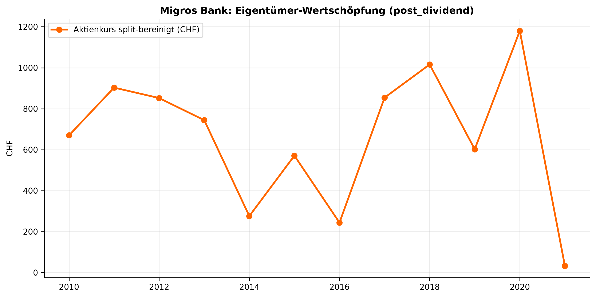

# 05 · Dividendenablieferung an Post AG & Eigentümerwert (2010–2025): Migros Bank AG

> **Eigentümer-Modus:** `post_dividend` | **Staatsgarantie:** Keine | **Ticker:** `nicht kotiert`

## 1. Management Summary
- Im Geschäftsjahr 2025 erwirtschaftete Migros Bank einen Gewinn von **276,2 Mio. CHF** bei einem Eigenkapital von **5'448,3 Mio. CHF**.
- **Eigenkapitalrendite (2025):** ROE **5,07 %** bei einem Eigenkapital von **5'448,3 Mio. CHF**.

## 2. Quantitative Entwicklung
| Jahr | Reingewinn (Mio.) | Eigenkapital (Mio.) | Aktienkurs (split-ber.) | Dividende/Aktie | Div.-Rendite | Öff. Ablieferung (Mio.) |
| --- | --- | --- | --- | --- | --- | --- |
| 2010 | 172,6 | – | 670.00 | – | – % | – |
| 2011 | 174,6 | – | 903.00 | – | – % | – |
| 2012 | 171,7 | – | 852.00 | – | – % | – |
| 2013 | 174,0 | – | 744.00 | – | – % | – |
| 2014 | 225,2 | – | 276.00 | – | – % | – |
| 2015 | 226,3 | – | 571.00 | – | – % | – |
| 2016 | 214,6 | – | 244.00 | – | – % | – |
| 2017 | 200,6 | – | 854.00 | – | – % | – |
| 2018 | 204,2 | – | 1'016.00 | – | – % | – |
| 2019 | 230,6 | 4'068,0 | 602.00 | – | – % | – |
| 2020 | 192,9 | 4'211,0 | 1'180.00 | – | – % | – |
| 2021 | 240,1 | 4'329,0 | 33.00 | – | – % | – |
| 2022 | 240,5 | 4'572,0 | – | – | – % | – |
| 2023 | 313,4 | 4'887,0 | – | – | – % | – |
| 2024 | 282,1 | 5'171,0 | – | – | – % | – |
| 2025 | 276,2 | 5'448,3 | – | – | – % | – |

## 3. Treiberanalyse & Wendepunkte (Investoren-Perspektive)
- Bei kotierten Instituten mit Aktiensplits (z. B. BCV 1:10 im Jahr 2020) sind sämtliche historischen Kurs- und Dividendenreihen deterministisch split-bereinigt.
- Im Branchenvergleich (siehe `comparison/reports/06_investoren_branchenvergleich.md`) werden P/B, P/E, Dividendenrendite und Eigentümer-Ablieferungen über alle 19 Institute eingeordnet.

## 4. Fazit, Führungsleistung & Ausblick
- Stabile Ertragskraft sichert langfristig Dividendenkontinuität bzw. verlässliche Ablieferungen an Kanton, Post oder Genossenschafter.
- Die detaillierte Leistungsbilanz von CEO und Verwaltungsratspräsidium aus Investoren- und Eigentümersicht findet sich im [CEO & Chairman of the Board Achievement Report](./08_ceo_und_vrp_leistungsbericht.md).
