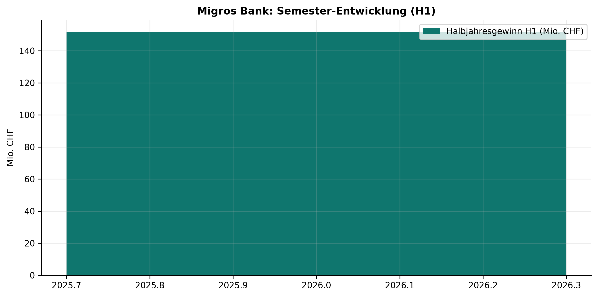

# 06 · Unterjährige Dynamik (Semesterberichte): Migros Bank AG

## 1. Management Summary
- Vorliegen von **4 Halbjahresabschlüssen**; jüngster Stichtag ist **H1-2026** mit einem Geschäftsertrag von **433,8 Mio. CHF** und einem Halbjahresgewinn von **151,5 Mio. CHF**.

## 2. Quantitative Entwicklung
| Periode | Bilanzsumme | Zinserfolg H1 | Geschäftsertrag H1 | Geschäftserfolg H1 | Reingewinn H1 |
| --- | --- | --- | --- | --- | --- |
| H1-2023 | 58'428,3 | 340,8 | 414,9 | 201,8 | – |
| H1-2024 | 59'583,8 | 320,0 | 402,3 | 186,5 | – |
| H1-2025 | 61'806,6 | 306,4 | 399,7 | 161,7 | – |
| H1-2026 | 63'341,5 | 326,4 | 433,8 | 185,5 | 151,5 |

## 3. Treiberanalyse & Wendepunkte
- Der Vergleich von H1-Werten gegen die jeweiligen Gesamtjahresergebnisse (FY) zeigt die saisonale Ertragsverteilung und Reservebildung im zweiten Halbjahr.

## 4. Fazit & Ausblick
- Die Halbjahresberichte ermöglichen ein zeitnahes Monitoring der Zinsmargen- und Kreditvolumen-Dynamik bis H1-2026.
