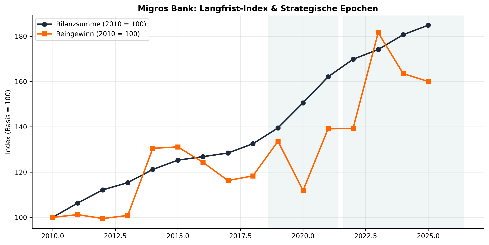
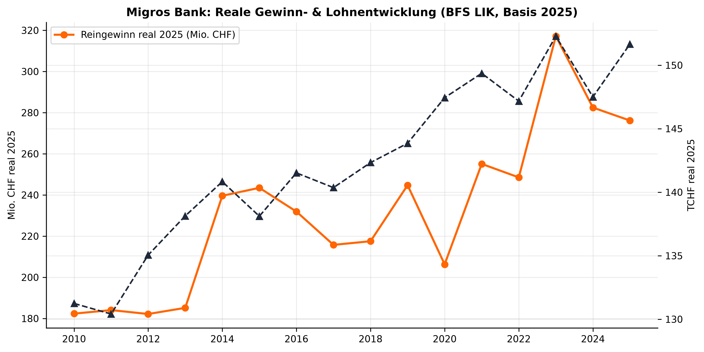

# 07 · Strategische Epochen, Governance, reale Vergütung & Vorsorge (2010–2025): Migros Bank AG

> **Preisbasis:** Sämtliche Realgrössen sind mit dem offiziellen **BFS Landesindex der Konsumentenpreise (LIK, Dez. 1982 = 100)** deterministisch auf **reale CHF 2025** deflationiert.

## 1. Management Summary & Strategische Epochen
- **Epoche 1 (2019–2021):** SNB-Negativzinsen & Hypothekenwachstum
- **Epoche 2 (2022–2026):** Zinswende & Basel III final

## 2. Reale Gewinn-, Lohn- & Vergütungsentwicklung (real 2025 CHF)
| Jahr | Gewinn nom. | Gewinn real 2025 | Lohn/FTE real (TCHF) | VR real (TCHF) | CEO real (TCHF) | GL real (TCHF) |
| --- | --- | --- | --- | --- | --- | --- |
| 2010 | 172,6 | 182,4 | 131,2 | – | – | – |
| 2011 | 174,6 | 184,1 | 130,4 | – | – | – |
| 2012 | 171,7 | 182,2 | 135,1 | – | – | – |
| 2013 | 174,0 | 185,2 | 138,1 | – | – | – |
| 2014 | 225,2 | 239,6 | 140,8 | – | – | – |
| 2015 | 226,3 | 243,5 | 138,1 | – | – | – |
| 2016 | 214,6 | 231,9 | 141,5 | – | – | – |
| 2017 | 200,6 | 215,8 | 140,4 | – | – | – |
| 2018 | 204,2 | 217,5 | 142,3 | – | – | – |
| 2019 | 230,6 | 244,8 | 143,8 | – | – | – |
| 2020 | 192,9 | 206,3 | 147,4 | – | – | – |
| 2021 | 240,1 | 255,1 | 149,4 | – | – | – |
| 2022 | 240,5 | 248,6 | 147,2 | – | – | – |
| 2023 | 313,4 | 317,1 | 152,3 | – | – | – |
| 2024 | 282,1 | 282,5 | 147,5 | – | – | – |
| 2025 | 276,2 | 276,2 | 151,7 | – | – | – |

## 3. Arbeitgeber-Attraktivität & Vorsorgeeinrichtung (Pensionskasse)
- **Vorsorgeeinrichtung:** Migros-Pensionskasse (MPK) (*Beitragsprimat (Konzern-Pensionskasse)*, Basis: `Swiss GAAP FER 16 / ARB`)
- **Versichertenstruktur:** Aktive **–**, Rentner **–** (Verhältnis Aktive/Rentner: **–**)
- **Deckungsgrad (BVG) / Reserven:** Deckungsgrad **– %**, Arbeitgeberbeitragsreserve **0,0 Mio. CHF**, Sondereinlagen **0,0 Mio. CHF**
- **CEO-zu-Mitarbeitenden-Pay-Ratio (2025):** **–×** (CEO real 2025: – TCHF vs. Ø Personalaufwand/FTE: 151,7 TCHF)
- **Quelle:** `migrosbank/.md/migrosbank-geschaeftsbericht-2025.md (Anhang Ziff. 9)` — Keine eigenständige PK; Vorsorge über Migros-Pensionskasse (MPK). Verpflichtungen gegenüber PK per 31.12.2025 CHF 16,163 Mio. (2024: 19,249 Mio.); keine AGBR aktiviert.

## 4. Treiberanalyse, Strukturbrüche & Ausblick
- **2025:** Inkrafttreten Basel III final per 01.01.2025
- Die gemeinsame Inflationsbereinigung auf `real 2025 CHF` ermöglicht den unverzerrten Vergleich von Produktivität, Reallöhnen, Pay Ratio und Pensionskassen-Resilienz im Branchenvergleich (`comparison/reports/07_mitarbeiter_und_vorsorge_branchenvergleich.md`).
