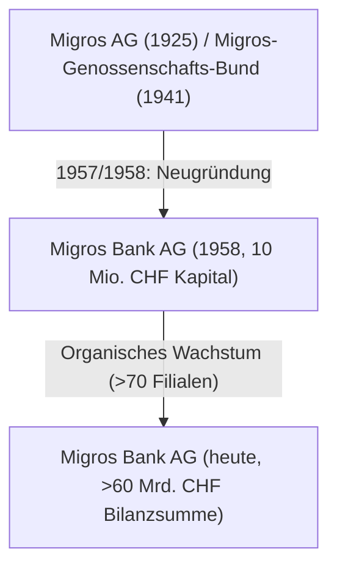

# 10 · Fusionsbaum & Institutsgeschichte seit 1900: Migros Bank AG

> **Gründung / Ursprung:** 1958 (Migros Bank AG, Tochter des Migros-Genossenschafts-Bundes) | **Aktuelle Rechtsform:** `ag_unlisted` | **FINMA-Kategorie:** 3

## 1. Überblick der Institutslinie (1900–2026)
Die Migros Bank AG wurde Ende 1957 ins Handelsregister eingetragen und nahm 1958 auf Initiative von Gottlieb Duttweiler (Migros-Genossenschafts-Bund, gegr. 1925) den Betrieb auf. Seit ihrer Gründung wuchs die Bank rein organisch innerhalb der Migros-Gruppe zu einer der grössten Schweizer Retail- und Hypothekarbanken.

## 2. Fusionsbaum (Mermaid-Diagramm seit 1900)

## 3. Chronologische Meilensteine (Fusionen, Übernahmen & Rechtsformwechsel)
| Jahr / Zeitraum | Institut / Ereignis | Typ | Bedeutung & Auswirkung |
| --- | --- | --- | --- |
| 1925 / 1941 | Gründung Migros AG & Umwandlung in MGB | Mutterkonzern | Genossenschaftlicher Hintergrund durch Gottlieb Duttweiler |
| 1957–1958 | Gründung der Migros Bank AG | Neugründung | Eintrag Ende 1957 mit 10 Mio. CHF Aktienkapital; Eröffnung 1958 für günstige Kredite & Sparzinsen |
| 1958–2026 | Organischer Filial- und Digitalausbau | Kontinuität | Ausbau auf >70 Filialen, Direct-Banking und >62 Mrd. CHF Bilanzsumme ohne Grossfusionen |

- **Quellenbasis:** `Migros-Chronik (corporate.migros.ch); Migros Bank Geschäftsberichte (2010–2025)`
