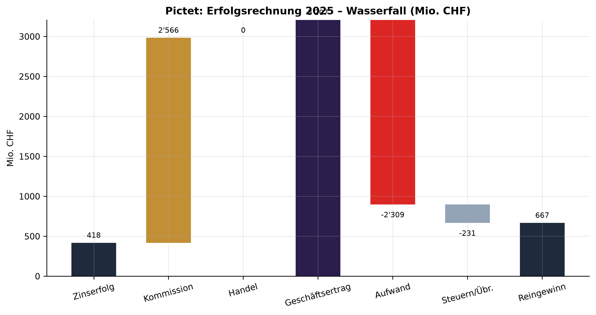
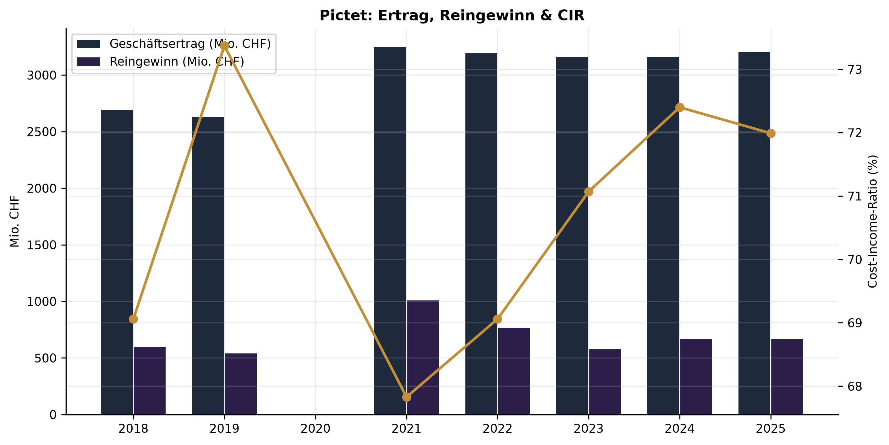

# 01 · Zinszyklen & Ertragsarchitektur (2018–2025): Pictet Gruppe (Pictet & Cie Group SCA)

> **Scope:** `consolidated` | **Standard:** `ARB_RVB` | **Währung:** Mio. CHF (harmonisierte Zeitreihe)

## 1. Management Summary
- Im Zeitraum **2018–2025** entwickelte sich der Geschäftsertrag von **2'693,8 Mio. CHF** auf **3'206,8 Mio. CHF** (CAGR **2,52 % p. a.**).
- Der Reingewinn erreichte im jüngsten Geschäftsjahr 2025 **667,2 Mio. CHF** (nach 595,9 Mio. CHF im Jahr 2018).
- Der Netto-Zinserfolg trägt aktuell **13,0 %** zum Gesamtertrag bei, das Kommissionsgeschäft **80,0 %** und das Handelsgeschäft **– %**.

## 2. Quantitative Entwicklung
| Jahr | Zinserfolg (Mio.) | Kommission (Mio.) | Handel (Mio.) | Geschäftsertrag | Geschäftserfolg | Reingewinn | Zinsanteil |
| --- | --- | --- | --- | --- | --- | --- | --- |
| 2018 | 291,8 | 2'222,3 | – | 2'693,8 | 762,6 | 595,9 | 10,8 % |
| 2019 | 260,5 | 2'216,4 | – | 2'628,7 | 606,1 | 539,1 | 9,9 % |
| 2021 | 163,8 | 2'886,3 | – | 3'251,3 | 923,6 | 1'007,9 | 5,0 % |
| 2022 | 391,5 | 2'597,0 | – | 3'191,2 | 929,5 | 767,9 | 12,3 % |
| 2023 | 582,8 | 2'404,1 | – | 3'161,5 | 737,1 | 576,7 | 18,4 % |
| 2024 | 491,7 | 2'474,5 | – | 3'160,2 | 816,3 | 665,4 | 15,6 % |
| 2025 | 417,6 | 2'565,8 | – | 3'206,8 | 846,1 | 667,2 | 13,0 % |

## 3. Treiberanalyse & Wendepunkte
- **2025:** Inkrafttreten Basel III final per 01.01.2025

## 4. Fazit & Ausblick
- Die Ertragsarchitektur von Pictet spiegelt die Zinszyklen (Negativzinsphase 2015–2022, Zinswende 2022–2024, Zinssenkungen ab 2025) unmittelbar wider.
