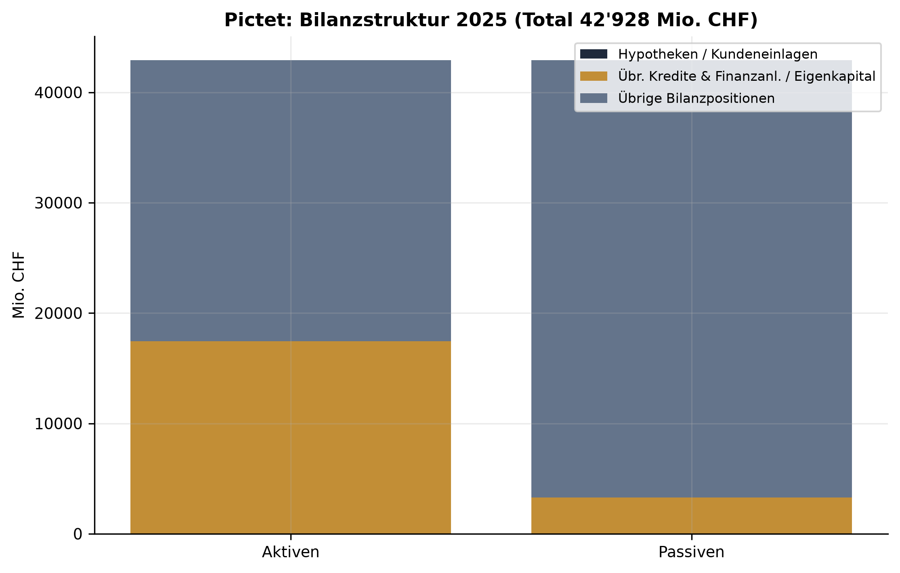
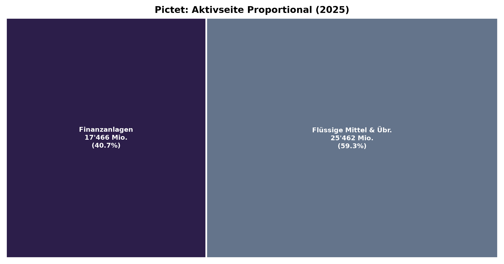
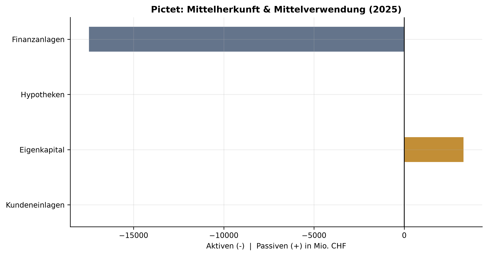
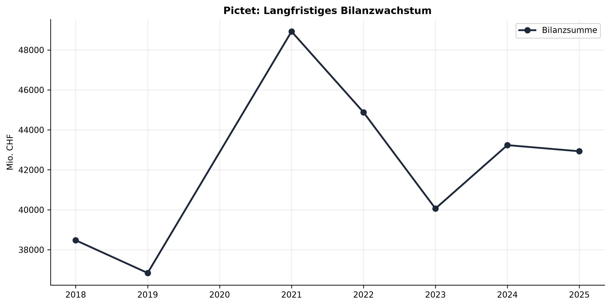

# 02 · Bilanzwachstum, Hypotheken & Refinanzierung (2018–2025): Pictet Gruppe (Pictet & Cie Group SCA)

## 1. Management Summary
- Die Bilanzsumme wuchs von **38'474,2 Mio. CHF** (2018) auf **42'928,1 Mio. CHF** (2025, CAGR **1,58 %**).
- Die Hypothekarforderungen machen im Jahr 2025 **– %** der Bilanzsumme aus.
- Die Kundeneinlagen belaufen sich 2025 auf **– Mio. CHF**, das Eigenkapital auf **3'283,5 Mio. CHF** (Eigenkapitalquote **7,65 %**).

## 2. Quantitative Entwicklung
| Jahr | Bilanzsumme | Hypotheken | Finanzanlagen | Kundeneinlagen | Eigenkapital | Deckungsgrad |
| --- | --- | --- | --- | --- | --- | --- |
| 2018 | 38'474,2 | – | 8'788,0 | – | 2'945,8 | – % |
| 2019 | 36'836,5 | – | 9'960,3 | – | 3'131,1 | – % |
| 2021 | 48'923,7 | – | 15'379,9 | – | 3'679,9 | – % |
| 2022 | 44'881,3 | – | 18'435,9 | – | 4'154,6 | – % |
| 2023 | 40'060,3 | – | 12'893,5 | – | 4'103,6 | – % |
| 2024 | 43'236,2 | – | 16'047,8 | – | 3'782,0 | – % |
| 2025 | 42'928,1 | – | 17'466,0 | – | 3'283,5 | – % |

## 3. Treiberanalyse & Wendepunkte
- **2025:** Inkrafttreten Basel III final per 01.01.2025

## 4. Fazit & Ausblick
- Refinanzierungsbasis und Bilanzstruktur bleiben eng an Kundeneinlagen und die jeweilige Geschäftsmodell-Spezialisierung gekoppelt.
