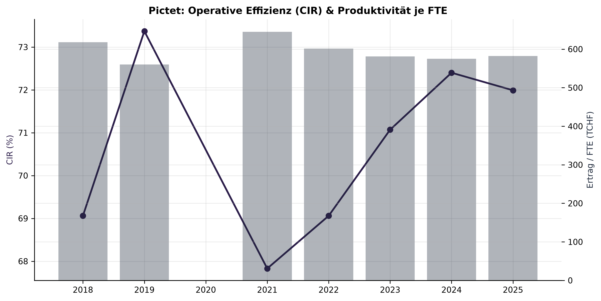

# 04 · Operative Effizienz & Transformation (2018–2025): Pictet Gruppe (Pictet & Cie Group SCA)

## 1. Management Summary
- Die Cost-Income-Ratio (CIR) liegt im Jahr 2025 bei **71,99 %** (vs. 69,06 % im Jahr 2018), die Eigenkapitalrendite (ROE) bei **20,32 %**.
- Der Personalbestand umfasst 2025 **5'507,0 FTE** bei einem Ertrag pro Vollzeitstelle von **582,3 TCHF** und einem **Lohnkosten-/Produktivitätsverhältnis von 50,3 %** (bzw. **1,99×** Ertrag je CHF Personalaufwand).

## 2. Quantitative Entwicklung
| Jahr | CIR % | ROE % | FTE | Ertrag/FTE (TCHF) | Lohn/FTE (TCHF) | Lohn/Ertrag % | Ertrag/Lohn | Bilanz/FTE (Mio.) |
| --- | --- | --- | --- | --- | --- | --- | --- | --- |
| 2018 | 69,06 % | 20,23 % | 4'358,0 | 618,1 | 302,8 | 49,0 % | 2,04× | 8,83 |
| 2019 | 73,37 % | 17,22 % | 4'694,0 | 560,0 | 285,3 | 51,0 % | 1,96× | 7,85 |
| 2021 | 67,83 % | 27,39 % | 5'040,0 | 645,1 | 319,0 | 49,5 % | 2,02× | 9,71 |
| 2022 | 69,06 % | 18,48 % | 5'307,0 | 601,3 | 290,4 | 48,3 % | 2,07× | 8,46 |
| 2023 | 71,07 % | 14,05 % | 5'439,0 | 581,3 | 281,3 | 48,4 % | 2,07× | 7,37 |
| 2024 | 72,40 % | 17,59 % | 5'496,0 | 575,0 | 286,2 | 49,8 % | 2,01× | 7,87 |
| 2025 | 71,99 % | 20,32 % | 5'507,0 | 582,3 | 293,2 | 50,3 % | 1,99× | 7,80 |

## 3. Treiberanalyse & Wendepunkte
- **2025:** Inkrafttreten Basel III final per 01.01.2025

## 4. Fazit & Ausblick
- Digitalisierung und Skalierung steigern Bilanzsumme und Geschäftsvolumen pro Vollzeitstelle langfristig.
