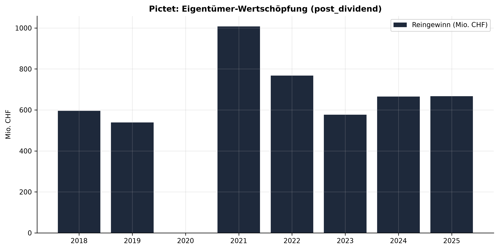

# 05 · Dividendenablieferung an Post AG & Eigentümerwert (2018–2025): Pictet Gruppe (Pictet & Cie Group SCA)

> **Eigentümer-Modus:** `post_dividend` | **Staatsgarantie:** Keine | **Ticker:** `nicht kotiert`

## 1. Management Summary
- Im Geschäftsjahr 2025 erwirtschaftete Pictet einen Gewinn von **667,2 Mio. CHF** bei einem Eigenkapital von **3'283,5 Mio. CHF**.
- **Eigenkapitalrendite (2025):** ROE **20,32 %** bei einem Eigenkapital von **3'283,5 Mio. CHF**.

## 2. Quantitative Entwicklung
| Jahr | Reingewinn (Mio.) | Eigenkapital (Mio.) | Aktienkurs (split-ber.) | Dividende/Aktie | Div.-Rendite | Öff. Ablieferung (Mio.) |
| --- | --- | --- | --- | --- | --- | --- |
| 2018 | 595,9 | 2'945,8 | – | – | – % | – |
| 2019 | 539,1 | 3'131,1 | – | – | – % | – |
| 2021 | 1'007,9 | 3'679,9 | – | – | – % | – |
| 2022 | 767,9 | 4'154,6 | – | – | – % | – |
| 2023 | 576,7 | 4'103,6 | – | – | – % | – |
| 2024 | 665,4 | 3'782,0 | – | – | – % | – |
| 2025 | 667,2 | 3'283,5 | – | – | – % | – |

## 3. Treiberanalyse & Wendepunkte (Investoren-Perspektive)
- Bei kotierten Instituten mit Aktiensplits (z. B. BCV 1:10 im Jahr 2020) sind sämtliche historischen Kurs- und Dividendenreihen deterministisch split-bereinigt.
- Im Branchenvergleich (siehe `comparison/reports/06_investoren_branchenvergleich.md`) werden P/B, P/E, Dividendenrendite und Eigentümer-Ablieferungen über alle 8 Institute eingeordnet.

## 4. Fazit, Führungsleistung & Ausblick
- Stabile Ertragskraft sichert langfristig Dividendenkontinuität bzw. verlässliche Ablieferungen an Kanton, Post oder Genossenschafter.
- Die detaillierte Leistungsbilanz von CEO und Verwaltungsratspräsidium aus Investoren- und Eigentümersicht findet sich im [CEO & Chairman of the Board Achievement Report](./08_ceo_und_vrp_leistungsbericht.md).
