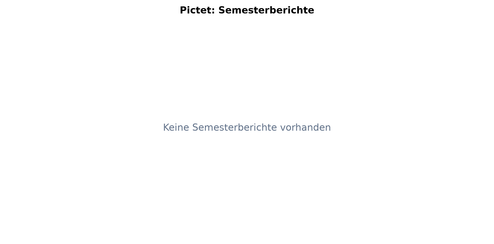

# 06 · Unterjährige Dynamik (Semesterberichte): Pictet Gruppe (Pictet & Cie Group SCA)

## 1. Management Summary
- Vorliegen von **1 Halbjahresabschlüssen**; jüngster Stichtag ist **H1-2025** mit einem Geschäftsertrag von **1'570,2 Mio. CHF** und einem Halbjahresgewinn von **– Mio. CHF**.

## 2. Quantitative Entwicklung
| Periode | Bilanzsumme | Zinserfolg H1 | Geschäftsertrag H1 | Geschäftserfolg H1 | Reingewinn H1 |
| --- | --- | --- | --- | --- | --- |
| H1-2025 | 43'710,9 | 224,4 | 1'570,2 | 419,6 | – |

## 3. Treiberanalyse & Wendepunkte
- Der Vergleich von H1-Werten gegen die jeweiligen Gesamtjahresergebnisse (FY) zeigt die saisonale Ertragsverteilung und Reservebildung im zweiten Halbjahr.

## 4. Fazit & Ausblick
- Die Halbjahresberichte ermöglichen ein zeitnahes Monitoring der Zinsmargen- und Kreditvolumen-Dynamik bis H1-2026.
