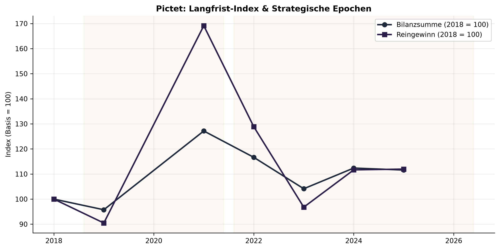
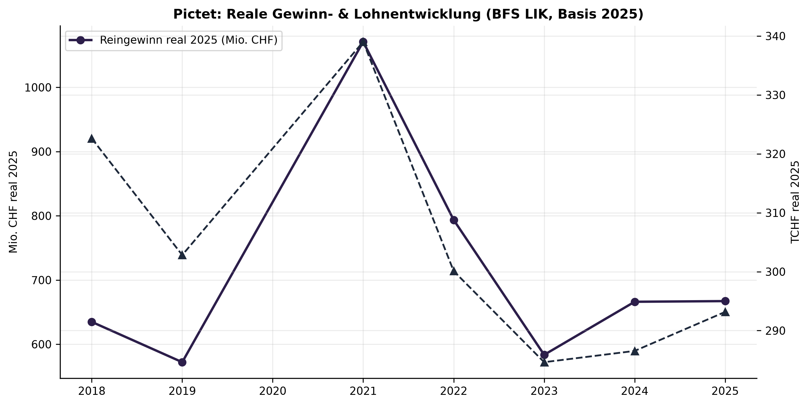

# 07 · Strategische Epochen, Governance, reale Vergütung & Vorsorge (2018–2025): Pictet Gruppe (Pictet & Cie Group SCA)

> **Preisbasis:** Sämtliche Realgrössen sind mit dem offiziellen **BFS Landesindex der Konsumentenpreise (LIK, Dez. 1982 = 100)** deterministisch auf **reale CHF 2025** deflationiert.

## 1. Management Summary & Strategische Epochen
- **Epoche 1 (2019–2021):** Negativzinsphase & AuM-Rekordwachstum
- **Epoche 2 (2022–2026):** Zinswende & Basel III final

## 2. Reale Gewinn-, Lohn- & Vergütungsentwicklung (real 2025 CHF)
| Jahr | Gewinn nom. | Gewinn real 2025 | Lohn/FTE real (TCHF) | VR real (TCHF) | CEO real (TCHF) | GL real (TCHF) |
| --- | --- | --- | --- | --- | --- | --- |
| 2018 | 595,9 | 634,8 | 322,6 | – | – | – |
| 2019 | 539,1 | 572,1 | 302,8 | – | – | – |
| 2021 | 1'007,9 | 1'071,0 | 339,0 | – | – | – |
| 2022 | 767,9 | 793,6 | 300,1 | – | – | – |
| 2023 | 576,7 | 583,6 | 284,6 | – | – | – |
| 2024 | 665,4 | 666,2 | 286,6 | – | – | – |
| 2025 | 667,2 | 667,2 | 293,2 | – | – | – |

## 3. Arbeitgeber-Attraktivität & Vorsorgeeinrichtung (Pensionskasse)
- **Vorsorgeeinrichtung:** Fondation de prévoyance du Groupe Pictet (*Beitragsprimat (unabhängige Genfer Stiftung)*, Basis: `Swiss GAAP FER 26 / ARB`)
- **Versichertenstruktur:** Aktive **–**, Rentner **–** (Verhältnis Aktive/Rentner: **–**)
- **Deckungsgrad (BVG) / Reserven:** Deckungsgrad **122,7 %**, Arbeitgeberbeitragsreserve **– Mio. CHF**, Sondereinlagen **0,0 Mio. CHF**
- **CEO-zu-Mitarbeitenden-Pay-Ratio (2025):** **–×** (CEO real 2025: – TCHF vs. Ø Personalaufwand/FTE: 293,2 TCHF)
- **Quelle:** `pictet/.md/pictet-geschaeftsbericht-2025.md (Note 11 Disclosures on pension schemes)` — Unabhängige Vorsorgeeinrichtung (Kanton Genf, FER 26); Deckungsgrad Ende 2025 122,7 % (2024: 119,3 %); Wertschwankungsreserve 25 % der Vorsorgeverpflichtungen.

## 4. Treiberanalyse, Strukturbrüche & Ausblick
- **2025:** Inkrafttreten Basel III final per 01.01.2025
- Die gemeinsame Inflationsbereinigung auf `real 2025 CHF` ermöglicht den unverzerrten Vergleich von Produktivität, Reallöhnen, Pay Ratio und Pensionskassen-Resilienz im Branchenvergleich (`comparison/reports/07_mitarbeiter_und_vorsorge_branchenvergleich.md`).
