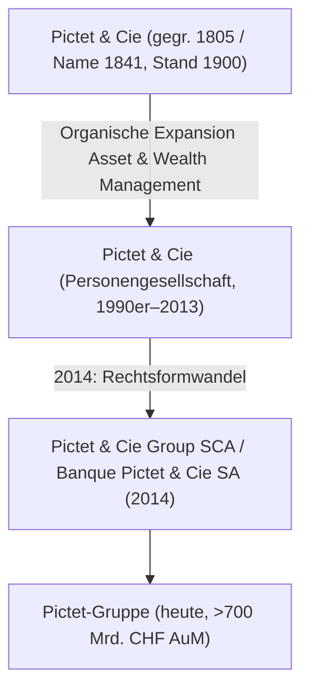

# 10 · Fusionsbaum & Institutsgeschichte seit 1900: Pictet Gruppe (Pictet & Cie Group SCA)

> **Gründung / Ursprung:** 1805 (De Candolle, Mallet & Cie → 1841 Pictet & Cie → 2014 Banque Pictet & Cie SA) | **Aktuelle Rechtsform:** `partnership_sca` | **FINMA-Kategorie:** 3

## 1. Überblick der Institutslinie (1900–2026)
Die Pictet-Gruppe geht auf die 1805 in Genf gegründete Bank De Candolle, Mallet & Cie zurück (seit 1841 unter dem Namen Pictet & Cie). Seit 1900 wuchs die Privatbank nahezu vollständig organisch durch ihre Teilhaberstruktur; 2014 erfolgte die historische Umwandlung von einer unbeschränkt haftenden Personengesellschaft in eine Kapitalgesellschaft-Gruppe (Pictet & Cie Group SCA / Banque Pictet & Cie SA).

## 2. Fusionsbaum (Mermaid-Diagramm seit 1900)

## 3. Chronologische Meilensteine (Fusionen, Übernahmen & Rechtsformwechsel)
| Jahr / Zeitraum | Institut / Ereignis | Typ | Bedeutung & Auswirkung |
| --- | --- | --- | --- |
| 1805 / 1841 / 1900 | De Candolle, Mallet & Cie → Pictet & Cie | Ausgangslage 1900 | Genfer Privatbankier-Partnerschaft mit internationaler Vermögensverwaltung |
| 1974–2013 | Aufbau Asset Management & Institutional Custody | Organisches Wachstum | Globale Expansion nach London, Luxemburg, Tokio, Hongkong und Singapur ohne Grossfusionen |
| 2014 | Umwandlung in Pictet & Cie Group SCA & Banque Pictet & Cie SA | Rechtsformwechsel | Übergang von der Kommanditgesellschaft zur modernen Konzernstruktur mit Kommanditaktiengesellschaft |

- **Quellenbasis:** `Pictet Annual Review (2018–2025); Pictet Group Corporate History`
