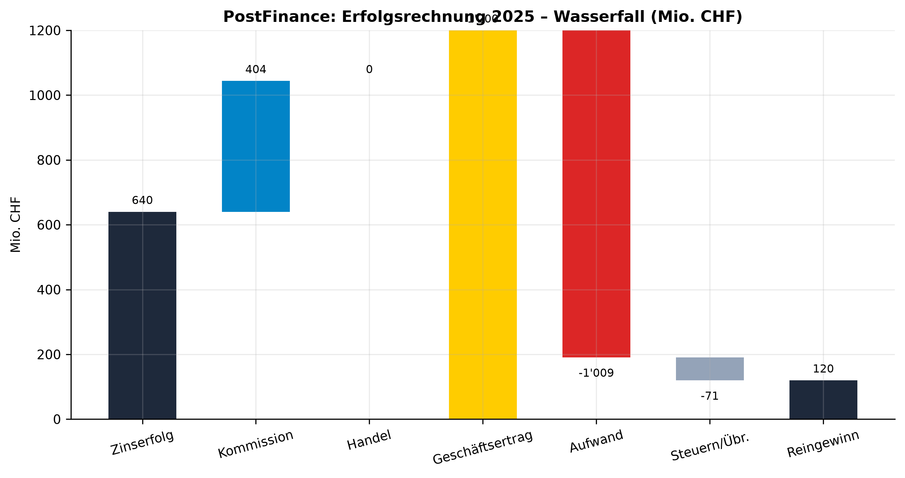
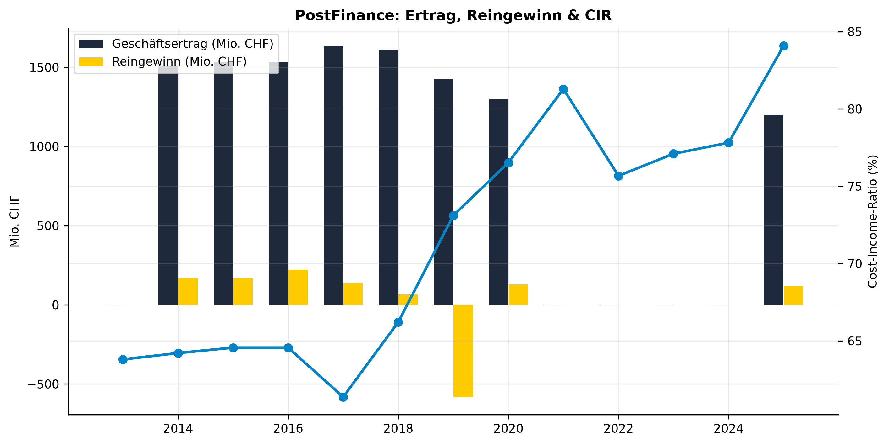

# 01 · Zinszyklen & Ertragsarchitektur (2013–2025): PostFinance AG

> **Scope:** `standalone` | **Standard:** `ARB_RVB` | **Währung:** Mio. CHF (harmonisierte Zeitreihe)

## 1. Management Summary
- Im Zeitraum **2013–2025** entwickelte sich der Geschäftsertrag von **1,5 Mio. CHF** auf **1'200,0 Mio. CHF** (CAGR **74,80 % p. a.**).
- Der Reingewinn erreichte im jüngsten Geschäftsjahr 2025 **120,0 Mio. CHF** (nach 0,0 Mio. CHF im Jahr 2013).
- Der Netto-Zinserfolg trägt aktuell **53,3 %** zum Gesamtertrag bei, das Kommissionsgeschäft **33,7 %** und das Handelsgeschäft **– %**.

## 2. Quantitative Entwicklung
| Jahr | Zinserfolg (Mio.) | Kommission (Mio.) | Handel (Mio.) | Geschäftsertrag | Geschäftserfolg | Reingewinn | Zinsanteil |
| --- | --- | --- | --- | --- | --- | --- | --- |
| 2013 | 934,0 | 0,2 | 0,0 | 1,5 | 0,5 | 0,0 | 63'322,0 % |
| 2014 | 965,0 | 175,0 | 21,0 | 1'506,0 | 539,0 | 167,0 | 64,1 % |
| 2015 | 953,0 | 198,0 | 25,0 | 1'535,0 | 276,0 | 167,0 | 62,1 % |
| 2016 | 953,0 | 198,0 | 27,0 | 1'535,0 | 276,0 | 221,0 | 62,1 % |
| 2017 | 921,0 | 227,0 | 27,0 | 1'636,0 | 349,0 | 136,0 | 56,3 % |
| 2018 | 864,0 | 255,0 | 27,0 | 1'610,0 | 166,0 | 66,0 | 53,7 % |
| 2019 | 719,0 | 276,0 | 27,0 | 1'428,0 | 87,0 | -582,0 | 50,4 % |
| 2020 | 565,0 | 346,0 | 26,0 | 1'299,0 | -597,0 | 129,0 | 43,5 % |
| 2021 | 0,6 | 0,3 | 0,0 | 1,2 | 0,1 | 0,2 | 46,3 % |
| 2022 | 0,6 | 0,4 | 0,0 | 1,3 | 0,2 | 0,2 | 42,1 % |
| 2023 | 0,5 | 0,4 | 0,0 | 1,2 | 0,2 | 0,2 | 40,9 % |
| 2024 | 0,5 | 343,0 | 0,0 | 1,2 | 0,2 | 0,2 | 41,4 % |
| 2025 | 640,0 | 404,0 | – | 1'200,0 | – | 120,0 | 53,3 % |

## 3. Treiberanalyse & Wendepunkte
- **2013:** Ausgründung als AG unter FINMA-Aufsicht (mit Kreditverbot)
- **2023:** Zinswende-Effekt auf SNB-Guthaben & Finanzanlagen
- **2025:** Inkrafttreten Basel III final per 01.01.2025

## 4. Fazit & Ausblick
- Die Ertragsarchitektur von PostFinance spiegelt die Zinszyklen (Negativzinsphase 2015–2022, Zinswende 2022–2024, Zinssenkungen ab 2025) unmittelbar wider.
