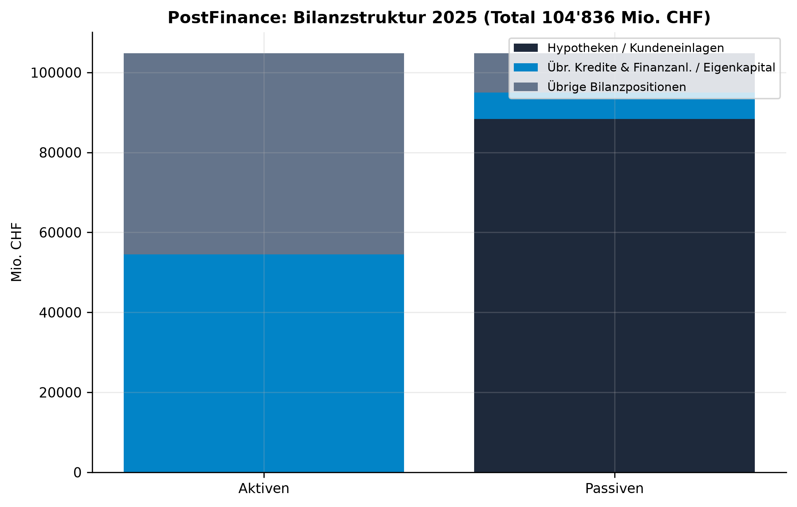
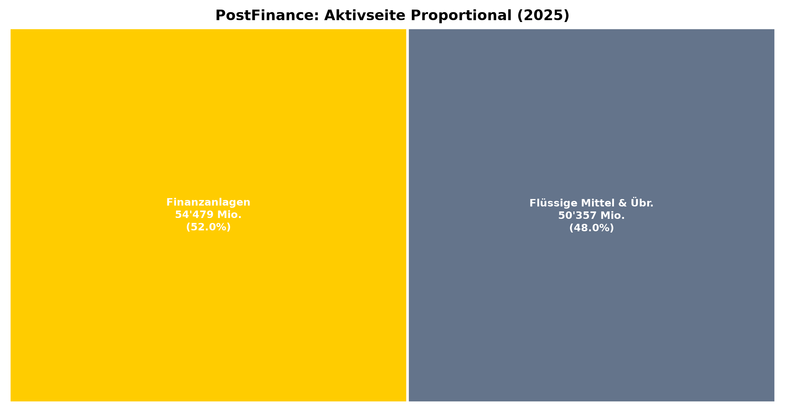
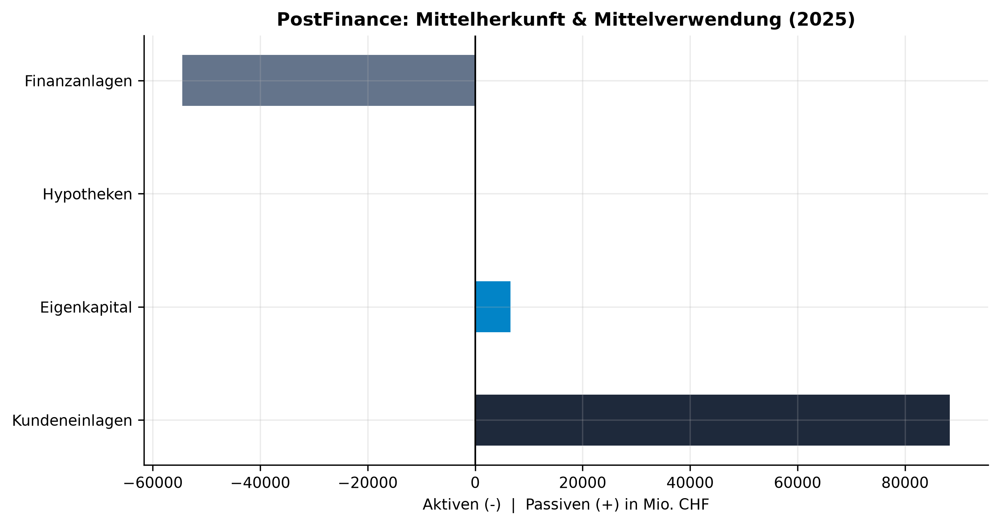
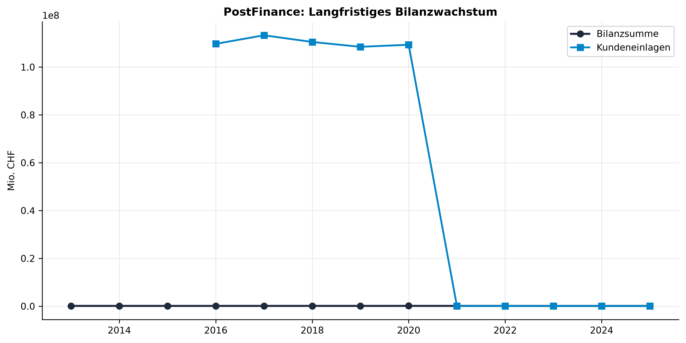

# 02 · Bilanzwachstum, Hypotheken & Refinanzierung (2013–2025): PostFinance AG

## 1. Management Summary
- Die Bilanzsumme wuchs von **115'193,0 Mio. CHF** (2013) auf **104'836,0 Mio. CHF** (2025, CAGR **-0,78 %**).
- Aufgrund des gesetzlichen **Kreditverbots (`has_credit_ban: true`)** weist PostFinance keine Hypothekarforderungen aus; die Aktivseite wird von Finanzanlagen und SNB-Guthaben dominiert.
- Die Kundeneinlagen belaufen sich 2025 auf **88'326,0 Mio. CHF**, das Eigenkapital auf **6'608,0 Mio. CHF** (Eigenkapitalquote **6,30 %**).

## 2. Quantitative Entwicklung
| Jahr | Bilanzsumme | Hypotheken | Finanzanlagen | Kundeneinlagen | Eigenkapital | Deckungsgrad |
| --- | --- | --- | --- | --- | --- | --- |
| 2013 | 115'193,0 | 1,0 | 66'697,0 | – | – | – % |
| 2014 | 118'829,0 | 0,0 | 72'705,0 | – | – | – % |
| 2015 | 114'468,0 | 0,0 | 72'385,0 | – | – | – % |
| 2016 | 114'468,0 | 6'000,0 | 72'385,0 | 109'709'000,0 | – | 914'241,7 % |
| 2017 | 119'435,0 | 0,0 | 79'166,0 | 113'292'000,0 | – | 930,7 % |
| 2018 | 120'848,0 | 0,0 | 79'309,0 | 110'501'000,0 | – | 946,4 % |
| 2019 | 118'173,0 | 0,0 | 78'215,0 | 108'469'000,0 | – | 898,3 % |
| 2020 | 125'742,0 | 0,0 | 76'388,0 | 109'340'000,0 | – | 872,8 % |
| 2021 | 121'667,0 | 0,0 | 58'179,0 | 94'624,0 | – | 800,7 % |
| 2022 | 114'380,0 | 0,0 | 60'222,0 | 90'413,0 | – | 788,7 % |
| 2023 | 102'257,0 | 0,0 | 57'485,0 | 89'607,0 | – | 754,8 % |
| 2024 | 102'257,0 | 6,0 | 8,0 | 89'607,0 | – | 1'493'450,0 % |
| 2025 | 104'836,0 | 0,0 | 54'479,0 | 88'326,0 | 6'608,0 | – % |

## 3. Treiberanalyse & Wendepunkte
- **2013:** Ausgründung als AG unter FINMA-Aufsicht (mit Kreditverbot)
- **2023:** Zinswende-Effekt auf SNB-Guthaben & Finanzanlagen
- **2025:** Inkrafttreten Basel III final per 01.01.2025

## 4. Fazit & Ausblick
- Refinanzierungsbasis und Bilanzstruktur bleiben eng an Kundeneinlagen und die jeweilige Geschäftsmodell-Spezialisierung gekoppelt.
