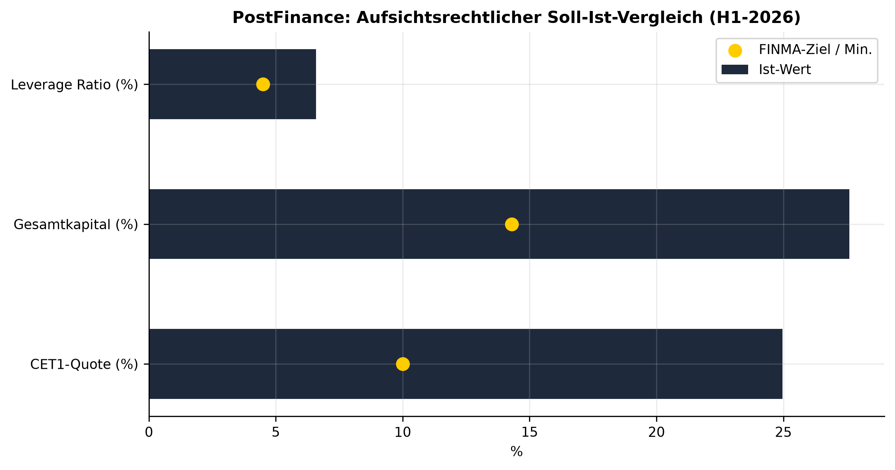
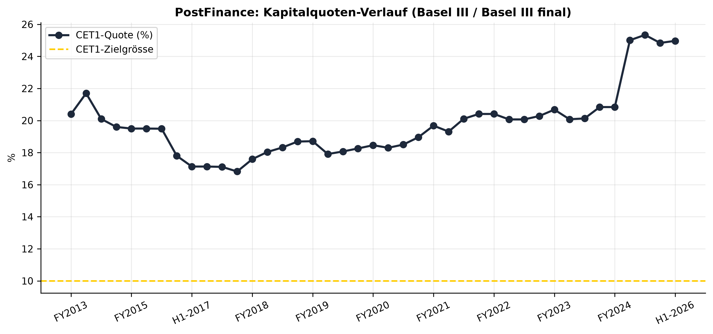

# 03 · Aufsichtsrechtliche Resilienz & Basel III: PostFinance AG

> **FINMA-Kategorie:** Kategorie 2 | **CET1-Zielgrösse:** 10,00 % | **Gesamtkapital-Ziel:** 14,30 %

## 1. Management Summary
- Am jüngsten Offenlegungsstichtag (**H1-2026**, Regime: *Basel III final*) beträgt die **CET1-Quote 24,97 %** (Puffer über Ziel: **14,97 Prozentpunkte**).
- Die Gesamtkapitalquote liegt bei **27,60 %**, die Leverage Ratio bei **6,59 %**.
- Liquiditätsquoten: LCR **– %**, NSFR **– %** (Mindestanforderung je 100 %).

## 2. Quantitative Entwicklung (45 Stichtage)
| Periode | Regime | RWA (Mio.) | CET1 (Mio.) | CET1 % | Gesamtkap. % | Leverage % | LCR % | NSFR % |
| --- | --- | --- | --- | --- | --- | --- | --- | --- |
| FY2013 | Basel III | 6,3 | 4,9 | 20,40 % | – % | – % | – % | – % |
| H1-2014 | Basel III | 4,3 | 5,0 | 21,70 % | – % | – % | – % | – % |
| FY2014 | Basel III | 4,7 | 5,1 | 20,10 % | – % | – % | – % | – % |
| H1-2015 | Basel III | 4'277,0 | – | 19,60 % | – % | – % | – % | – % |
| FY2015 | Basel III | 4'528,0 | – | 19,50 % | – % | – % | – % | – % |
| H1-2016 | Basel III | 5'234,0 | – | 19,50 % | – % | – % | – % | – % |
| FY2016 | Basel III | 5'650,0 | – | 19,49 % | – % | – % | – % | – % |
| Q1-2017 | Basel III | – | 5'532,0 | 17,80 % | 17,80 % | 4,54 % | – % | – % |
| H1-2017 | Basel III | 5'651,0 | – | 17,13 % | – % | – % | – % | – % |
| Q3-2017 | Basel III | – | 5,5 | 17,13 % | 17,13 % | 4,54 % | – % | – % |
| FY2017 | Basel III | – | – | 17,11 % | – % | – % | – % | – % |
| Q1-2018 | Basel III | – | – | – % | – % | – % | – % | – % |
| H1-2018 | Basel III | – | – | 16,82 % | – % | – % | – % | – % |
| Q3-2018 | Basel III | – | – | – % | – % | – % | – % | – % |
| FY2018 | Basel III | 33,8 | 5,9 | 17,59 % | 17,65 % | – % | – % | – % |
| Q1-2019 | Basel III | 33'254,0 | 5'999,0 | 18,04 % | 18,50 % | – % | 182,0 % | – % |
| H1-2019 | Basel III | 32,7 | 6,0 | 18,32 % | 18,99 % | 11,00 % | 191,0 % | – % |
| Q3-2019 | Basel III | 32'273,0 | 6'032,0 | 18,69 % | 19,37 % | – % | 197,0 % | – % |
| FY2019 | Basel III | 32,6 | 6,1 | 18,71 % | 19,39 % | – % | 200,0 % | – % |
| Q1-2020 | Basel III | 34'057,0 | 6'101,0 | 17,91 % | 18,56 % | – % | 185,0 % | – % |
| H1-2020 | Basel III | 33,8 | 6,1 | 18,07 % | 18,75 % | 11,00 % | 179,0 % | – % |
| Q3-2020 | Basel III | 33'405,0 | 6'101,0 | 18,26 % | 18,95 % | – % | 191,0 % | – % |
| FY2020 | Basel III | 33,0 | 6,1 | 18,46 % | 19,19 % | – % | – % | – % |
| Q1-2021 | Basel III | 33'292,0 | 6'093,0 | 18,30 % | 19,03 % | – % | – % | – % |
| H1-2021 | Basel III | 32,9 | 6,1 | 18,50 % | 19,23 % | 11,00 % | – % | – % |
| Q3-2021 | Basel III | 32'147,0 | 6'093,0 | 18,96 % | 19,70 % | – % | – % | 166,0 % |
| FY2021 | Basel III | 31,0 | 6,1 | 19,68 % | 20,42 % | – % | – % | 170,0 % |
| Q1-2022 | Basel III | 31'550,0 | 6'094,0 | 19,31 % | 20,04 % | – % | – % | 161,0 % |
| H1-2022 | Basel III | 30,3 | 6,1 | 20,11 % | 21,03 % | 11,00 % | – % | 158,0 % |
| Q3-2022 | Basel III | 29'852,0 | 6'094,0 | 20,41 % | 21,35 % | – % | – % | 165,0 % |
| FY2022 | Basel III | 29,9 | 6,1 | 20,41 % | 21,34 % | – % | – % | 168,0 % |
| Q1-2023 | Basel III | 30'363,0 | 6'095,0 | 20,07 % | 20,99 % | – % | – % | 182,0 % |
| H1-2023 | Basel III | 30,4 | 6,1 | 20,07 % | 21,61 % | 11,00 % | – % | 178,0 % |
| Q3-2023 | Basel III | 30'049,0 | 6'095,0 | 20,28 % | 21,83 % | – % | – % | 186,0 % |
| FY2023 | Basel III | 29,5 | 6,1 | 20,68 % | 22,25 % | – % | – % | 183,0 % |
| Q1-2024 | Basel III | 30'605,0 | 6'145,0 | 20,08 % | 21,59 % | – % | – % | – % |
| H1-2024 | Basel III | 30,5 | 6,1 | 20,13 % | 21,64 % | – % | – % | 179,0 % |
| Q3-2024 | Basel III | 29'577,0 | 6'164,0 | 20,84 % | 22,41 % | – % | – % | – % |
| FY2024 | Basel III | 29,6 | 6,2 | 20,84 % | 22,40 % | – % | – % | 187,0 % |
| Q1-2025 | Basel III final | – | – | – % | – % | – % | – % | – % |
| H1-2025 | Basel III final | 24'807,0 | 6'205,0 | 25,01 % | 26,87 % | 6,23 % | – % | – % |
| Q3-2025 | Basel III final | – | – | – % | – % | – % | – % | – % |
| FY2025 | Basel III final | 24'946,0 | 6'322,0 | 25,34 % | 28,10 % | 6,67 % | – % | – % |
| Q1-2026 | Basel III final | 25,6 | 6,4 | 24,84 % | 27,53 % | – % | – % | – % |
| H1-2026 | Basel III final | 25'564,0 | 6'382,0 | 24,97 % | 27,60 % | 6,59 % | – % | – % |

## 3. Treiberanalyse & Wendepunkte
- Mit Inkrafttreten von **Basel III final** ab 01.01.2025 verändern sich risikogewichtete Aktiven (RWA) und RWA-Dichte durch angepasste Standard- bzw. Output-Floor-Vorgaben.

## 4. Fazit & Ausblick
- Die Eigenmittel- und Liquiditätspuffer übertreffen die regulatorischen Mindestanforderungen für FINMA-Kategorie 2 deutlich.
