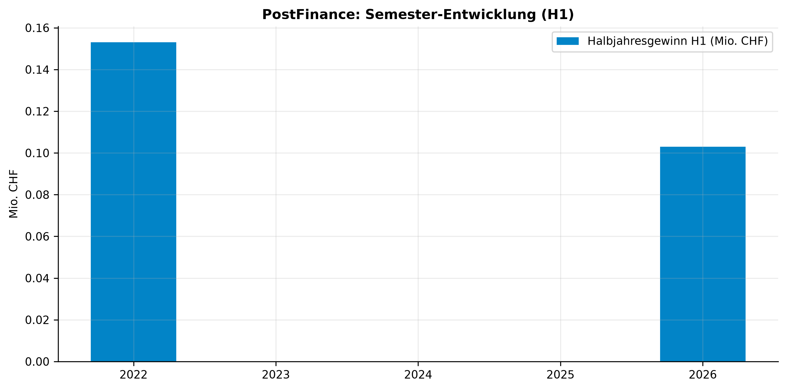

# 06 · Unterjährige Dynamik (Semesterberichte): PostFinance AG

## 1. Management Summary
- Vorliegen von **2 Halbjahresabschlüssen**; jüngster Stichtag ist **H1-2026** mit einem Geschäftsertrag von **0,6 Mio. CHF** und einem Halbjahresgewinn von **0,1 Mio. CHF**.

## 2. Quantitative Entwicklung
| Periode | Bilanzsumme | Zinserfolg H1 | Geschäftsertrag H1 | Geschäftserfolg H1 | Reingewinn H1 |
| --- | --- | --- | --- | --- | --- |
| H1-2022 | 123,4 | 0,3 | 0,6 | 0,0 | 0,2 |
| H1-2026 | 106,5 | 0,3 | 0,6 | 0,1 | 0,1 |

## 3. Treiberanalyse & Wendepunkte
- Der Vergleich von H1-Werten gegen die jeweiligen Gesamtjahresergebnisse (FY) zeigt die saisonale Ertragsverteilung und Reservebildung im zweiten Halbjahr.

## 4. Fazit & Ausblick
- Die Halbjahresberichte ermöglichen ein zeitnahes Monitoring der Zinsmargen- und Kreditvolumen-Dynamik bis H1-2026.
