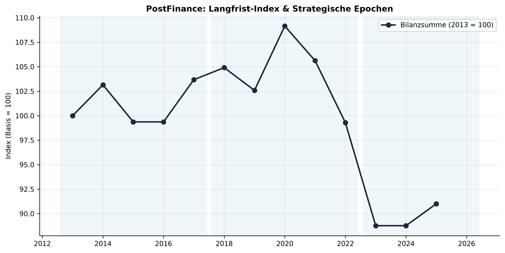
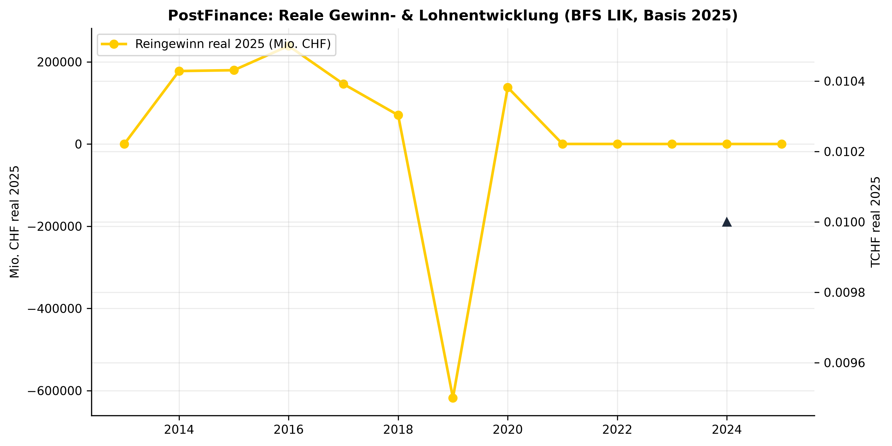

# 07 · Strategische Epochen, Governance, reale Vergütung & Vorsorge (2013–2025): PostFinance AG

> **Preisbasis:** Sämtliche Realgrössen sind mit dem offiziellen **BFS Landesindex der Konsumentenpreise (LIK, Dez. 1982 = 100)** deterministisch auf **reale CHF 2025** deflationiert.

## 1. Management Summary & Strategische Epochen
- **Epoche 1 (2013–2017):** AG-Ausgründung & Beginn Negativzinsphase
- **Epoche 2 (2018–2022):** Margenerosion unter Kreditverbot & Gebührenumbau
- **Epoche 3 (2023–2026):** Zinswende-Erholung & Basel III final

## 2. Reale Gewinn-, Lohn- & Vergütungsentwicklung (real 2025 CHF)
| Jahr | Gewinn nom. | Gewinn real 2025 | Lohn/FTE real (TCHF) | VR real (TCHF) | CEO real (TCHF) | GL real (TCHF) |
| --- | --- | --- | --- | --- | --- | --- |
| 2013 | 0,0 | 0,0 | – | – | – | – |
| 2014 | 167,0 | 177,7 | – | – | – | – |
| 2015 | 167,0 | 179,7 | – | – | – | – |
| 2016 | 221,0 | 238,9 | – | – | – | – |
| 2017 | 136,0 | 146,3 | – | – | – | – |
| 2018 | 66,0 | 70,3 | – | – | – | – |
| 2019 | -582,0 | -617,7 | – | – | – | – |
| 2020 | 129,0 | 137,9 | – | – | – | – |
| 2021 | 0,2 | 0,2 | – | – | – | – |
| 2022 | 0,2 | 0,2 | – | – | – | – |
| 2023 | 0,2 | 0,2 | – | – | – | – |
| 2024 | 0,2 | 0,2 | 0,0 | – | – | – |
| 2025 | 120,0 | 120,0 | 149,4 | 820,0 | 890,0 | 4'650,0 |

## 3. Arbeitgeber-Attraktivität & Vorsorgeeinrichtung (Pensionskasse)
- **Vorsorgeeinrichtung:** Pensionskasse Post (Sammelstiftung Konzern Post) (*Beitragsprimat (umhüllend)*, Basis: `Swiss GAAP FER 16 / FER 26`)
- **Versichertenstruktur:** Aktive **37'516**, Rentner **28'703** (Verhältnis Aktive/Rentner: **1,31**)
- **Deckungsgrad (BVG) / Reserven:** Deckungsgrad **– %**, Arbeitgeberbeitragsreserve **36,0 Mio. CHF**, Sondereinlagen **0,0 Mio. CHF**
- **CEO-zu-Mitarbeitenden-Pay-Ratio (2025):** **6,0×** (CEO real 2025: 890,0 TCHF vs. Ø Personalaufwand/FTE: 149,4 TCHF)
- **Quelle:** `postfinance/.md/postfinance-geschaeftsbericht-2025.md (Anhang Ziff. 15, S. 77)` — Keine eigene PK; Anschluss an Pensionskasse Post (37'516 Aktive, 28'703 Rentner Konzern). Vorsorgeaufwand PostFinance 2025: 46 Mio. CHF (2024: 44 Mio. CHF); AGBR: 36 Mio. CHF.

## 4. Treiberanalyse, Strukturbrüche & Ausblick
- **2013:** Ausgründung als AG unter FINMA-Aufsicht (mit Kreditverbot)
- **2023:** Zinswende-Effekt auf SNB-Guthaben & Finanzanlagen
- **2025:** Inkrafttreten Basel III final per 01.01.2025
- Die gemeinsame Inflationsbereinigung auf `real 2025 CHF` ermöglicht den unverzerrten Vergleich von Produktivität, Reallöhnen, Pay Ratio und Pensionskassen-Resilienz im Branchenvergleich (`comparison/reports/07_mitarbeiter_und_vorsorge_branchenvergleich.md`).
