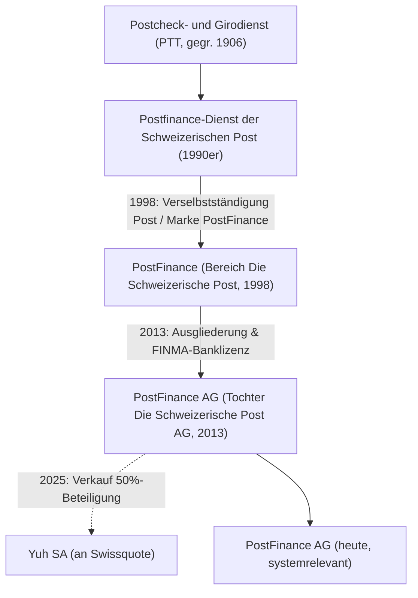

# 10 · Fusionsbaum & Institutsgeschichte seit 1900: PostFinance AG

> **Gründung / Ursprung:** 1906 (Postcheck- und Girodienst) / 2013 (PostFinance AG) | **Aktuelle Rechtsform:** `post_subsidiary` | **FINMA-Kategorie:** 2

## 1. Überblick der Institutslinie (1900–2026)
PostFinance geht auf den 1906 eingeführten schweizerischen Postcheck- und Girodienst zurück. 1998 wurde der Zahlungsverkehrs- und Finanzdienstleistungsbereich im Rahmen der PTT-Aufspaltung unter der Marke PostFinance gebündelt und am 26. Juni 2013 als eigenständige Aktiengesellschaft (PostFinance AG) mit FINMA-Bankbewilligung aus der Post ausgegliedert. 2025 erfolgte der Ausstieg aus dem Neobank-Joint-Venture Yuh (Verkauf 50 % an Swissquote).

## 2. Fusionsbaum (Mermaid-Diagramm seit 1900)

## 3. Chronologische Meilensteine (Fusionen, Übernahmen & Rechtsformwechsel)
| Jahr / Zeitraum | Institut / Ereignis | Typ | Bedeutung & Auswirkung |
| --- | --- | --- | --- |
| 1906 | Einführung des Postcheck- und Girodienstes (PTT) | Gründung | Aufbau des schweizweiten bargeldlosen Zahlungsverkehrs |
| 1998 | Aufspaltung PTT → Die Schweizerische Post & Swisscom | Reorganisation & Carve-Out | Etablierung der Marke PostFinance innerhalb der Schweizerischen Post |
| 2013 | Ausgliederung als PostFinance AG | Spin-off & Lizenz | Erteilung der FINMA-Bankbewilligung (26.06.2013); 100 % im Eigentum der Post |
| 2015–2024 | Einstufung als inlandrelevante systemrelevante Bank (D-SIB) | Regulierung | Kreditvergabeverbot bleibt bestehen; Ausbau von Anlage-, Vorsorge- und Digitalangeboten |
| 2025 | Verkauf Yuh-Beteiligung & Swissquote-Aktienabbau | Devestition | Verkauf des 50%-Anteils an Neobank Yuh SA an Swissquote sowie Reduktion der Swissquote-Beteiligung |

- **Quellenbasis:** `PostFinance Geschäftsberichte; Bundesamt für Kommunikation / Post-Chronik`
