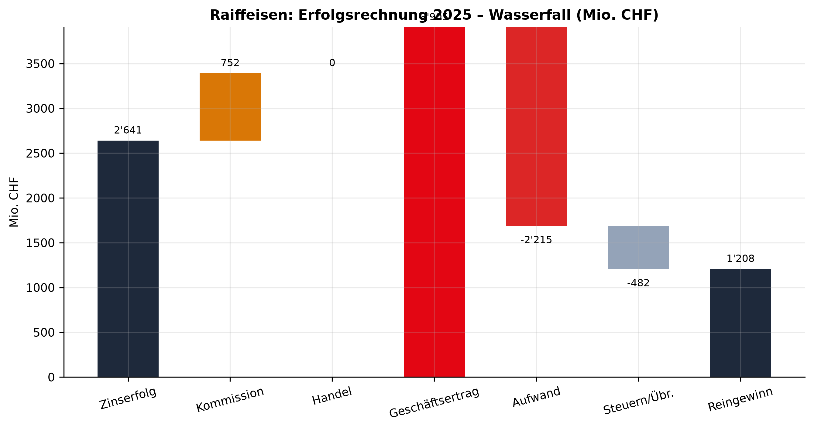

# 01 · Zinszyklen & Ertragsarchitektur (2011–2025): Raiffeisen Gruppe Schweiz

> **Scope:** `consolidated` | **Standard:** `ARB_RVB` | **Währung:** Mio. CHF (harmonisierte Zeitreihe)

## 1. Management Summary
- Im Zeitraum **2011–2025** entwickelte sich der Geschäftsertrag von **2'438,4 Mio. CHF** auf **3'905,0 Mio. CHF** (CAGR **3,42 % p. a.**).
- Der Reingewinn erreichte im jüngsten Geschäftsjahr 2025 **1'208,0 Mio. CHF** (nach 595,3 Mio. CHF im Jahr 2011).
- Der Netto-Zinserfolg trägt aktuell **67,6 %** zum Gesamtertrag bei, das Kommissionsgeschäft **19,3 %** und das Handelsgeschäft **– %**.

## 2. Quantitative Entwicklung
| Jahr | Zinserfolg (Mio.) | Kommission (Mio.) | Handel (Mio.) | Geschäftsertrag | Geschäftserfolg | Reingewinn | Zinsanteil |
| --- | --- | --- | --- | --- | --- | --- | --- |
| 2011 | 2'075,8 | 168,0 | 137,4 | 2'438,4 | 992,1 | 595,3 | 85,1 % |
| 2012 | 2'092,6 | 367,7 | – | 2'460,3 | 927,0 | 635,0 | 85,1 % |
| 2013 | 2'130,5 | 395,7 | 185,4 | 2'790,7 | 1'068,0 | 717,0 | 76,3 % |
| 2014 | 2'133,6 | 429,0 | 157,8 | 2'829,0 | 1'062,0 | 759,0 | 75,4 % |
| 2015 | 2'176,8 | 462,7 | 209,3 | 3'016,0 | 943,0 | 808,0 | 72,2 % |
| 2016 | – | 466,8 | 227,9 | 3'108,0 | 855,0 | 754,0 | – % |
| 2017 | – | 494,3 | 230,4 | 3'310,0 | 1'108,0 | 917,0 | – % |
| 2018 | 2'227,9 | 450,8 | 210,4 | 3'078,0 | 699,0 | 541,0 | 72,4 % |
| 2019 | 2'254,1 | 416,0 | 228,1 | 3'052,0 | 930,0 | 835,0 | 73,9 % |
| 2020 | 2,1 | 451,0 | 0,1 | 3'060,0 | 967,0 | 861,0 | 0,1 % |
| 2021 | 2'111,0 | 536,0 | 124,0 | 3'383,0 | 1'268,0 | 1'069,0 | 62,4 % |
| 2022 | 2'121,0 | 536,0 | 144,0 | 3'383,0 | 1'268,0 | 1'069,0 | 62,7 % |
| 2023 | 2'324,0 | 624,0 | 173,0 | 4'069,0 | 1'709,0 | 1'391,0 | 57,1 % |
| 2024 | 2'843,0 | 683,0 | – | 4'069,0 | 1'709,0 | 1'391,0 | 69,9 % |
| 2025 | 2'641,0 | 752,0 | – | 3'905,0 | 1'419,0 | 1'208,0 | 67,6 % |

## 3. Treiberanalyse & Wendepunkte
- **2015:** Umstellung auf FINMA-RVB
- **2018:** Governance-Reform & strategische Neuausrichtung
- **2025:** Inkrafttreten Basel III final per 01.01.2025

## 4. Fazit & Ausblick
- Die Ertragsarchitektur von Raiffeisen spiegelt die Zinszyklen (Negativzinsphase 2015–2022, Zinswende 2022–2024, Zinssenkungen ab 2025) unmittelbar wider.
