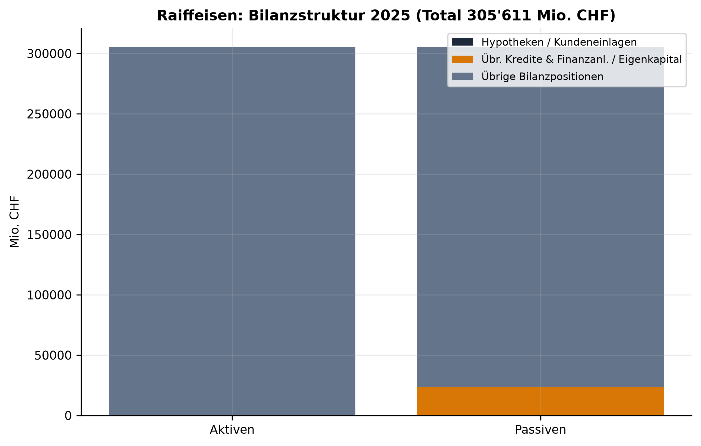
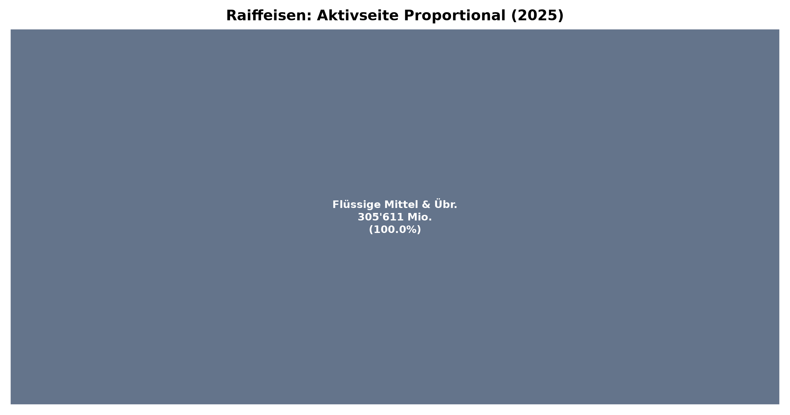
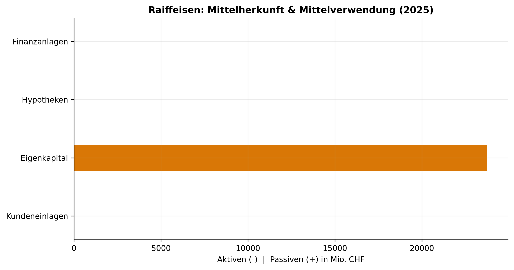
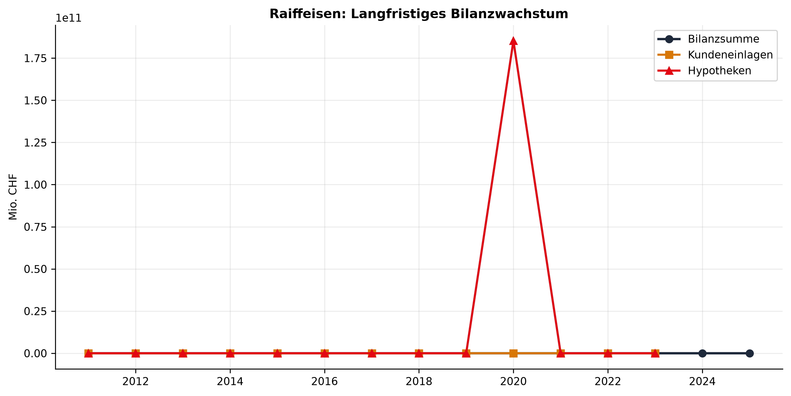

# 02 · Bilanzwachstum, Hypotheken & Refinanzierung (2011–2025): Raiffeisen Gruppe Schweiz

## 1. Management Summary
- Die Bilanzsumme wuchs von **155'888,6 Mio. CHF** (2011) auf **305'611,0 Mio. CHF** (2025, CAGR **4,93 %**).
- Die Hypothekarforderungen machen im Jahr 2025 **– %** der Bilanzsumme aus.
- Die Kundeneinlagen belaufen sich 2025 auf **– Mio. CHF**, das Eigenkapital auf **23'759,0 Mio. CHF** (Eigenkapitalquote **7,77 %**).

## 2. Quantitative Entwicklung
| Jahr | Bilanzsumme | Hypotheken | Finanzanlagen | Kundeneinlagen | Eigenkapital | Deckungsgrad |
| --- | --- | --- | --- | --- | --- | --- |
| 2011 | 155'888,6 | 128'526,8 | 4'774,5 | 92'549,1 | 9'875,4 | 72,0 % |
| 2012 | 168'124,0 | 135'942,7 | – | 103'065,0 | 10'496,0 | 75,8 % |
| 2013 | 176'575,0 | 143'658,6 | 4'283,9 | 109'576,0 | 11'201,0 | 76,3 % |
| 2014 | 188'640,0 | 150'880,4 | 5'866,4 | 114'937,0 | 12'060,0 | 76,2 % |
| 2015 | 205'748,0 | 158'593,6 | 6'877,4 | 150'272,4 | 13'318,0 | 94,8 % |
| 2016 | 218'590,0 | 165'426,2 | 7'952,0 | 158'254,4 | 14'385,0 | 95,7 % |
| 2017 | 227'728,0 | 172'621,5 | 7'593,4 | 164'084,8 | 15'700,0 | 95,0 % |
| 2018 | 225'333,0 | 179'558,4 | 6'612,8 | 165'701,4 | 16'524,0 | 92,3 % |
| 2019 | 248'345,0 | 185'290,5 | 7'194,4 | 176'179,5 | 17'416,0 | 91,1 % |
| 2020 | 259'653,0 | 185'290'514'000,0 | 7'194'368'000,0 | 162,3 | 18'444,0 | 0,0 % |
| 2021 | 284'489,0 | 179'410,0 | 7'593,0 | 174'872,0 | 19'179,0 | 93,7 % |
| 2022 | 284'489,0 | 185'323,0 | 6'613,0 | 185'058,0 | 19'179,0 | 96,3 % |
| 2023 | 297'135,0 | 198'857,0 | 10'852,0 | 194'879,0 | 22'378,0 | 94,6 % |
| 2024 | 297'135,0 | – | – | – | 22'378,0 | – % |
| 2025 | 305'611,0 | – | – | – | 23'759,0 | – % |

## 3. Treiberanalyse & Wendepunkte
- **2015:** Umstellung auf FINMA-RVB
- **2018:** Governance-Reform & strategische Neuausrichtung
- **2025:** Inkrafttreten Basel III final per 01.01.2025

## 4. Fazit & Ausblick
- Refinanzierungsbasis und Bilanzstruktur bleiben eng an Kundeneinlagen und die jeweilige Geschäftsmodell-Spezialisierung gekoppelt.
