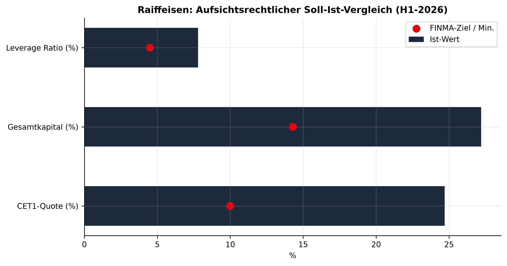
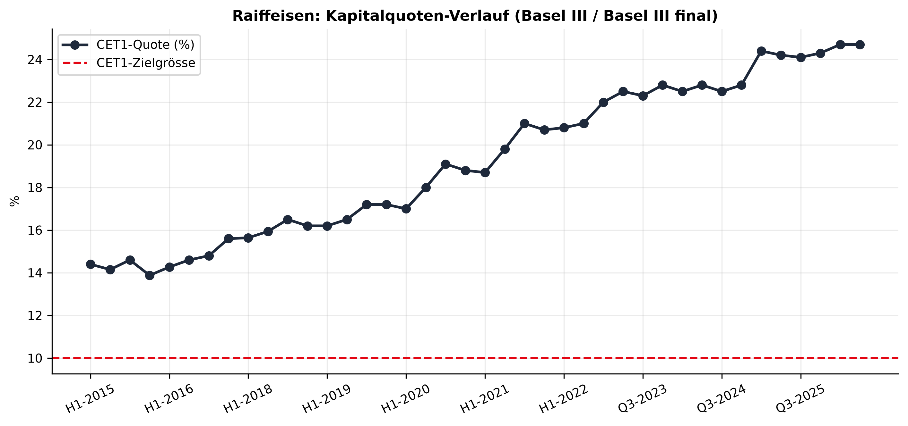

# 03 · Aufsichtsrechtliche Resilienz & Basel III: Raiffeisen Gruppe Schweiz

> **FINMA-Kategorie:** Kategorie 2 | **CET1-Zielgrösse:** 10,00 % | **Gesamtkapital-Ziel:** 14,30 %

## 1. Management Summary
- Am jüngsten Offenlegungsstichtag (**H1-2026**, Regime: *Basel III final*) beträgt die **CET1-Quote 24,70 %** (Puffer über Ziel: **14,70 Prozentpunkte**).
- Die Gesamtkapitalquote liegt bei **27,20 %**, die Leverage Ratio bei **7,80 %**.
- Liquiditätsquoten: LCR **– %**, NSFR **– %** (Mindestanforderung je 100 %).

## 2. Quantitative Entwicklung (45 Stichtage)
| Periode | Regime | RWA (Mio.) | CET1 (Mio.) | CET1 % | Gesamtkap. % | Leverage % | LCR % | NSFR % |
| --- | --- | --- | --- | --- | --- | --- | --- | --- |
| H1-2015 | Basel III | 85'616'094,0 | – | 14,40 % | 16,20 % | – % | – % | – % |
| Q3-2015 | Basel III | – | 12'116,0 | 14,15 % | 16,19 % | 6,53 % | – % | – % |
| FY2015 | Basel III | 87'458'514,0 | – | 14,60 % | 16,40 % | – % | – % | – % |
| Q1-2016 | Basel III | – | 12'705,0 | 13,88 % | 15,28 % | 6,66 % | – % | – % |
| H1-2016 | Basel III | – | 12'705,0 | 14,27 % | 16,34 % | 6,66 % | – % | – % |
| Q3-2016 | Basel III | – | – | 14,60 % | 16,30 % | – % | – % | – % |
| FY2016 | Basel III | – | – | 14,80 % | 16,50 % | – % | – % | – % |
| Q1-2017 | Basel III | – | – | – % | – % | – % | – % | – % |
| H1-2017 | Basel III | – | – | – % | – % | – % | – % | – % |
| Q3-2017 | Basel III | – | – | – % | – % | – % | – % | – % |
| FY2017 | Basel III | – | – | – % | – % | – % | – % | – % |
| Q1-2018 | Basel III | – | – | 15,60 % | 17,03 % | – % | – % | – % |
| H1-2018 | Basel III | – | – | 15,64 % | 16,92 % | – % | – % | – % |
| Q3-2018 | Basel III | – | – | 15,94 % | 17,21 % | – % | – % | – % |
| FY2018 | Basel III | 99'307,0 | 16'408,0 | 16,50 % | 17,80 % | – % | – % | – % |
| Q1-2019 | Basel III | 102'003,0 | 16'479,0 | 16,20 % | 17,30 % | – % | – % | – % |
| H1-2019 | Basel III | 102'032,0 | 16'548,0 | 16,20 % | 17,40 % | – % | – % | – % |
| Q3-2019 | Basel III | 97'333,0 | 16'063,0 | 16,50 % | 17,70 % | – % | – % | – % |
| FY2019 | Basel III | 98'295,0 | 16'868,0 | 17,20 % | 18,30 % | – % | – % | – % |
| Q1-2020 | Basel III | 98'651,0 | 16'920,0 | 17,20 % | 18,30 % | – % | – % | – % |
| H1-2020 | Basel III | 99'928,0 | 16'959,0 | 17,00 % | 18,10 % | – % | – % | – % |
| Q3-2020 | Basel III | 95'033,0 | 17'085,0 | 18,00 % | 18,40 % | – % | – % | – % |
| FY2020 | Basel III | 93,5 | 17,9 | 19,10 % | 20,50 % | – % | – % | – % |
| Q1-2021 | Basel III | 95,3 | 18,0 | 18,80 % | 20,70 % | – % | – % | – % |
| H1-2021 | Basel III | 96,4 | 18,0 | 18,70 % | 20,60 % | – % | – % | – % |
| Q3-2021 | Basel III | 91,0 | 18,1 | 19,80 % | 22,00 % | – % | – % | 146,5 % |
| FY2021 | Basel III | 91,2 | 19,1 | 21,00 % | 23,20 % | – % | – % | 144,9 % |
| Q1-2022 | Basel III | 92,5 | 19,2 | 20,70 % | 22,80 % | 7,00 % | – % | 143,8 % |
| H1-2022 | Basel III | 93,2 | 19,4 | 20,80 % | 22,80 % | – % | – % | 142,3 % |
| Q3-2022 | Basel III | 92,2 | 19,4 | 21,00 % | 23,10 % | 7,00 % | – % | 141,4 % |
| FY2022 | Basel III | – | 20,6 | – % | – % | – % | – % | – % |
| Q1-2023 | Basel III | 94,2 | 20,7 | 22,00 % | 24,10 % | 8,00 % | – % | 140,5 % |
| H1-2023 | Basel III | 95,3 | 21,5 | 22,50 % | 25,20 % | – % | – % | – % |
| Q3-2023 | Basel III | 96,3 | 21,5 | 22,30 % | 25,00 % | 8,00 % | – % | – % |
| FY2023 | Basel III | 97,1 | 22,2 | 22,80 % | 25,20 % | – % | – % | – % |
| Q1-2024 | Basel III | 98,9 | 22,3 | 22,50 % | 24,90 % | 8,00 % | – % | – % |
| H1-2024 | Basel III | 100,5 | 22,9 | 22,80 % | 25,30 % | – % | – % | – % |
| Q3-2024 | Basel III | 102,2 | 22,9 | 22,50 % | 25,30 % | 8,00 % | – % | – % |
| FY2024 | Basel III | 103,5 | 23,5 | 22,80 % | 25,30 % | – % | – % | – % |
| Q1-2025 | Basel III final | 97,9 | 23,9 | 24,40 % | – % | 9,00 % | – % | – % |
| H1-2025 | Basel III final | 99,3 | 24,1 | 24,20 % | 26,90 % | 7,80 % | – % | – % |
| Q3-2025 | Basel III final | 100,8 | 24,3 | 24,10 % | 26,70 % | 7,80 % | – % | – % |
| FY2025 | Basel III final | 102,0 | 24,8 | 24,30 % | 26,70 % | 7,90 % | – % | – % |
| Q1-2026 | Basel III final | 101,3 | 25,0 | 24,70 % | 27,00 % | 7,80 % | – % | – % |
| H1-2026 | Basel III final | 102,1 | 25,3 | 24,70 % | 27,20 % | 7,80 % | – % | – % |

## 3. Treiberanalyse & Wendepunkte
- Mit Inkrafttreten von **Basel III final** ab 01.01.2025 verändern sich risikogewichtete Aktiven (RWA) und RWA-Dichte durch angepasste Standard- bzw. Output-Floor-Vorgaben.

## 4. Fazit & Ausblick
- Die Eigenmittel- und Liquiditätspuffer übertreffen die regulatorischen Mindestanforderungen für FINMA-Kategorie 2 deutlich.
