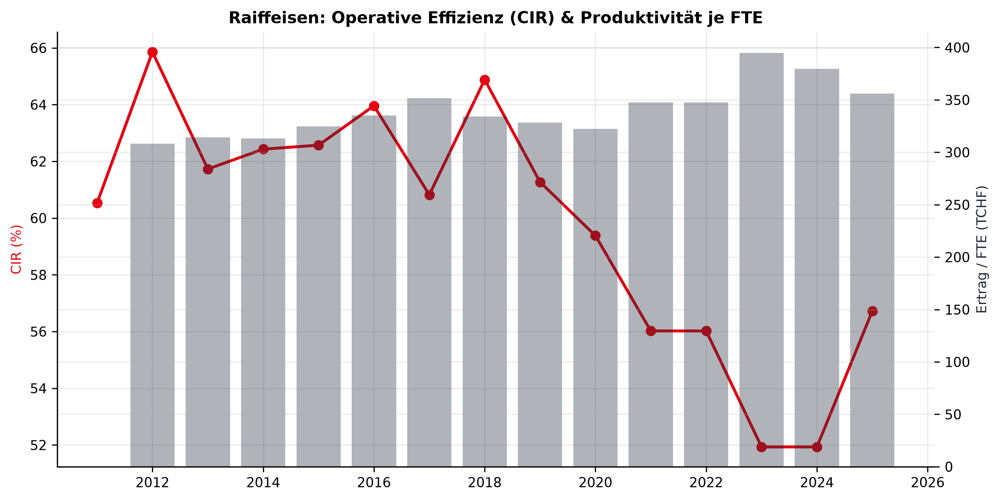

# 04 · Operative Effizienz & Transformation (2011–2025): Raiffeisen Gruppe Schweiz

## 1. Management Summary
- Die Cost-Income-Ratio (CIR) liegt im Jahr 2025 bei **56,72 %** (vs. 60,53 % im Jahr 2011), die Eigenkapitalrendite (ROE) bei **6,30 %**.
- Der Personalbestand umfasst 2025 **10'972,0 FTE** bei einem Ertrag pro Vollzeitstelle von **355,9 TCHF** und einem **Lohnkosten-/Produktivitätsverhältnis von 42,4 %** (bzw. **2,36×** Ertrag je CHF Personalaufwand).

## 2. Quantitative Entwicklung
| Jahr | CIR % | ROE % | FTE | Ertrag/FTE (TCHF) | Lohn/FTE (TCHF) | Lohn/Ertrag % | Ertrag/Lohn | Bilanz/FTE (Mio.) |
| --- | --- | --- | --- | --- | --- | --- | --- | --- |
| 2011 | 60,53 % | 6,03 % | – | – | – | – % | –× | – |
| 2012 | 65,86 % | 6,05 % | 8'797,0 | 308,3 | – | – % | –× | 19,11 |
| 2013 | 61,73 % | 6,40 % | 8'887,0 | 314,1 | 136,1 | 43,3 % | 2,31× | 19,87 |
| 2014 | 62,43 % | 6,29 % | 9'028,0 | 313,1 | 140,1 | 44,8 % | 2,23× | 20,89 |
| 2015 | 62,57 % | 6,07 % | 9'286,0 | 324,8 | 143,2 | 44,1 % | 2,27× | 22,16 |
| 2016 | 63,96 % | 5,24 % | 9'276,0 | 335,1 | 148,9 | 44,4 % | 2,25× | 23,57 |
| 2017 | 60,82 % | 5,84 % | 9'411,0 | 351,7 | 148,3 | 42,2 % | 2,37× | 24,20 |
| 2018 | 64,88 % | 3,27 % | 9'215,0 | 334,0 | 150,9 | 45,2 % | 2,21× | 24,45 |
| 2019 | 61,27 % | 5,05 % | 9'295,0 | 328,3 | 143,3 | 43,6 % | 2,29× | 26,72 |
| 2020 | 59,38 % | 5,48 % | 9'492,0 | 322,4 | 0,1 | 0,0 % | 3'355,26× | 27,35 |
| 2021 | 56,02 % | 6,47 % | 9'729,0 | 347,7 | 96,1 | 27,6 % | 3,62× | 29,24 |
| 2022 | 56,02 % | 5,17 % | 9'729,0 | 347,7 | 98,7 | 28,4 % | 3,52× | 29,24 |
| 2023 | 51,93 % | 6,22 % | 10'305,0 | 394,9 | 99,0 | 25,1 % | 3,99× | 28,83 |
| 2024 | 51,93 % | 5,85 % | 10'720,0 | 379,6 | – | – % | –× | 27,72 |
| 2025 | 56,72 % | 6,30 % | 10'972,0 | 355,9 | 150,9 | 42,4 % | 2,36× | 27,85 |

## 3. Treiberanalyse & Wendepunkte
- **2015:** Umstellung auf FINMA-RVB
- **2018:** Governance-Reform & strategische Neuausrichtung
- **2025:** Inkrafttreten Basel III final per 01.01.2025

## 4. Fazit & Ausblick
- Digitalisierung und Skalierung steigern Bilanzsumme und Geschäftsvolumen pro Vollzeitstelle langfristig.
