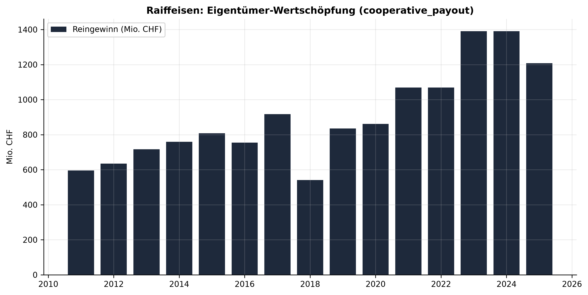

# 05 · Genossenschaftskapital, Mitglieder & Ausschüttung (2011–2025): Raiffeisen Gruppe Schweiz

> **Eigentümer-Modus:** `cooperative_payout` | **Staatsgarantie:** Keine | **Ticker:** `nicht kotiert`

## 1. Management Summary
- Im Geschäftsjahr 2025 erwirtschaftete Raiffeisen einen Gewinn von **1'208,0 Mio. CHF** bei einem Eigenkapital von **19'179,0 Mio. CHF**.
- **Eigenkapitalrendite (2025):** ROE **6,30 %** bei einem Eigenkapital von **19'179,0 Mio. CHF**.

## 2. Quantitative Entwicklung
| Jahr | Reingewinn (Mio.) | Eigenkapital (Mio.) | Aktienkurs (split-ber.) | Dividende/Aktie | Div.-Rendite | Öff. Ablieferung (Mio.) |
| --- | --- | --- | --- | --- | --- | --- |
| 2011 | 595,3 | 9'875,4 | – | – | – % | – |
| 2012 | 635,0 | 10'496,0 | – | – | – % | – |
| 2013 | 717,0 | 11'201,0 | – | – | – % | – |
| 2014 | 759,0 | 12'060,0 | – | – | – % | – |
| 2015 | 808,0 | 13'318,0 | – | – | – % | – |
| 2016 | 754,0 | 14'385,0 | – | – | – % | – |
| 2017 | 917,0 | 15'700,0 | – | – | – % | – |
| 2018 | 541,0 | 16'524,0 | – | – | – % | – |
| 2019 | 835,0 | 16'524,0 | – | – | – % | – |
| 2020 | 861,0 | 15'700,0 | – | – | – % | – |
| 2021 | 1'069,0 | 16'524,0 | – | – | – % | – |
| 2022 | 1'069,0 | 20'673,0 | – | – | – % | – |
| 2023 | 1'391,0 | 22'378,0 | – | – | – % | – |
| 2024 | 1'391,0 | 23'759,0 | – | – | – % | – |
| 2025 | 1'208,0 | 19'179,0 | – | – | – % | – |

## 3. Treiberanalyse & Wendepunkte (Investoren-Perspektive)
- Bei kotierten Instituten mit Aktiensplits (z. B. BCV 1:10 im Jahr 2020) sind sämtliche historischen Kurs- und Dividendenreihen deterministisch split-bereinigt.
- Im Branchenvergleich (siehe `comparison/reports/06_investoren_branchenvergleich.md`) werden P/B, P/E, Dividendenrendite und Eigentümer-Ablieferungen über alle 19 Institute eingeordnet.

## 4. Fazit, Führungsleistung & Ausblick
- Stabile Ertragskraft sichert langfristig Dividendenkontinuität bzw. verlässliche Ablieferungen an Kanton, Post oder Genossenschafter.
- Die detaillierte Leistungsbilanz von CEO und Verwaltungsratspräsidium aus Investoren- und Eigentümersicht findet sich im [CEO & Chairman of the Board Achievement Report](./08_ceo_und_vrp_leistungsbericht.md).
