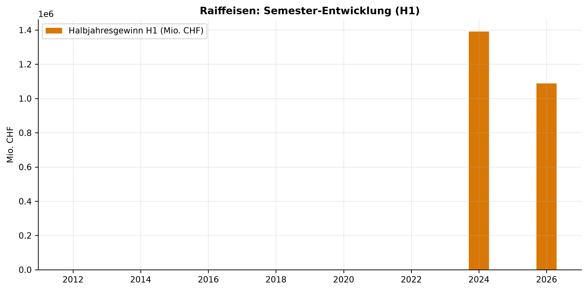

# 06 · Unterjährige Dynamik (Semesterberichte): Raiffeisen Gruppe Schweiz

## 1. Management Summary
- Vorliegen von **15 Halbjahresabschlüssen**; jüngster Stichtag ist **H1-2026** mit einem Geschäftsertrag von **2'041,0 Mio. CHF** und einem Halbjahresgewinn von **1'087'806,0 Mio. CHF**.

## 2. Quantitative Entwicklung
| Periode | Bilanzsumme | Zinserfolg H1 | Geschäftsertrag H1 | Geschäftserfolg H1 | Reingewinn H1 |
| --- | --- | --- | --- | --- | --- |
| H1-2012 | 169'336,0 | 1'041,0 | – | 521,0 | 332,4 |
| H1-2013 | 172'260,0 | 1'053,0 | – | 535,0 | 369,1 |
| H1-2014 | 182'638,0 | 1'066,4 | – | 533,0 | 363,0 |
| H1-2015 | 201'345,0 | 1'095,8 | – | 597,0 | 395,0 |
| H1-2016 | 213'539,0 | 1'109,4 | 1'522,0 | 464,0 | 367,0 |
| H1-2017 | 228'148,0 | – | 1'629,0 | 532,0 | 434,0 |
| H1-2018 | 229'450,0 | – | 1'636,0 | 517,0 | 416,0 |
| H1-2019 | 234'974,0 | – | 1,5 | 0,4 | 0,4 |
| H1-2020 | 266'135,0 | 1'165,1 | 1'552,0 | 513,0 | 346,0 |
| H1-2021 | 281'166,0 | – | 1'645,0 | 614,0 | 505,0 |
| H1-2022 | 301'490,0 | – | 1'691,0 | 623,0 | 556,0 |
| H1-2023 | 287'603,0 | – | 2'044,0 | 894,0 | – |
| H1-2024 | 302'070,0 | – | 1'953,0 | 776,0 | 1'390'657,0 |
| H1-2025 | 311'958,0 | – | 1'897,0 | 670,0 | 554,6 |
| H1-2026 | 335'225,0 | – | 2'041,0 | 785,0 | 1'087'806,0 |

## 3. Treiberanalyse & Wendepunkte
- Der Vergleich von H1-Werten gegen die jeweiligen Gesamtjahresergebnisse (FY) zeigt die saisonale Ertragsverteilung und Reservebildung im zweiten Halbjahr.

## 4. Fazit & Ausblick
- Die Halbjahresberichte ermöglichen ein zeitnahes Monitoring der Zinsmargen- und Kreditvolumen-Dynamik bis H1-2026.
