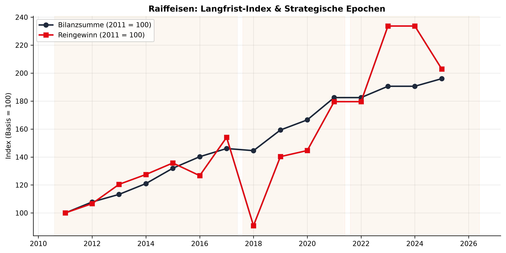
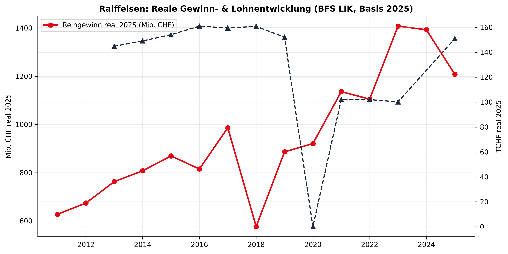

# 07 · Strategische Epochen, Governance, reale Vergütung & Vorsorge (2011–2025): Raiffeisen Gruppe Schweiz

> **Preisbasis:** Sämtliche Realgrössen sind mit dem offiziellen **BFS Landesindex der Konsumentenpreise (LIK, Dez. 1982 = 100)** deterministisch auf **reale CHF 2025** deflationiert.

## 1. Management Summary & Strategische Epochen
- **Epoche 1 (2011–2017):** Hypothekar-Expansion & D-SIB-Einstufung
- **Epoche 2 (2018–2021):** Governance-Reform & Kapitalstärkung
- **Epoche 3 (2022–2026):** Zinswende & Basel III final

## 2. Reale Gewinn-, Lohn- & Vergütungsentwicklung (real 2025 CHF)
| Jahr | Gewinn nom. | Gewinn real 2025 | Lohn/FTE real (TCHF) | VR real (TCHF) | CEO real (TCHF) | GL real (TCHF) |
| --- | --- | --- | --- | --- | --- | --- |
| 2011 | 595,3 | 627,4 | – | – | – | – |
| 2012 | 635,0 | 673,9 | – | – | – | – |
| 2013 | 717,0 | 762,9 | 144,8 | – | – | – |
| 2014 | 759,0 | 807,5 | 149,1 | – | – | – |
| 2015 | 808,0 | 869,5 | 154,1 | – | – | – |
| 2016 | 754,0 | 815,0 | 160,9 | – | – | – |
| 2017 | 917,0 | 986,2 | 159,4 | – | – | – |
| 2018 | 541,0 | 576,3 | 160,8 | – | – | – |
| 2019 | 835,0 | 886,2 | 152,1 | – | – | – |
| 2020 | 861,0 | 920,7 | 0,1 | – | – | – |
| 2021 | 1'069,0 | 1'135,9 | 102,1 | – | – | – |
| 2022 | 1'069,0 | 1'104,8 | 102,0 | – | – | – |
| 2023 | 1'391,0 | 1'407,6 | 100,2 | – | – | – |
| 2024 | 1'391,0 | 1'392,6 | – | – | – | – |
| 2025 | 1'208,0 | 1'208,0 | 150,9 | 1'950,0 | 1'780,0 | 8'900,0 |

## 3. Arbeitgeber-Attraktivität & Vorsorgeeinrichtung (Pensionskasse)
- **Vorsorgeeinrichtung:** Raiffeisen Pensionskasse Genossenschaft (+ Arbeitgeberstiftung) (*Beitragsprimat (umhüllend)*, Basis: `Swiss GAAP FER 16 / ARB`)
- **Versichertenstruktur:** Aktive **–**, Rentner **–** (Verhältnis Aktive/Rentner: **–**)
- **Deckungsgrad (BVG) / Reserven:** Deckungsgrad **117,4 %**, Arbeitgeberbeitragsreserve **179,1 Mio. CHF**, Sondereinlagen **0,0 Mio. CHF**
- **CEO-zu-Mitarbeitenden-Pay-Ratio (2025):** **11,8×** (CEO real 2025: 1'780,0 TCHF vs. Ø Personalaufwand/FTE: 150,9 TCHF)
- **Quelle:** `raiffeisen/.md/raiffeisen-geschaeftsbericht-2025.md (Anhang Ziff. 12.3, S. 125–126)` — Deckungsgrad per 31.12.2025: 117,4 % (Zielhöhe Wertschwankungsreserve 117 % überschritten); abgegrenzte Arbeitgeberbeiträge 2025: 169,850 Mio. CHF; AGBR: 179,102 Mio. CHF.

## 4. Treiberanalyse, Strukturbrüche & Ausblick
- **2015:** Umstellung auf FINMA-RVB
- **2018:** Governance-Reform & strategische Neuausrichtung
- **2025:** Inkrafttreten Basel III final per 01.01.2025
- Die gemeinsame Inflationsbereinigung auf `real 2025 CHF` ermöglicht den unverzerrten Vergleich von Produktivität, Reallöhnen, Pay Ratio und Pensionskassen-Resilienz im Branchenvergleich (`comparison/reports/07_mitarbeiter_und_vorsorge_branchenvergleich.md`).
