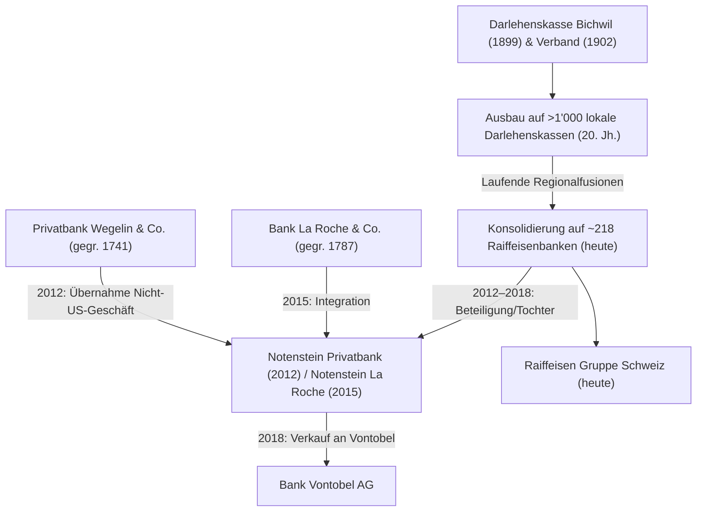

# 10 · Fusionsbaum & Institutsgeschichte seit 1900: Raiffeisen Gruppe Schweiz

> **Gründung / Ursprung:** 1899/1902 (Darlehenskasse Bichwil & Schweizerischer Raiffeisenverband) | **Aktuelle Rechtsform:** `cooperative_group` | **FINMA-Kategorie:** 2

## 1. Überblick der Institutslinie (1900–2026)
Die Raiffeisen-Gruppe entstand 1899/1902 mit der ersten Darlehenskasse in Bichwil (SG) und dem Schweizerischen Raiffeisenverband (1902). Über das 20. Jahrhundert wuchs das Netz auf über 1'000 lokale Genossenschaften an, die durch laufende Regionalfusionen auf rund 218 Raiffeisenbanken konsolidiert wurden. 2012 übernahm Raiffeisen Teile der Privatbank Wegelin & Co. (Notenstein, später Notenstein La Roche) und veräusserte Notenstein La Roche 2018 an Vontobel.

## 2. Fusionsbaum (Mermaid-Diagramm seit 1900)

## 3. Chronologische Meilensteine (Fusionen, Übernahmen & Rechtsformwechsel)
| Jahr / Zeitraum | Institut / Ereignis | Typ | Bedeutung & Auswirkung |
| --- | --- | --- | --- |
| 1899 / 1902 | Darlehenskasse Bichwil & Schweizerischer Raiffeisenverband | Gründung | Start der schweizerischen Genossenschaftsbanken nach Friedrich Wilhelm Raiffeisen |
| 1902–2025 | Gründungswelle & spätere Regionalfusionen | Konsolidierung | Von über 1'200 lokalen Darlehenskassen zu rund 218 schlagkräftigen Raiffeisenbanken |
| 2012 | Übernahme Nicht-US-Geschäft von Wegelin & Co. (Notenstein) | Akquisition | Einstieg ins Private Banking über Tochtergesellschaft Notenstein Privatbank AG |
| 2015 | Übernahme Bank La Roche & Co. durch Notenstein | Akquisition | Fusion zu Notenstein La Roche Privatbank AG |
| 2018 | Verkauf von Notenstein La Roche an Vontobel | Devestition | Fokussierung auf das Schweizer Retail-, KMU- und Anlagegeschäft |

- **Quellenbasis:** `Raiffeisen Schweiz Geschäftsberichte; Vontobel Chronik`
