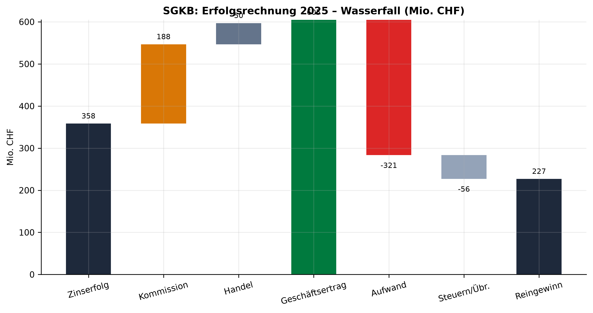
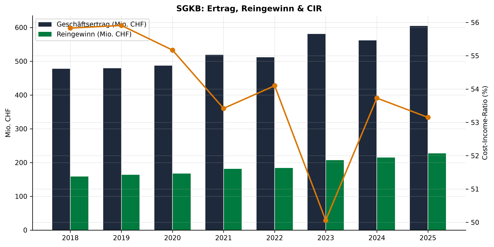

# 01 · Zinszyklen & Ertragsarchitektur (2018–2025): St.Galler Kantonalbank AG

> **Scope:** `consolidated` | **Standard:** `ARB_RVB` | **Währung:** Mio. CHF (harmonisierte Zeitreihe)

## 1. Management Summary
- Im Zeitraum **2018–2025** entwickelte sich der Geschäftsertrag von **477,6 Mio. CHF** auf **604,7 Mio. CHF** (CAGR **3,43 % p. a.**).
- Der Reingewinn erreichte im jüngsten Geschäftsjahr 2025 **227,0 Mio. CHF** (nach 158,6 Mio. CHF im Jahr 2018).
- Der Netto-Zinserfolg trägt aktuell **59,3 %** zum Gesamtertrag bei, das Kommissionsgeschäft **31,1 %** und das Handelsgeschäft **8,3 %**.

## 2. Quantitative Entwicklung
| Jahr | Zinserfolg (Mio.) | Kommission (Mio.) | Handel (Mio.) | Geschäftsertrag | Geschäftserfolg | Reingewinn | Zinsanteil |
| --- | --- | --- | --- | --- | --- | --- | --- |
| 2018 | 316,3 | 117,3 | 32,7 | 477,6 | 211,0 | 158,6 | 66,2 % |
| 2019 | 298,3 | 130,2 | 39,7 | 479,2 | 211,3 | 163,9 | 62,2 % |
| 2020 | 311,9 | 129,4 | 38,1 | 486,7 | 218,2 | 167,2 | 64,1 % |
| 2021 | 307,1 | 160,3 | 43,4 | 518,9 | 241,7 | 181,2 | 59,2 % |
| 2022 | 317,0 | 150,6 | 39,4 | 511,5 | 234,7 | 183,8 | 62,0 % |
| 2023 | 370,7 | 158,0 | 42,7 | 580,7 | 290,0 | 207,2 | 63,8 % |
| 2024 | 332,1 | 175,9 | 45,2 | 561,7 | 259,9 | 215,1 | 59,1 % |
| 2025 | 358,4 | 188,3 | 50,3 | 604,7 | 283,3 | 227,0 | 59,3 % |

## 3. Treiberanalyse & Wendepunkte
- **2022:** SNB-Zinswende & Rückkehr positiver Leitzinsen
- **2025:** Inkrafttreten Basel III final per 01.01.2025

## 4. Fazit & Ausblick
- Die Ertragsarchitektur von SGKB spiegelt die Zinszyklen (Negativzinsphase 2015–2022, Zinswende 2022–2024, Zinssenkungen ab 2025) unmittelbar wider.
