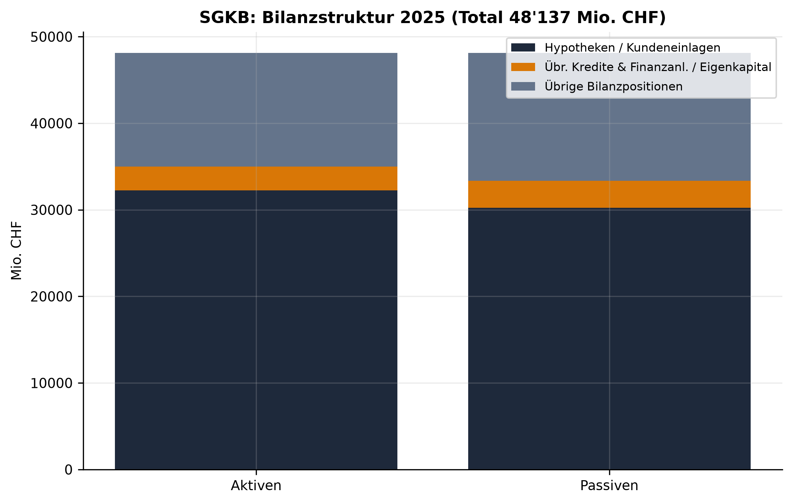
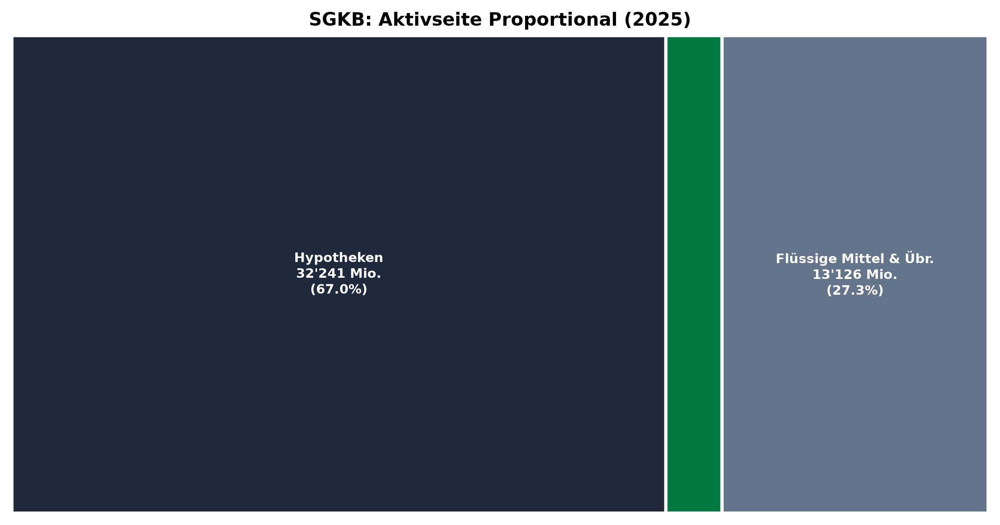
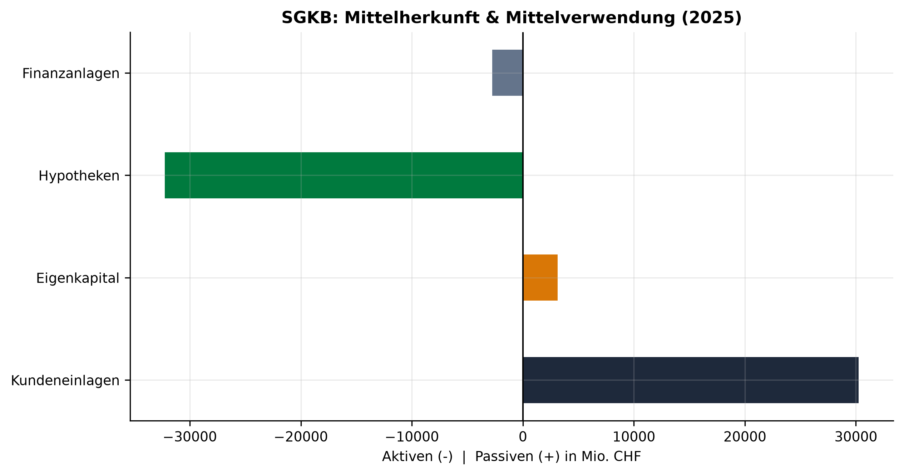
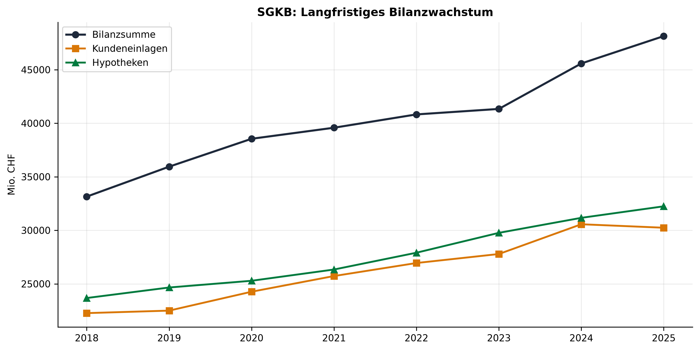

# 02 · Bilanzwachstum, Hypotheken & Refinanzierung (2018–2025): St.Galler Kantonalbank AG

## 1. Management Summary
- Die Bilanzsumme wuchs von **33'146,4 Mio. CHF** (2018) auf **48'136,6 Mio. CHF** (2025, CAGR **5,47 %**).
- Die Hypothekarforderungen machen im Jahr 2025 **67,0 %** der Bilanzsumme aus.
- Die Kundeneinlagen belaufen sich 2025 auf **30'240,7 Mio. CHF**, das Eigenkapital auf **3'118,0 Mio. CHF** (Eigenkapitalquote **6,48 %**).

## 2. Quantitative Entwicklung
| Jahr | Bilanzsumme | Hypotheken | Finanzanlagen | Kundeneinlagen | Eigenkapital | Deckungsgrad |
| --- | --- | --- | --- | --- | --- | --- |
| 2018 | 33'146,4 | 23'675,9 | 1'967,4 | 22'266,4 | 2'304,4 | 94,0 % |
| 2019 | 35'943,6 | 24'659,0 | 1'927,5 | 22'499,2 | 2'551,6 | 91,2 % |
| 2020 | 38'548,4 | 25'287,2 | 1'863,8 | 24'264,9 | 2'590,8 | 96,0 % |
| 2021 | 39'581,1 | 26'338,6 | 1'843,7 | 25'729,5 | 2'684,0 | 97,7 % |
| 2022 | 40'823,9 | 27'907,4 | 1'919,0 | 26'945,3 | 2'770,9 | 96,5 % |
| 2023 | 41'336,6 | 29'763,2 | 1'894,6 | 27'786,4 | 2'902,7 | 93,4 % |
| 2024 | 45'581,8 | 31'165,1 | 2'422,8 | 30'565,3 | 3'005,9 | 98,1 % |
| 2025 | 48'136,6 | 32'241,5 | 2'768,9 | 30'240,7 | 3'118,0 | 93,8 % |

## 3. Treiberanalyse & Wendepunkte
- **2022:** SNB-Zinswende & Rückkehr positiver Leitzinsen
- **2025:** Inkrafttreten Basel III final per 01.01.2025

## 4. Fazit & Ausblick
- Refinanzierungsbasis und Bilanzstruktur bleiben eng an Kundeneinlagen und die jeweilige Geschäftsmodell-Spezialisierung gekoppelt.
