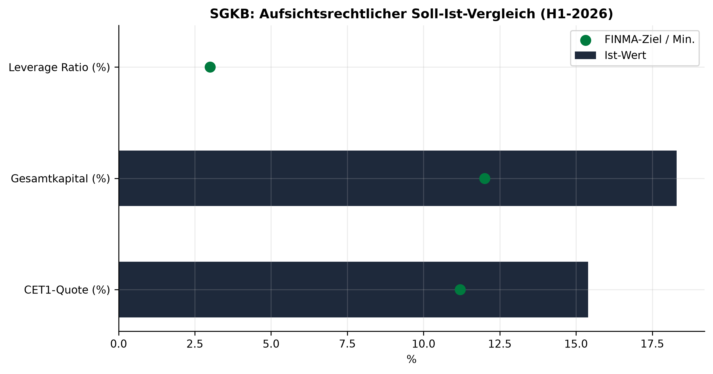
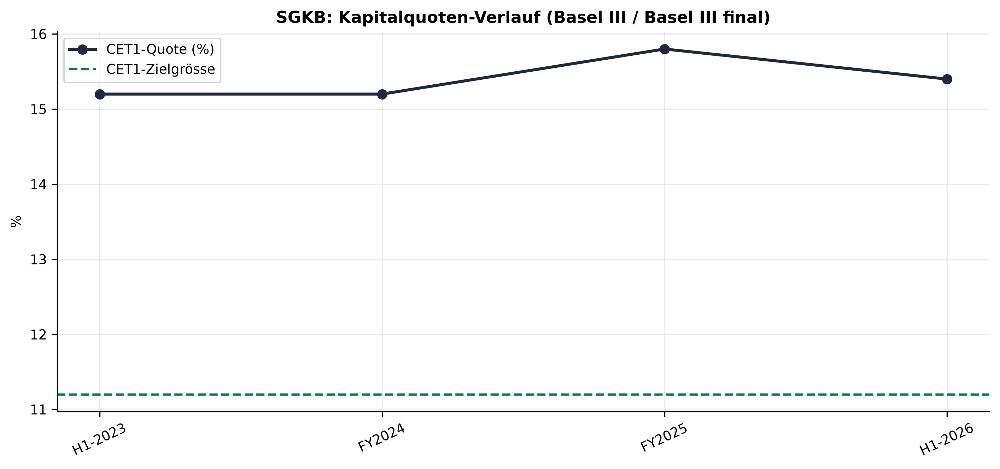

# 03 · Aufsichtsrechtliche Resilienz & Basel III: St.Galler Kantonalbank AG

> **FINMA-Kategorie:** Kategorie 3 | **CET1-Zielgrösse:** 11,20 % | **Gesamtkapital-Ziel:** 12,00 %

## 1. Management Summary
- Am jüngsten Offenlegungsstichtag (**H1-2026**, Regime: *Basel III final*) beträgt die **CET1-Quote 15,40 %** (Puffer über Ziel: **4,20 Prozentpunkte**).
- Die Gesamtkapitalquote liegt bei **18,30 %**, die Leverage Ratio bei **– %**.
- Liquiditätsquoten: LCR **141,2 %**, NSFR **126,0 %** (Mindestanforderung je 100 %).

## 2. Quantitative Entwicklung (4 Stichtage)
| Periode | Regime | RWA (Mio.) | CET1 (Mio.) | CET1 % | Gesamtkap. % | Leverage % | LCR % | NSFR % |
| --- | --- | --- | --- | --- | --- | --- | --- | --- |
| H1-2023 | Basel III | 17'671,7 | 2'679,6 | 15,20 % | 16,40 % | – % | 132,0 % | 130,6 % |
| FY2024 | Basel III | 18'963,5 | 2'886,7 | 15,20 % | 17,50 % | 7,00 % | 138,5 % | 130,2 % |
| FY2025 | Basel III final | 18'953,7 | 2'992,3 | 15,80 % | 18,80 % | 7,00 % | 142,1 % | 125,7 % |
| H1-2026 | Basel III final | 19'662,0 | 3'026,5 | 15,40 % | 18,30 % | – % | 141,2 % | 126,0 % |

## 3. Treiberanalyse & Wendepunkte
- Mit Inkrafttreten von **Basel III final** ab 01.01.2025 verändern sich risikogewichtete Aktiven (RWA) und RWA-Dichte durch angepasste Standard- bzw. Output-Floor-Vorgaben.

## 4. Fazit & Ausblick
- Die Eigenmittel- und Liquiditätspuffer übertreffen die regulatorischen Mindestanforderungen für FINMA-Kategorie 3 deutlich.
