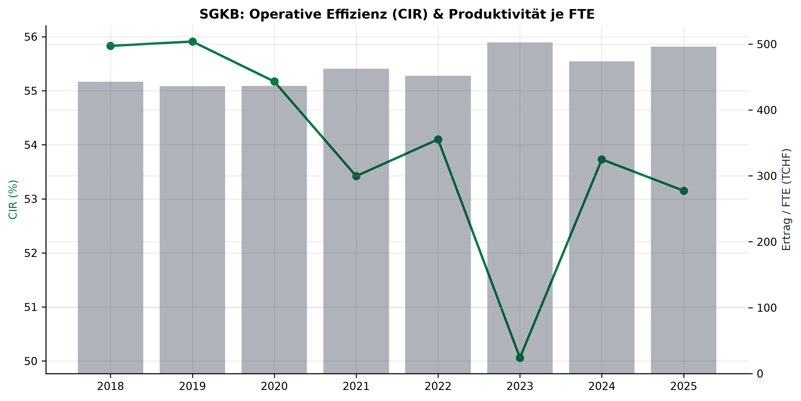

# 04 · Operative Effizienz & Transformation (2018–2025): St.Galler Kantonalbank AG

## 1. Management Summary
- Die Cost-Income-Ratio (CIR) liegt im Jahr 2025 bei **53,15 %** (vs. 55,83 % im Jahr 2018), die Eigenkapitalrendite (ROE) bei **7,28 %**.
- Der Personalbestand umfasst 2025 **1'219,0 FTE** bei einem Ertrag pro Vollzeitstelle von **496,0 TCHF** und einem **Lohnkosten-/Produktivitätsverhältnis von 34,0 %** (bzw. **2,94×** Ertrag je CHF Personalaufwand).

## 2. Quantitative Entwicklung
| Jahr | CIR % | ROE % | FTE | Ertrag/FTE (TCHF) | Lohn/FTE (TCHF) | Lohn/Ertrag % | Ertrag/Lohn | Bilanz/FTE (Mio.) |
| --- | --- | --- | --- | --- | --- | --- | --- | --- |
| 2018 | 55,83 % | 6,88 % | 1'078,0 | 443,0 | 157,2 | 35,5 % | 2,82× | 30,75 |
| 2019 | 55,91 % | 6,42 % | 1'099,0 | 436,0 | 160,6 | 36,8 % | 2,71× | 32,71 |
| 2020 | 55,17 % | 6,45 % | 1'115,0 | 436,5 | 157,1 | 36,0 % | 2,78× | 34,57 |
| 2021 | 53,42 % | 6,75 % | 1'121,0 | 462,8 | 158,3 | 34,2 % | 2,92× | 35,31 |
| 2022 | 54,10 % | 6,63 % | 1'132,0 | 451,8 | 159,2 | 35,2 % | 2,84× | 36,06 |
| 2023 | 50,06 % | 7,14 % | 1'155,0 | 502,7 | 162,1 | 32,2 % | 3,10× | 35,79 |
| 2024 | 53,73 % | 7,16 % | 1'186,0 | 473,6 | 162,1 | 34,2 % | 2,92× | 38,43 |
| 2025 | 53,15 % | 7,28 % | 1'219,0 | 496,0 | 168,8 | 34,0 % | 2,94× | 39,49 |

## 3. Treiberanalyse & Wendepunkte
- **2022:** SNB-Zinswende & Rückkehr positiver Leitzinsen
- **2025:** Inkrafttreten Basel III final per 01.01.2025

## 4. Fazit & Ausblick
- Digitalisierung und Skalierung steigern Bilanzsumme und Geschäftsvolumen pro Vollzeitstelle langfristig.
